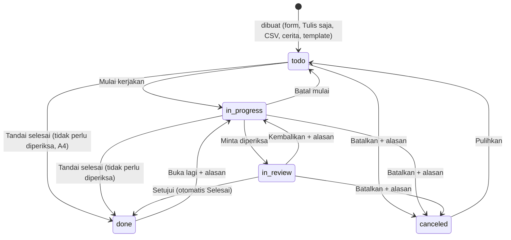

# Diskusi & Rencana Kerja: Wireframe & ERD 03 · Tugas

> Tanggal: 7 Oktober 2026. Status: **Tugas 1–2 selesai**, Tugas 3–4 (Penpot) belum.
> Lokasi hasil nanti: Penpot, file **PM-New**
> - Halaman **WIREFRAME NICO**, grup `03 · Tugas — Wireframe`
> - Halaman **ERD NICO**, grup `03 · Tugas — ERD`
> - Dokumen ERD: `erd/task.md` (baru) dan `erd/project.md` (diubah)

---

## 0. Untuk agent pelaksana: baca dulu

1. `erd/diskusi/02-proyek.md` (pola kerja, gaya wireframe, kendala Penpot) dan `erd/project.md` (tabel `projects`, `project_members`, `project_phases`, peran proyek).
2. `note.md` bagian **Menu Tasks** dan **detail task**. Ini spesifikasi lama yang sudah dirampingkan di dokumen ini. **Kalau bertentangan, dokumen ini yang berlaku.**
3. Segmen target: **awam/lansia**. Bahasa polos, teks besar, tanpa aksi yang bergantung hover.

Urutan **wajib**: Tugas 1 → 2 → 3 → 4. ERD digambar setelah `erd/task.md` selesai.

---

## 1. Keputusan dari diskusi

| # | Keputusan | Asal |
|---|---|---|
| 1 | Menu Tugas punya 3 tampilan: **Semua tugas**, **Tugas baru**, **Detail tugas** | User |
| 2 | Menu **Tiket** dan **Pengembangan** ditunda, tidak dibahas di modul ini. Tabel `tasks` disiapkan supaya keduanya bisa masuk nanti tanpa mengubah tabel | User |
| 3 | **Jenis tugas fleksibel per proyek (opsi C).** Nama jenis bebas, tapi tiap jenis wajib punya **kategori dasar**: `task` (Tugas), `issue` (Masalah), `idea` (Ide). Kategori dasar dipakai sistem untuk hitungan (misal "bug terbuka") dan aturan | User setuju usulan Claude |
| 4 | Jenis default saat proyek dibuat: **Tugas** (task) · **Bug** (issue) · **Ide** (idea). Hanya Pengelola/Admin yang mengubah. Maks. **6 jenis aktif** per proyek. Jenis yang sudah dipakai hanya bisa diarsipkan, tidak dihapus | Usulan Claude |
| 5 | Status: **Belum dikerjakan → Sedang dikerjakan → Menunggu diperiksa → Selesai**, ditambah **Dibatalkan**. `reopened` bukan status, tapi penanda "Dibuka lagi ×N" | Usulan Claude |
| 6 | **Langkah diperiksa diatur per jenis, bisa diubah per tugas.** Default: Bug ya, Tugas & Ide tidak. Kalau tidak perlu diperiksa, tombolnya **Tandai selesai**. Kalau perlu, tombolnya **Minta diperiksa**, lalu setelah **Setujui** tugas otomatis **Selesai** | User |
| 7 | **Pemeriksa default = pembuat tugas jika ia Pengelola, selain itu Lead.** Urutan cadangan: pembuat (Pengelola) → Lead → Pengelola lain → Admin. Pemeriksa ≠ yang mengerjakan. Pemeriksa bisa diganti manual, tapi hanya ke Pengelola atau Admin. Kalau jatuh ke **Admin**, `reviewer_id` kosong, UI menampilkan "Pemeriksa: Admin" + saran **"Tambahkan pengelola kedua"**, dan semua Admin dapat notifikasi | User (opsi b + urutan cadangan) |
| 8 | Yang boleh memeriksa (Setujui/Kembalikan): **hanya Pengelola proyek (termasuk Lead) dan Admin**. Anggota tidak bisa menyetujui, walaupun ia pembuat tugas. Semua Pengelola boleh memeriksa, bukan hanya pemeriksa yang ditunjuk, supaya Lead tidak jadi titik macet | User (opsi b) + Claude (semua Pengelola) |
| 9 | **Kembalikan** wajib alasan. Tugas kembali ke Sedang dikerjakan, penanda "Dikembalikan ×N" | Usulan Claude |
| 10 | **Pemantau boleh berkomentar**, tapi tidak bisa mengubah tugas dan tidak bisa jadi pemeriksa | User |
| 11 | Dua cara membuat tugas: **Tulis saja ✦** (AI) dan **Isi form**. Ditambah **Impor CSV** sebagai tombol sekunder untuk Admin/Pengelola | User |
| 12 | **Tulis saja**: satu paragraf bisa jadi beberapa tugas. AI hanya menyusun draf, tidak ada yang tersimpan sebelum **Simpan** diklik. Nama hanya dicocokkan dengan anggota proyek, tanggal dihitung oleh kode (bukan AI). Kalau ambigu, AI **bertanya satu hal**. Kalau AI tidak tersedia, tulisan masuk ke Judul dan user lanjut dengan form | User setuju usulan Claude |
| 13 | **Tag dipakai**, sebagai acuan tambahan untuk mencari tugas. Tag berlaku **per proyek** | User (pakai tag) + Claude (per proyek) |
| 14 | Daftar tugas: **List (default) + Papan**. Gantt ditunda ke fase 2. Tombol refresh dibuang | Usulan Claude |
| 15 | Default menu = **Tugas saya**, dikelompokkan per jadwal: Terlambat · Hari ini · Besok · Minggu ini · Nanti · Tanpa tenggat (sama dengan Ringkasan di `note.md`) | Usulan Claude |
| 16 | Tiap baris tugas punya **satu tombol langkah berikutnya** yang selalu terlihat (bukan dropdown status, bukan hover) | Usulan Claude |
| 17 | Detail tugas = **halaman penuh, satu halaman di-scroll**: Deskripsi · Langkah-langkah (checklist) · Bukti · Menunggu/menahan tugas lain · Obrolan & riwayat (komentar + log aktivitas jadi satu timeline). Kelima tab di `note.md` dihapus | Usulan Claude |
| 18 | Hapus tugas = pindah ke **Sampah 30 hari** (sama dengan Proyek) | Usulan Claude |
| 19 | **Nomor tugas satu urutan untuk semua proyek** (`#482`), tidak dipakai ulang walau tugas dihapus | User setuju usulan Claude |
| 20 | **Satu permintaan periksa yang menunggu per tugas.** Tiap Kembalikan → Minta diperiksa lagi = putaran baru, riwayat tiap putaran tersimpan | User setuju usulan Claude |
| 21 | **CSV:** tag dipisah `;`. Email yang tidak cocok = **peringatan**, tugas diimpor tanpa yang mengerjakan. Jenis tidak cocok atau judul kosong = **galat**. Jenis kosong = jenis pertama, prioritas kosong = Sedang | User setuju usulan Claude |
| 22 | **Alasan:** Batalkan memakai **kategori wajib** (Dobel/sudah ada · Tidak jadi dikerjakan · Di luar cakupan proyek · Salah buat · Lainnya), catatan wajib jika Lainnya. Kembalikan = teks wajib + tombol cepat yang mengisi teks. Buka lagi = teks wajib. Daftar kategori **tetap di sistem**; kategori baru ditambahkan developer di versi berikutnya berdasarkan catatan "Lainnya" yang sering muncul | User setuju usulan Claude |

### Matriks izin

Peran proyek dari `project_members.role`. "PM" yang bukan pengelola sebuah proyek hanya bisa melihat (asumsi A1 modul 02).

| Aksi | Admin | Pengelola | Anggota | Pemantau |
|---|---|---|---|---|
| Lihat tugas | Semua proyek | Proyek itu | Proyek itu | Proyek itu |
| Buat tugas (Tulis saja, Isi form) | ✅ | ✅ | ✅ | ❌ |
| Impor CSV, unduh CSV | ✅ | ✅ | ❌ | ❌ |
| Ubah isi tugas (judul, deskripsi, jenis, prioritas, tanggal, tag, checklist, yang mengerjakan) | ✅ | ✅ | Tugas yang ia buat atau kerjakan (A2) | ❌ |
| Mulai kerjakan, Tandai selesai, Minta diperiksa | ✅ | ✅ | Yang mengerjakan. Jika belum ada, siapa pun yang mengklik jadi yang mengerjakan | ❌ |
| Setujui, Kembalikan | ✅ | ✅ | ❌ | ❌ |
| Buka lagi (alasan wajib) | ✅ | ✅ | Pembuat, yang mengerjakan, atau pemeriksa | ❌ |
| Batalkan (alasan wajib), Hapus ke Sampah | ✅ | ✅ | Pembuat tugas | ❌ |
| Pulihkan dari Sampah | ✅ | ✅ | Yang menghapus | ❌ |
| Komentar | ✅ | ✅ | ✅ | ✅ |
| Lampirkan bukti | ✅ | ✅ | ✅ | ❌ |
| Kelola jenis tugas | ✅ | ✅ | ❌ | ❌ |
| Buat tag baru saat memberi tag | ✅ | ✅ | ✅ (A3) | ❌ |
| Ganti nama, gabung, hapus tag | ✅ | ✅ | ❌ | ❌ |

### Asumsi Claude (tandai di dokumen, belum dikonfirmasi user)
- **A1.** Pembuat tugas yang Anggota tetap dapat notifikasi saat tugasnya diminta diperiksa dan saat selesai, dan bisa memberi masukan lewat komentar. Keputusan Setujui/Kembalikan tetap di Pengelola/Admin.
- **A2.** Anggota hanya boleh mengubah tugas yang ia buat atau kerjakan, bukan semua tugas di proyek.
- **A3.** Anggota boleh membuat tag baru. Nama tag unik per proyek tanpa beda huruf besar/kecil, dan saat mengetik muncul saran tag yang sudah ada.
- **A4.** Tugas yang tidak perlu diperiksa boleh langsung **Tandai selesai** dari Belum dikerjakan, tanpa harus Mulai kerjakan dulu (untuk tugas kecil).
- **A5.** Tugas yang tidak wajib diperiksa tetap bisa **Minta diperiksa** secara sukarela (tombol sekunder). Tugas yang wajib diperiksa tidak bisa melewati langkah ini.
- **A6.** Sudah diputuskan user, dipindah ke keputusan #7.
- **A7.** Tugas hanya bisa menunggu tugas lain **di proyek yang sama** (v1).
- **A8.** Ambang **Mandek** = 3 hari tanpa aktivitas, untuk tugas Sedang dikerjakan (mengikuti "ghost reminder" di `note.md`). Disimpan sebagai konfigurasi `TASK_STALE_DAYS = 3`.

---

## 2. Alur tugas

| # | Langkah | Siapa | Yang terjadi |
|---|---|---|---|
| 1 | Buka menu Tugas | Semua | "Tugas saya", Terlambat paling atas |
| 2 | Buat tugas | Admin/Pengelola/Anggota | Status Belum dikerjakan. Yang ditunjuk dapat notifikasi di Inbox. Pemeriksa diisi otomatis jika perlu diperiksa |
| 3 | Mulai kerjakan | Yang mengerjakan | Sedang dikerjakan. Jika belum ada yang ditunjuk, yang mengklik otomatis jadi yang mengerjakan |
| 4 | Kerjakan | Yang mengerjakan | Centang langkah, komentar, lampirkan bukti. Jika menunggu tugas lain yang belum selesai, muncul label **Tertahan** (peringatan, tidak memblokir) |
| 5a | Tandai selesai | Yang mengerjakan | Selesai (jika tidak perlu diperiksa) |
| 5b | Minta diperiksa | Yang mengerjakan | Menunggu diperiksa, pemeriksa dapat notifikasi. Jika kategori dasar `issue`, minimal 1 bukti wajib ada. Checklist belum lengkap = peringatan |
| 6a | Setujui | Pengelola/Admin | Otomatis Selesai, yang mengerjakan dapat notifikasi |
| 6b | Kembalikan + alasan | Pengelola/Admin | Kembali ke Sedang dikerjakan, alasan masuk timeline, "Dikembalikan ×N" |
| 7 | Buka lagi + alasan | Lihat matriks | Selesai → Sedang dikerjakan, "Dibuka lagi ×N" |
| 8 | Batalkan / Hapus | Lihat matriks | Batalkan: status Dibatalkan + alasan. Hapus: ke Sampah 30 hari |

---

## 3. Tugas 1: ubah `erd/project.md`

1. Bagian placeholder `tasks` diganti satu kalimat rujukan: "Kolom lengkap ada di `erd/task.md`." Mermaid tetap menampilkan `tasks` sebagai rujukan ringkas.
2. Tambah relasi `projects ||--o{ task_kinds` dan `projects ||--o{ tags` di mermaid (rujukan ke modul 03).
3. Di "Alur yang didukung" poin 3, tambah: saat proyek dibuat, sistem membuat 3 jenis tugas default (Tugas, Bug, Ide). Proyek dari template/cerita memakai jenis dari struktur tersebut.
4. Contoh `structure` template: `"kind": "task"` → `"kind": "Tugas", "base_kind": "task"`.
5. Di header file, tambah: `Diperbarui 7 Oktober 2026: tasks dipindah ke erd/task.md, tambah jenis tugas default (keputusan modul 03 · Tugas).`

---

## 4. Tugas 2: tulis `erd/task.md`

Ikuti format `erd/project.md`: judul, alur, hak akses, mermaid, enum, tabel kolom per tabel (Kolom | Tipe | Null | Default | Keterangan), nilai yang dihitung, index, alasan desain, belum diputuskan. Semua `id` = `uuid` default `gen_random_uuid()`, semua `created_at`/`updated_at` = `timestamptz` default `now()`.

### 4.1 Enum

| Enum | Nilai | Label UI |
|---|---|---|
| `task_base_kind` | task, issue, idea | Tugas, Masalah, Ide (kategori dasar, label jenis di UI memakai `task_kinds.name`) |
| `task_status` | todo, in_progress, in_review, done, canceled | Belum dikerjakan, Sedang dikerjakan, Menunggu diperiksa, Selesai, Dibatalkan |
| `task_priority` | low, medium, high, critical | Rendah, Sedang, Tinggi, Kritis |
| `task_source` | form, ai_text, csv, story, template | – |
| `task_review_decision` | approved, returned | Disetujui, Dikembalikan |
| `task_attachment_type` | file, image, link | File, Foto, Tautan |
| `task_import_status` | previewed, imported, canceled | – |
| `task_cancel_category` | duplicate, not_needed, out_of_scope, created_by_mistake, other | Dobel / sudah ada, Tidak jadi dikerjakan, Di luar cakupan proyek, Salah buat, Lainnya |

### 4.2 Tabel

**`task_kinds`**: id · project_id FK CASCADE · name varchar(50) · base_kind `task_base_kind` · needs_review boolean (default dari base: issue = true, lainnya false) · position smallint · archived_at NULL · created_at · updated_at.
UNIQUE `(project_id, lower(name))`. Maks. 6 jenis aktif per proyek dijaga di service.

**`tasks`**: id · project_id FK · number bigint (nomor tampil `#482`, dari sequence `task_number_seq`, UNIQUE untuk semua proyek) · phase_id FK project_phases NULL (SET NULL) · kind_id FK task_kinds NOT NULL · title varchar(200) · description text NULL · status `task_status` default `'todo'` · priority `task_priority` default `'medium'` · assignee_id FK users NULL · reviewer_id FK users NULL (hanya Pengelola/Admin, dijaga di service; kosong = jatuh ke Admin, keputusan #7) · needs_review boolean (default dari jenis) · created_by FK users · start_date date NULL · due_date date NULL · estimate_hours numeric(6,1) NULL · source `task_source` · import_job_id FK task_import_jobs NULL · reopen_count int default 0 · return_count int default 0 · cancel_category `task_cancel_category` NULL · cancel_note text NULL · started_at · review_requested_at · completed_at · canceled_at · last_activity_at default `now()` · deleted_at NULL · deleted_by FK users NULL · created_at · updated_at.
CHECK: `due_date >= start_date`, `reviewer_id IS NULL OR assignee_id IS NULL OR reviewer_id <> assignee_id`, `status <> 'canceled' OR cancel_category IS NOT NULL`, `cancel_category IS DISTINCT FROM 'other' OR cancel_note IS NOT NULL`.

**`task_checklist_items`**: id · task_id FK CASCADE · text varchar(300) · is_done boolean default false · done_by FK users NULL · done_at NULL · position smallint · created_at · updated_at.

**`task_comments`**: id · task_id FK CASCADE · author_id FK users · body text · edited_at NULL · deleted_at NULL · created_at.

**`task_attachments`** (Bukti): id · task_id FK CASCADE · type `task_attachment_type` · url text (link, atau lokasi file di storage) · file_name varchar(255) NULL · note text NULL · uploaded_by FK users · deleted_at NULL · created_at.

**`task_dependencies`**: PK (task_id, blocked_by_task_id) · task_id FK CASCADE (tugas yang menunggu) · blocked_by_task_id FK CASCADE (tugas yang ditunggu) · created_by FK users · created_at.
CHECK `task_id <> blocked_by_task_id`. Siklus dan beda proyek ditolak di service (A7).

**`task_reviews`**: id · task_id FK CASCADE · requested_by FK users · reviewer_id FK users NULL (pemeriksa saat diminta) · decision `task_review_decision` NULL (kosong = masih menunggu) · decided_by FK users NULL (Pengelola/Admin yang memutuskan, bisa berbeda dari pemeriksa yang ditunjuk) · note text NULL (wajib saat `returned`) · requested_at · decided_at NULL.

**`task_activities`**: id · task_id FK CASCADE · actor_id FK users · action varchar(50) (`created`, `status_changed`, `assigned`, `reviewer_changed`, `review_requested`, `approved`, `returned`, `reopened`, `canceled`, `restored`, `field_changed`, `checklist_done`, `attachment_added`, `dependency_added`, `dependency_removed`, `deleted`) · payload jsonb (untuk `created` via `ai_text`: tulisan asli user) · created_at.

**`tags`**: id · project_id FK CASCADE · name varchar(40) · created_by FK users · created_at. UNIQUE `(project_id, lower(name))`.

**`task_tags`**: PK (task_id, tag_id) · task_id FK CASCADE · tag_id FK CASCADE · created_at.

**`task_import_jobs`**: id · project_id FK · created_by FK users · file_name varchar(255) NULL (kosong jika ditempel) · rows_total int · rows_ok int · rows_error int · errors jsonb (nomor baris + pesan) · warnings jsonb · status `task_import_status` default `'previewed'` · created_at · updated_at.
Header CSV: `title,description,kind,priority,startsAt,dueAt,estimateHours,assigneeEmail,tagNames`. Aturan baris: lihat keputusan #21. `errors` menyimpan baris galat, `warnings` menyimpan baris yang tetap diimpor dengan catatan.

### 4.3 Nilai yang dihitung, tidak disimpan

| Nilai | Rumus |
|---|---|
| Terlambat | `due_date` < hari ini dan status ∉ {done, canceled} |
| Tertahan | ada `blocked_by_task_id` yang status ∉ {done, canceled} |
| Mandek | status `in_progress` dan `last_activity_at` lebih lama dari `TASK_STALE_DAYS` (A8) |
| Dibuka lagi ×N / Dikembalikan ×N | `reopen_count` / `return_count` |
| Kelompok jadwal | Terlambat · Hari ini · Besok · Minggu ini (s.d. Minggu) · Nanti · Tanpa tenggat |
| Tugas aktif | status ∈ {todo, in_progress, in_review} |
| Bug terbuka (Ringkasan) | tugas aktif dengan jenis ber-`base_kind = issue` |

Jika satu tugas memenuhi beberapa label, yang tampil di baris hanya satu, dengan urutan: **Terlambat > Menunggu diperiksa saya > Tertahan > Mandek** (mengikuti usulan di `diskusi/catatan-beranda-zona-b-d.md`). Detail tugas menampilkan semuanya.

### 4.4 Index
`tasks(project_id, status)`, `tasks(assignee_id, status, due_date)` (Tugas saya), `tasks(reviewer_id, status)` (Menunggu diperiksa saya), `tasks(number)` UNIQUE, `tasks(phase_id)`, `tasks(kind_id)`, `tasks(deleted_at)`, `tasks(status, last_activity_at)` (Mandek), `task_dependencies(blocked_by_task_id)`, `task_activities(task_id, created_at)`, `task_comments(task_id, created_at)`, `task_reviews(task_id, requested_at)`, `task_tags(tag_id)`. Daftar tugas **wajib paginated**.

### 4.5 Isi bagian "Belum diputuskan" di `erd/task.md`
Asumsi A1–A5 dan A7–A8, ditambah:
- Apakah tugas boleh tanpa proyek (tugas pribadi)? Desain ini: **tidak**, `project_id` wajib.
- Apakah sub-tugas sungguhan dibutuhkan, atau checklist sudah cukup?
- Apakah estimasi jam benar-benar dipakai? Kalau tidak, kolom disembunyikan di form.

---

## 5. Tugas 3: wireframe di Penpot (halaman WIREFRAME NICO)

**Gaya:** sama dengan grup `02 · Proyek — Wireframe`: frame putih **1280×800**, lo-fi abu-abu, panah dengan keterangan. Letakkan **di bawah grup 02** (grup 02: y = 2820, tinggi 4080, berakhir y = 6900). Periksa batasnya dulu.

**Kerangka layar:** top bar (cari, lonceng, avatar) + menu samping (Beranda, Inbox, Proyek, **Tugas** aktif, Events, Tim, Sampah, Pengaturan).

**Data dummy** (hari ini = Rabu, 7 Oktober 2026; login = **Nico**, Project Manager, Lead Atlas). Semua tugas di **Proyek Atlas**, kecuali disebut lain.

| # | Tugas | Jenis | Prioritas | Mengerjakan | Pembuat → Pemeriksa | Tenggat | Status | Tahapan | Tag |
|---|---|---|---|---|---|---|---|---|---|
| #12 | Fix login SSO | Bug | Tinggi | Nico | Rina → **Admin** (Rina Anggota → Lead Nico, tapi Nico yang mengerjakan dan Atlas hanya punya 1 Pengelola, keputusan #7) | 5 Okt (terlambat 2 hari) | Sedang dikerjakan, checklist 2/3 | Pengembangan | sso, login |
| #14 | Tulis spesifikasi API | Tugas | Sedang | Nico | Nico → – (tidak perlu diperiksa) | 7 Okt (hari ini) | Belum dikerjakan | Pengembangan | api |
| #15 | Periksa desain halaman onboarding | Tugas | Sedang | Nico | Rina → – | 9 Okt (minggu ini) | Belum dikerjakan | Pengembangan | desain |
| #16 | Siapkan data uji | Tugas | Sedang | Dodi | Nico → – | 9 Okt | Sedang dikerjakan, **Tertahan** oleh #12 | Pengujian | uji |
| #17 | Perbaiki tombol simpan di halaman profil | Bug | Sedang | Dodi | Nico → Nico | 8 Okt (besok) | **Menunggu diperiksa** | Pengembangan | profil |
| #8 | Susun rancangan arsitektur | Tugas | Tinggi | Nico | Nico → – | 20 Sep | Selesai | Perencanaan | – |
| #9 | Laporan progres untuk PT Sinar | Tugas | Sedang | Nico | Rina → – | 8 Okt (besok) | Belum dikerjakan | – (Portal Klien PT Sinar) | laporan |

Timeline #12: Rina membuat tugas (3 Okt) · Nico mulai mengerjakan (4 Okt) · Dodi: "error masih muncul di staging" (6 Okt) · Nico melampirkan bukti tangkapan layar (6 Okt).
Tulis saja ⑤: "Rina perbaiki halaman login besok, penting. Dodi siapkan data uji sebelum Jumat." → 2 draf (Rina · 8 Okt · Tinggi · Bug) dan (Dodi · 9 Okt · Sedang · Tugas).

**Layar:**

| No | Layar | Isi wajib |
|---|---|---|
| ① | Tugas saya (List) | Judul "Tugas", tombol besar **+ Tugas baru**, toggle **Tugas saya / Semua tugas**, cari, chip status, filter Proyek · Orang · Jenis · Prioritas · Tag, Urutkan, toggle List/Papan. Kelompok jadwal: Terlambat (#12), Hari ini (#14), Besok (#9), Minggu ini (#15). Bagian **Menunggu diperiksa saya** (#17) di atas. Tiap baris: judul, proyek, jenis, prioritas, label (ikon + teks), satu tombol langkah berikutnya |
| ② | Semua tugas (List, filter Proyek Atlas) | Tab Semua tugas aktif, filter terisi, kolom: #, judul, jenis, status, prioritas, mengerjakan, tenggat, tag. Checkbox selalu terlihat, tombol **Unduh CSV** dan **Impor CSV** (Pengelola). Tampilkan #16 dengan label Tertahan |
| ③ | Papan | 4 kolom: Belum dikerjakan · Sedang dikerjakan · Menunggu diperiksa · Selesai. Kartu besar. Catatan: pindah kartu lewat tombol di kartu, bukan hanya drag |
| ④ | Tugas saya kosong | Pesan: "Belum ada tugas untuk Anda. Tugas yang ditunjuk ke Anda akan muncul di sini." Tombol + Tugas baru. Catatan: Pemantau tidak melihat tombol ini |
| ⑤ | Tugas baru · Tulis saja ✦ | Toggle **Tulis saja ✦ / Isi form**, pilih proyek, kotak teks besar berisi contoh dummy, 🎤 (nonaktif, "segera"), tombol **Susun ✦**. Di bawahnya hasil: banner "Draf dari AI. Periksa dulu sebelum disimpan.", 2 draf dengan centang + ✏️, contoh pertanyaan "Rina yang mana?" (kotak catatan), tombol Ubah tulisan · **Simpan 2 tugas** |
| ⑥ | Tugas baru · Isi form | Proyek, Judul*, Siapa yang mengerjakan, Prioritas, Tenggat. "Tampilkan lebih banyak" (terbuka): Deskripsi, Jenis, Tahapan, Tanggal mulai, Estimasi jam, Tag, centang **Perlu diperiksa** (otomatis dari jenis) + Pemeriksa (otomatis, pilihan hanya Pengelola/Admin). Tombol Batal · **Simpan** |
| ⑦ | Impor CSV | Unggah file / tempel teks, Unduh contoh, pratinjau 5 baris (1 galat: "Jenis 'QC' tidak ada di proyek ini"; 1 peringatan: "budi@kantor.id bukan anggota Atlas, diimpor tanpa yang mengerjakan"), ringkasan "4 siap (1 dengan catatan), 1 galat". Tombol Batal · **Impor 4 tugas** |
| ⑧ | Detail · Belum dikerjakan (#14) | Header: ← Kembali, judul, #14, proyek, tahapan, jenis, prioritas, mengerjakan, tenggat, label "Hari ini". Tombol utama **Mulai kerjakan**, sekunder **Tandai selesai** (A4). Isi: deskripsi, langkah-langkah kosong + "Tambah langkah", obrolan & riwayat. Menu ⋯: Batalkan, Hapus |
| ⑨ | Detail · Sedang dikerjakan (#12) | Label ⏰ Terlambat 2 hari, Perlu diperiksa · Pemeriksa: Admin + saran "Tambahkan pengelola kedua". Langkah-langkah 2/3, Bukti (1 tangkapan layar + catatan), **Menahan 1 tugas**: #16 Siapkan data uji · Dodi, tag, Obrolan & riwayat sesuai timeline dummy + kotak komentar. Tombol utama **Minta diperiksa** |
| ⑩ | Detail · Menunggu diperiksa (#17, dilihat Nico) | Banner "Dodi meminta Anda memeriksa tugas ini · 7 Okt". Bukti dari Dodi. Tombol **Setujui** dan **Kembalikan**. Catatan: Anggota yang membuka layar ini tidak melihat kedua tombol |
| ⑪ | Modal Kembalikan + Modal Batalkan | **Kembalikan**: tombol cepat "Masih ada error" · "Belum sesuai permintaan" · "Bukti kurang jelas" (mengisi teks), Alasan* (teks), contoh: "Tombol masih tidak bisa diklik di HP". Tombol Batal · **Kembalikan**. **Batalkan** (berdampingan): 5 pilihan kategori, Lainnya terpilih + catatan* "Klien menunda fitur ini sampai tahun depan". Tombol Batal · **Batalkan tugas**. Catatan: Buka lagi memakai modal seperti Kembalikan tanpa tombol cepat |
| ⑫ | Pengaturan proyek · Jenis tugas | Dari Detail proyek ⋯ › Pengaturan proyek. Daftar jenis Atlas: Tugas (Tugas, tidak diperiksa), Bug (Masalah, diperiksa), Ide (Ide, tidak diperiksa). Tiap baris: nama, kategori dasar, centang Perlu diperiksa, Arsipkan. Tombol + Jenis (maks. 6). Di bawahnya bagian **Tag**: daftar tag + jumlah tugas, ganti nama, gabung, hapus |

**Panah & keterangan:**

| Dari → Ke | Keterangan |
|---|---|
| ① ↔ ② | Tugas saya / Semua tugas |
| ② ↔ ③ | List / Papan |
| ① → ⑤ | + Tugas baru (default Tulis saja) |
| ⑤ ↔ ⑥ | Toggle cara membuat |
| ② → ⑦ | Impor CSV (Pengelola/Admin) |
| ⑤ / ⑥ / ⑦ → ① | Tugas tersimpan |
| ① → ⑧ | Klik tugas |
| ⑧ → ⑨ | Mulai kerjakan |
| ⑨ → ⑩ | Minta diperiksa (pemeriksa dapat notifikasi) |
| ⑩ → Selesai | Setujui, otomatis Selesai |
| ⑩ → ⑪ → ⑨ | Kembalikan + alasan |
| ⑧ → Selesai (putus-putus) | Tandai selesai, tugas tanpa pemeriksaan |
| ① (putus-putus) → ④ | User yang belum punya tugas |

**Catatan anotasi** (kotak kuning, bukan bagian UI):
- Matriks izin di dekat ①.
- Diagram alur status (§2) di dekat ⑧–⑩.
- Di ⑤: "AI tidak menyimpan apa pun sebelum Simpan diklik. Tanggal dihitung oleh sistem, nama hanya dari anggota proyek."
- Di ⑨: "Bug wajib minimal 1 bukti sebelum Minta diperiksa."
- Di ⑩: "Yang boleh memeriksa: Pengelola (termasuk Lead) dan Admin."
- Di ⑨: "Pemeriksa jatuh ke Admin karena Lead sendiri yang mengerjakan dan Atlas hanya punya 1 Pengelola (keputusan #7)."

---

## 6. Tugas 4: ERD di Penpot (halaman ERD NICO)

- Grup baru `03 · Tugas — ERD`, di bawah grup `02 · Proyek — ERD` (grup 02: y = 2010, tinggi 3442, berakhir y = 5452), gaya kotak tabel sama.
- Isi: 11 tabel dari §4.2. `users`, `projects`, `project_phases` cukup kotak rujukan kecil bergaris putus-putus yang menunjuk ke grup 01/02.
- Garis relasi + kardinalitas sesuai mermaid di `erd/task.md`. FK ke `users` selain `assignee_id` dan `reviewer_id` tidak perlu digambar garisnya, cukup dijelaskan di kotak Keterangan.
- Tabel ringkas **"Layar → tabel"**: ①②③ tasks + task_kinds + tags + hitungan · ⑤ tasks (source ai_text) + task_activities · ⑥ tasks, task_tags · ⑦ task_import_jobs → tasks, tags · ⑧⑨ tasks, task_checklist_items, task_attachments, task_dependencies, task_comments, task_activities · ⑩⑪ task_reviews, tasks · ⑫ task_kinds, tags.
- Kotak kuning **"Dihitung, tidak disimpan"** dari §4.3.
- **Perbarui grup 02**: kotak placeholder `tasks` diberi keterangan "lihat grup 03 · Tugas".

---

## 7. Kendala Penpot yang sudah diketahui
Lihat `erd/diskusi/02-proyek.md` §6 dan §8 "Kendala selama pengerjaan". Ringkasnya: jalankan Claude dengan env Penpot ter-load, tab Penpot harus fokus, plugin hanya mengubah halaman aktif (`penpot.openPage(...)`), pecah perintah besar menjadi 2–4 tabel per perintah, dan cek `Object.keys(storage)` sebelum memakai helper.

---

## 8. Kriteria selesai

- [x] `erd/project.md` diperbarui sesuai §3
- [x] `erd/task.md` memuat 11 tabel, enum, alur status, matriks izin, rumus hitungan, index, dan asumsi A1–A5, A7–A8
- [ ] Wireframe ①–⑫ ada, bernomor, dengan panah & keterangan, dan data dummy sesuai §5
- [ ] ERD di Penpot sama persis dengan `erd/task.md`, grup 02 sudah diberi rujukan
- [ ] Export PNG tiap grup dicek secara visual: tidak ada teks terpotong atau elemen bertumpuk
- [ ] Bagian **§9** di bawah diisi

## 9. Hasil & kendala (diisi agent pelaksana)

### Tugas 1 · `erd/project.md` ✅
- Header: baris "Diperbarui 7 Oktober 2026 …".
- Alur poin 3: pembuatan 3 jenis tugas default.
- Mermaid: relasi `projects → task_kinds` dan `projects → tags`, kotak `tasks` diberi `kind_id`, ditambah kotak ringkas `task_kinds` dan `tags`.
- Contoh `structure` template: tugas memakai `"kind": "Tugas", "base_kind": "task"`, ditambah daftar `task_kinds`.
- Placeholder tabel `tasks` diganti rujukan ke `erd/task.md`.

### Tugas 2 · `erd/task.md` ✅
- Alur + diagram status + tabel efek tiap transisi, hak akses, **Aturan pemeriksa** (urutan cadangan keputusan #7), mermaid 11 tabel, 7 enum, tabel kolom per tabel, nilai yang dihitung, index, alasan desain, belum diputuskan.
- Tambahan dari Claude, sudah dibahas dan diputuskan (keputusan #19–#21):
  - Nomor tugas: diubah dari urut per proyek menjadi satu sequence untuk semua proyek.
  - UNIQUE parsial `task_reviews(task_id) WHERE decision IS NULL`: paling banyak satu permintaan periksa yang menunggu.
  - CSV: `tagNames` dipisah `;`. Email tidak cocok diubah dari galat menjadi peringatan (kolom baru `task_import_jobs.warnings`).
  - Konfigurasi `TASK_KINDS_MAX_ACTIVE = 6` dan `TASK_STALE_DAYS = 3`.
  - Kategori alasan Batalkan (keputusan #22): `cancel_reason` dipecah jadi `cancel_category` + `cancel_note`, enum baru `task_cancel_category`.

### Tugas 3–4 · Penpot
_Belum dikerjakan._

---

## Tindak lanjut di luar rencana ini (jangan dikerjakan sekarang)
- Menu **Tiket** dan **Pengembangan** (keputusan #2).
- Tab Tugas di Detail proyek (⑨ modul 02) diselaraskan dengan komponen list modul ini.
- Beranda: label "Telat" → "Terlambat", dan "Menunggu saya" memakai `reviewer_id` + status `in_review`.
- Inbox: jenis notifikasi tugas (ditunjuk, diminta memeriksa, disetujui, dikembalikan, dikomentari, di-mention).
- Sampah global: tampilan tugas yang dihapus.
