# Workflow Produk — PM Dashboard 2026

> **Versi:** 1.2 · 5 Oktober 2026 · Run `run_16f58567a2c7` · Peran: Product Ops / Workflow Designer · Revisi 1.1 menutup temuan R2 (`reviews/R2-review-deliverables.md`) sesuai Addendum F. Revisi 1.2 menutup m14 dan R3-1…R3-6 (`reviews/R3-verifikasi.md`); setiap perubahan diberi penanda **[R3-#]**.
> **Sumber kebenaran:** `orchestration/DECISIONS.md` (D1–D17, E1–E4, Addendum F1–F20, glosarium, IA final). Dokumen ini adalah acuan tunggal; wireframe mengikuti nilai di sini. Baseline pendukung: `reviews/R1-review-analisis.md` §4–§6, `analysis/A1–A4`, `note.md`.
> **Untuk siapa:** tim engineering, desain, dan QA. Setiap alur bisa langsung dipecah menjadi tiket implementasi.
> Label **[ASUMSI]** = default yang diambil di dokumen ini karena belum dijawab DECISIONS; semua dikumpulkan di bagian [Asumsi & pertanyaan terbuka](#asumsi--pertanyaan-terbuka).

## Daftar isi

- [Cara membaca dokumen ini](#cara-membaca-dokumen-ini)
- [W-0 Peta besar produk & navigasi](#w-0-peta-besar-produk--navigasi)
- [W-1 State machine Work Item](#w-1-state-machine-work-item)
- [W-2 Intake & triage Tiket](#w-2-intake--triage-tiket)
- [W-3 Siklus Rapat](#w-3-siklus-rapat)
- [W-4 Planner "Proyek dari cerita"](#w-4-planner-proyek-dari-cerita)
- [W-5 Rencana & jadwal](#w-5-rencana--jadwal)
- [W-6 Ide → pekerjaan](#w-6-ide--pekerjaan)
- [W-7 Briefing harian & Fokus Saya](#w-7-briefing-harian--fokus-saya)
- [W-8 Notifikasi & Inbox](#w-8-notifikasi--inbox)
- [W-9 Retro per fase/periode](#w-9-retro-per-faseperiode)
- [W-10 Governance AI](#w-10-governance-ai)
- [Matriks peran & izin](#matriks-peran--izin)
- [Roadmap per alur](#roadmap-per-alur)
- [Peta alur → layar wireframe](#peta-alur--layar-wireframe)
- [Asumsi & pertanyaan terbuka](#asumsi--pertanyaan-terbuka)

---

## Cara membaca dokumen ini

### Format setiap alur

Setiap alur W-0…W-10 memakai urutan yang sama:

1. **Tujuan & pemicu** — kenapa alur ini ada dan apa yang memulainya.
2. **Aktor** — manusia (role workspace/proyek) dan sistem.
3. **Diagram** — Mermaid (`flowchart`, `stateDiagram-v2`, atau `sequenceDiagram`).
4. **Langkah bernomor** — urutan yang bisa diimplementasikan.
5. **Aturan / guard** — syarat yang wajib ditegakkan di backend (bukan hanya di UI).
6. **Titik AI** — fitur AI, level approval (L0–L4), fase rilis, dan fallback saat AI tidak tersedia.
7. **Edge case** — kondisi tepi yang wajib punya perilaku terdefinisi dan test.

### Prinsip produk (dari DECISIONS, berlaku di semua alur)

1. **AI menyarankan, manusia memutuskan.** Angka dan hitungan selalu dari query deterministik. LLM hanya menarasikan, mengekstrak, dan menyarankan.
2. **Setiap output AI di UI wajib punya:** label "Draf AI"/ikon AI · sumber/kutipan · confidence (Tinggi/Sedang/Rendah) · aksi **Terima / Ubah / Tolak** · fallback ketika AI tidak tersedia.
3. **Selalu butuh manusia** (tidak pernah bisa otomatis, apa pun levelnya): hapus, ubah ke `done`/`canceled`, extend deadline (aksi UI **Ubah deadline**, F7), ubah role/anggota, kirim ke pihak eksternal, aksi bulk > 20 item.
4. **Satu glosarium** dipakai di UI, dokumen, wireframe, dan prompt AI.

### Model approval AI (L0–L4)

| Level | Nama | Perilaku | Contoh default di produk ini |
|---|---|---|---|
| **L0** | Off | Fitur dimatikan Admin (atau kill switch/circuit breaker) | Semua fitur AI saat kill switch aktif |
| **L1** | Suggest | AI menampilkan saran/narasi; user menerapkan sendiri | Saran triage, Briefing harian, deteksi duplikat |
| **L2** | Confirm | AI menyiapkan perubahan lengkap; user klik Terapkan setelah melihat pratinjau | Hasil Rapat → item, draf Planner → proyek |
| **L3** | Auto + Undo | AI menerapkan, tercatat, bisa dibatalkan dalam 24 jam (F15) | (P1) tag otomatis, komentar follow-up agen |
| **L4** | Autonomous (scoped) | Agen bekerja multi-langkah dalam scope proyek & budget; hasil tetap direview | (P2) agen eksternal/coding |

**Di P0 (P0a + P0b) tidak ada fitur AI di atas L2.** L3 mulai P1, L4 mulai P2.

### Label fase rilis (D17)

| Label | Isi | Perkiraan |
|---|---|---|
| **P0a** | Fondasi Work Item + state machine, Beranda (Briefing + Fokus Saya), Inbox minimal, Tiket + triage + duplikat, matriks izin, AI-0…AI-4 | gelombang 1 MVP |
| **P0b** | Rapat AI (AI-5, AI-6), tab Rencana + Health v1 + Ubah deadline (E2), Planner v1 (AI-7), Retro angka | gelombang 2 MVP (MVP total ±4–5 bulan) |
| **P1** | ⌘K NL, pencarian semantik, recap & Decision Log, digest, status update AI, Retro AI, agen internal, MCP read-only, kapasitas | setelah MVP |
| **P2** | Agen eksternal/coding, MCP write, aksi tulis lewat ⌘K, bot rapat, Monte Carlo, native app | lanjutan |

ID AI P0 (R1 §5.3): **AI-0** fondasi AI (gateway, plafon, kill switch, AI Action Log) · **AI-1** Briefing harian · **AI-2** AI Triage · **AI-3** deteksi duplikat · **AI-4** quick-add bahasa alami (teks) · **AI-5** capture & draf notulensi · **AI-6** ekstraksi Hasil Rapat · **AI-7** Planner v1.

### Glosarium (wajib, dari DECISIONS)

| Konsep | Istilah UI | Enum |
|---|---|---|
| Unit kerja | Pekerjaan (item) | `WorkItem` |
| Jenis | Tugas · Bug · Ide | `task` · `bug` · `idea` |
| Status | Triage · Terbuka · Dikerjakan · Siap QC · Selesai · Dibatalkan | `triage` · `open` · `in_progress` · `in_review` · `done` · `canceled` |
| Agregat status (turunan, F12) | **Aktif** = Terbuka + Dikerjakan + Siap QC | `open` · `in_progress` · `in_review` |
| Kondisi turunan | Telat · Terblokir · Mandek · Dibuka ulang | `overdue` · `blocked` · `stale` · `reopened` |
| Prioritas | Rendah · Sedang · Tinggi · Kritis | `low` · `medium` · `high` · `critical` |
| Sumber | Manual · Tiket (intake) · Rapat · Import · Agen | `manual` · `intake` · `meeting` · `import` · `agent` |
| Health proyek | Sesuai jalur · Berisiko · Keluar jalur | `on_track` · `at_risk` · `off_track` |
| Rencana proyek | Fase (rentang) · Milestone (titik cek) | `Phase` · `Milestone`, `task.phaseId` |
| Status milestone (F14) | Menunggu · Tercapai · Meleset | — |
| Kartu retro (F14) | Selesai · Meleset · Masih terblokir · Item baru · Perpanjangan | — |
| Status saran AI (F18) | Menunggu · Diterima · Diubah · Ditolak · Kedaluwarsa (hasil aksi Terima / Ubah / Tolak) | `AISuggestion.status`: `pending` · `accepted` · `edited` · `rejected` · `expired` |
| Status proyek (E4) | Draft · Active · On Hold · Completed · Cancelled | — |
| Role workspace (D6) | Admin · Member · Guest | — |
| Role proyek (D6) | PM · Member · Viewer (+ atribut **Lead**, 1 per proyek) | — |

Istilah tetap: **Inbox** hanya untuk notifikasi & persetujuan (E1). View tiket di Pekerjaan bernama **Tiket** dengan sub-tab **Triage | Berjalan**. Istilah teknis yang dipertahankan: QC, Inbox, Retro, Board (D16).
Chip hitungan agregat memakai **Aktif**; label **Terbuka** hanya untuk status `open` (F12). Dua label penolakan dibedakan (F2): **Tolak saran** = membuang saran AI (item tidak berubah) dan **Tolak tiket** = keputusan triage → Dibatalkan + alasan. Istilah lama untuk Tolak tiket tidak dipakai [R3-N4].

---

## W-0 Peta besar produk & navigasi

**Tujuan:** memberi peta tunggal tentang di mana setiap alur hidup di IA final, dan bagaimana tiga persona utama (PM, Member, Guest) bergerak di dalamnya.

**Aktor:** PM (role proyek PM, sering juga Lead), Member (role proyek Member), Guest (role workspace Guest, pihak luar), Admin (role workspace), sistem.

### Diagram 1 — IA final & alur yang menempel di tiap menu

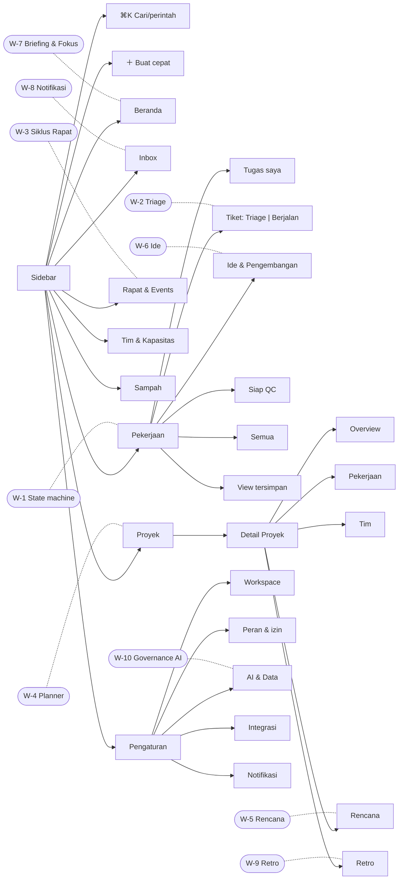

**Peta alur → lokasi IA**

| Alur | Lokasi utama di IA | Lokasi sekunder |
|---|---|---|
| W-1 State machine Work Item | Detail item (semua view Pekerjaan, tab Pekerjaan proyek) | Board (kolom = status) |
| W-2 Intake & triage Tiket | Pekerjaan › Tiket › Triage | ＋ Buat cepat, Inbox (Butuh aksi untuk triager) |
| W-3 Siklus Rapat | Rapat & Events › detail event › Capture / Hasil Rapat | Inbox (konfirmasi, penugasan PIC), Beranda (Agenda) |
| W-4 Planner | Proyek › Proyek baru (Kosong · Dari cerita (AI) · Dari template) | Library template |
| W-5 Rencana & jadwal | Detail Proyek › Rencana (+ Riwayat jadwal) | Header proyek (health, Diperpanjang ×N), Overview |
| W-6 Ide → pekerjaan | Pekerjaan › Ide & Pengembangan | ＋ Buat cepat |
| W-7 Briefing & Fokus Saya | Beranda | PWA (Fokus Saya di HP) |
| W-8 Notifikasi & Inbox | Inbox | Pengaturan › Notifikasi |
| W-9 Retro | Detail Proyek › Retro | Inbox (pengingat retro fase) |
| W-10 Governance AI | Pengaturan › AI & Data | Tab Aktivitas item, Inbox (persetujuan AI) |

### Diagram 2 — Perjalanan utama tiga persona

```mermaid
flowchart TB
  subgraph PMJ["PM - perjalanan mingguan"]
    direction LR
    pm1["Beranda: Briefing + KPI strip"] --> pm2["Inbox: Butuh aksi"]
    pm2 --> pm3["Pekerjaan › Tiket › Triage"]
    pm3 --> pm4["Detail Proyek › Rencana: health, Ubah deadline"]
    pm4 --> pm5["Rapat: konfirmasi Hasil Rapat"]
    pm5 --> pm6["Retro fase + action item"]
  end
  subgraph MBJ["Member - perjalanan harian"]
    direction LR
    mb1["Beranda: Fokus Saya"] --> mb2["Detail item: Dikerjakan"]
    mb2 --> mb3["Evidence + checklist"]
    mb3 --> mb4["Kirim ke Siap QC"]
    mb4 --> mb5["Inbox: komentar QC, penugasan dari rapat"]
    mb5 --> mb1
  end
  subgraph GSJ["Guest - perjalanan terbatas"]
    direction LR
    gs1["Undangan proyek via email"] --> gs2["Laporkan tiket"]
    gs2 --> gs3["Pantau tiket miliknya"]
    gs3 --> gs4["Komentar / jawab pertanyaan"]
    gs4 --> gs5["Lihat notulensi rapat yang dihadiri"]
  end
```

### Langkah — perjalanan PM (minggu biasa)

1. **Senin pagi, Beranda:** baca Briefing mode Mingguan (W-7); lihat KPI strip ≤ 4 (Item aktif Δ, Bug kritis Δ, Tenggat terlewat minggu ini, dan KPI ke-4 per gelombang: P0a "Item menunggu Triage" → P0b "Proyek Berisiko/Keluar jalur" → P1 "Kapasitas tim %"; F6).
2. **Inbox › Butuh aksi:** setujui Hasil Rapat yang didelegasikan, jawab mention, review persetujuan AI (W-8).
3. **Pekerjaan › Tiket › Triage:** terima/gabung/tolak tiket dengan bantuan saran AI (W-2).
4. **Detail Proyek › Overview/Rencana:** cek Health v1 + "▸ kenapa"; bila perlu override health atau **Ubah deadline** dengan alasan (W-5).
5. **Rapat & Events:** sebelum rapat lihat "Dari rapat sebelumnya"; sesudah rapat konfirmasi Hasil Rapat (W-3).
6. **Akhir fase:** buat Retro fase, ubah action item menjadi pekerjaan (W-9).
7. **Saat memulai proyek baru:** Proyek baru › Dari cerita (AI) (W-4).

### Langkah — perjalanan Member (hari biasa)

1. Buka **Beranda › Fokus Saya** (desktop atau PWA): satu daftar dengan chip alasan (W-7).
2. Buka item teratas → ubah status ke **Dikerjakan** (W-1).
3. Tambah evidence & centang checklist → **Kirim ke Siap QC**.
4. Terima notifikasi di **Inbox** bila QC menolak (item kembali Dikerjakan, `rework_count+1`) atau bila ditugaskan dari rapat (Terima / Tolak / Alihkan, W-3).
5. Catat ide yang muncul lewat **＋ Buat cepat › Ide** (W-6).

### Langkah — perjalanan Guest (pihak luar, mis. klien)

1. Menerima undangan email ke **satu atau lebih proyek** (role proyek default Viewer, maks. Member; Diputuskan: F3).
2. Melaporkan masalah lewat **＋ Buat cepat › Laporkan tiket** di proyek yang diundang → item `source=intake`, `status=triage` (W-2). Tampilan Guest memakai sidebar terbatas (layar P17).
3. Memantau tiket miliknya (filter "Dilaporkan oleh saya"); menerima notifikasi saat diterima/ditolak/selesai.
4. Berkomentar dan menjawab pertanyaan triager **hanya** di item yang ia laporkan atau ikuti (F3).
5. Melihat **notulensi yang sudah dikonfirmasi** dari rapat yang ia hadiri; tidak pernah melihat audio/transkrip mentah.
6. Tidak melihat: Tim & Kapasitas, beban individu, Sampah, Pengaturan, Riwayat AI, proyek lain.

### Aturan / guard

- Sidebar hanya menampilkan menu yang boleh diakses role (lihat [Matriks peran & izin](#matriks-peran--izin)); Guest tidak melihat Tim & Kapasitas dan Sampah.
- Tab Detail Proyek selalu lima: **Overview | Pekerjaan | Rencana | Tim | Retro**. Tidak ada tab Milestone/Phases/Extensions/Tasks terpisah.
- View **Pekerjaan** dan tab **Pekerjaan** proyek memakai komponen yang sama; di dalam proyek, filter proyek terkunci.
- Kata "Inbox" tidak boleh muncul di dalam menu Pekerjaan (E1).
- Proyek **Completed/Cancelled** menjadi read-only (PM bisa membuka ulang), item aktifnya keluar dari Fokus Saya & Briefing [ASUMSI A-04, dari R1 C8].

### Titik AI

| Titik | ID | Level | Fase | Fallback |
|---|---|---|---|---|
| ⌘K navigasi & cari keyword | — (non-AI) | — | P0a | — |
| ⌘K bahasa alami → filter & tanya-jawab | engine bersama | L1 | P1 | ⌘K keyword |
| ＋ Buat cepat: kalimat → draf item | AI-4 | L2 (draf dikonfirmasi) | P0a | Form composer biasa |
| Aksi tulis lewat ⌘K dengan pratinjau diff | engine bersama | L2 | P2 | — |

### Edge case

- **User tanpa proyek** (baru diundang): Beranda menampilkan empty-state "Belum ada proyek" + tombol Proyek baru (jika boleh) — Briefing berbunyi "Tidak ada yang mendesak hari ini".
- **Guest diundang ke proyek lalu dikeluarkan:** akses hilang seketika; cache AI (briefing, ringkasan) yang memuat data proyek itu tidak ditampilkan lagi karena ACL dicek saat baca (R1 R2).
- **Layar HP (PWA):** sidebar menjadi bottom bar berisi **Beranda · Pekerjaan · ＋ · Rapat · Inbox** (urutan tetap; Fokus Saya adalah bagian Beranda). Menu lain ("Lainnya": Proyek, Tim & Kapasitas, Sampah, Pengaturan) dibuka lewat **menu avatar di header** (Diputuskan: F4, A-05).
- **Link lama** (menu Tasks/Ticket/Pengembangan, tab Milestone/Phases/Extensions) dialihkan ke view baru (Tugas saya, Tiket, Ide & Pengembangan, Rencana) selama masa transisi (R1 R12).

---

## W-1 State machine Work Item

**Tujuan:** satu state machine untuk semua Pekerjaan (Tugas, Bug, Ide) sehingga Board, chip hitungan, Fokus Saya, Health, Retro, dan agen membaca status yang sama (D1).
**Pemicu:** setiap perubahan `status` lewat UI, bulk action, import, Hasil Rapat, atau Tool API (agen/MCP).

**Aktor:** PM proyek, Member proyek, reviewer (QC), pelapor (reporter), Guest (pelapor terbatas), Agen (delegate, P1), sistem (flag turunan).

### Diagram 1 — Status

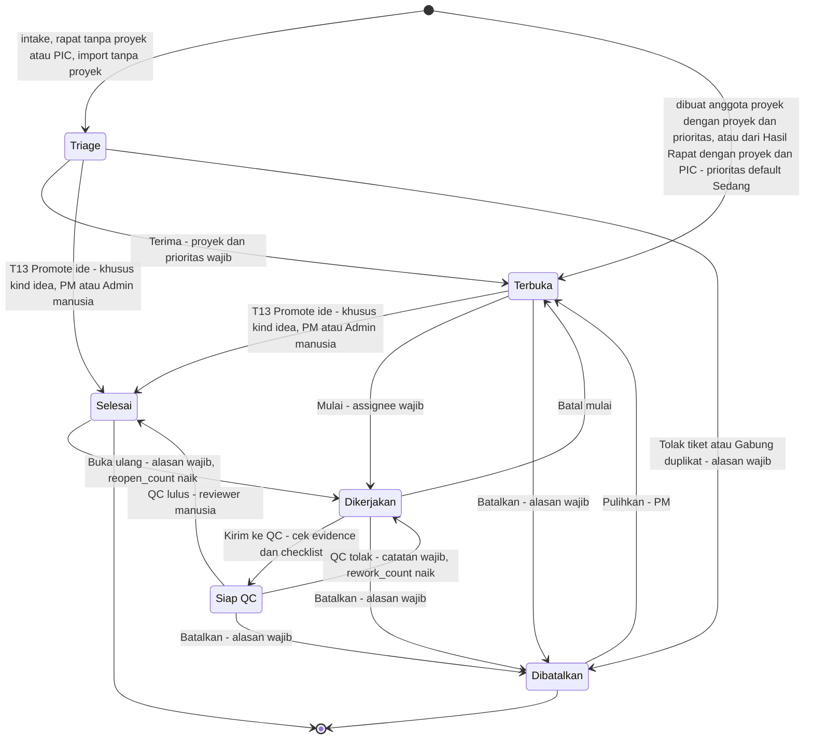

### Diagram 2 — Penegakan aturan agen (P1) di Tool API

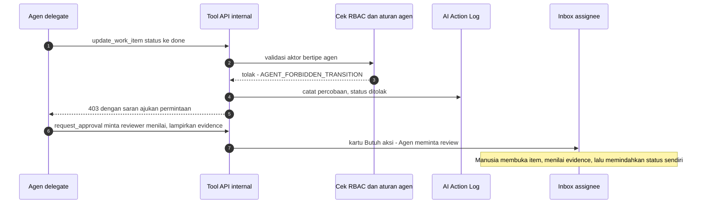

### Langkah (alur normal Tugas/Bug)

1. Item dibuat: masuk **Triage** bila proyek atau prioritas belum pasti; masuk **Terbuka** bila dibuat anggota proyek dengan proyek + prioritas terisi, **atau dibuat dari Hasil Rapat dengan proyek + PIC (prioritas default Sedang bila tidak disebut; bisa diubah di layar Review Hasil Rapat)** (D7, F1).
2. **Terima** (dari Triage): proyek dan prioritas wajib; assignee opsional.
3. **Mulai** (Terbuka → Dikerjakan): jika assignee kosong, sistem meng-assign pelaku. Jika item **Terblokir**, tampilkan peringatan (tidak memblokir).
4. **Kirim ke QC** (Dikerjakan → Siap QC): cek checklist (belum lengkap → peringatan) dan evidence (`require_evidence_for_review`, default ON untuk Bug → minimal 1 evidence `proof_of_done`). Reviewer default dari pengaturan proyek menerima notifikasi Butuh aksi.
5. **QC lulus** (Siap QC → Selesai): hanya reviewer manusia. Opsi proyek "reviewer ≠ assignee".
6. **QC tolak** (Siap QC → Dikerjakan): catatan wajib (komentar atau evidence `qc_rejection`), `rework_count + 1`, notifikasi assignee.
7. **Buka ulang** (Selesai → Dikerjakan): alasan wajib, `reopen_count + 1`, flag **Dibuka ulang**, notifikasi assignee & reviewer.
8. **Batalkan** (status aktif → Dibatalkan): `cancel_reason` wajib (`duplicate`, `wont_do`, `out_of_scope`, `declined_idea`, `spam`).
9. **Pulihkan** (Dibatalkan → Terbuka): hanya PM.
10. **Promote ide** (khusus `kind = idea`, Triage/Terbuka → Selesai, **T13**): dipakai W-6 bentuk B (pecah) dan C (jadikan proyek). Hanya PM proyek tujuan atau Admin manusia; sistem mengisi `promoted_to_ids` (B) atau `project_id` proyek baru (C) dan `completed_at` (F1).

### Aturan / guard (tabel transisi)

| # | Transisi | Aksi UI | Siapa boleh | Guard (backend) | Efek samping |
|---|---|---|---|---|---|
| T1 | `triage → open` | Terima | PM, Member proyek | `project_id` terisi, `priority` terisi | `AISuggestion` diperbarui; pelapor diberi tahu |
| T2 | `triage → canceled` (duplikat) | Gabung duplikat | PM, Member proyek | `duplicate_of_id` wajib, item asli bisa dilihat pelaku | Komentar & watcher dipindah ke item asli |
| T3 | `triage → canceled` (lainnya) | Tolak tiket… | PM; pelapor untuk itemnya sendiri (F3) | `cancel_reason` + catatan wajib | Pelapor diberi tahu dengan alasan |
| T4 | `open → in_progress` | Mulai | assignee, PM; Agen (P1) bila didelegasikan | assignee terisi atau diisi otomatis | Peringatan bila Terblokir |
| T5 | `in_progress → open` | Batal mulai | assignee, PM | — | — |
| T6 | `in_progress → in_review` | Kirim ke QC | assignee, PM; Agen (P1) | evidence wajib bila aturan proyek aktif | Notifikasi reviewer; AI evidence check (P1) |
| T7 | `in_review → done` | QC lulus | **reviewer manusia** (PM jika reviewer kosong) | aktor ≠ agen; opsi reviewer ≠ assignee | `completed_at` diisi; keluar dari Fokus Saya |
| T8 | `in_review → in_progress` | QC tolak | reviewer, PM | catatan atau evidence `qc_rejection` wajib | `rework_count + 1` |
| T9 | `done → in_progress` | Buka ulang | PM, Member proyek | alasan wajib; proyek tidak Completed/Cancelled | `reopen_count + 1`; flag Dibuka ulang |
| T10 | aktif → `canceled` | Batalkan | PM; pelapor untuk item miliknya yang masih Triage/Terbuka | `cancel_reason` wajib; aktor ≠ agen | Item keluar dari hitungan **Aktif** |
| T11 | `canceled → open` | Pulihkan | PM | proyek aktif | Riwayat tetap |
| T12 | Bulk perubahan status | Pilih banyak → ubah status | sesuai T1–T11 per item | > 20 item → dialog konfirmasi eksplisit dengan jumlah | Satu `ActivityEvent` per item; undo batch 24 jam [ASUMSI A-06] |
| T13 | `triage \| open → done` (khusus `kind = idea`) | Promote (pecah jadi pekerjaan / jadikan proyek) | **PM proyek tujuan atau Admin, manusia** (F1, F3) | `kind = idea`; aktor ≠ agen; minimal 1 pekerjaan baru dibuat (B) atau proyek dibuat (C); proyek tujuan tidak Completed/Cancelled | `promoted_to_ids` (B) / `project_id` (C) diisi; `completed_at` diisi; pencatat ide diberi tahu |

**Aturan umum:**
- Semua transisi lewat **Tool API internal** yang sama (UI, import, Hasil Rapat, agen, MCP), dengan cek RBAC dan `version` (optimistic locking).
- Setiap perubahan menulis `ActivityEvent` (`actor_type`, `via`: `ui | csv | ai_suggestion | agent | api`).
- Status Selesai dan Dibatalkan **tidak pernah** diterapkan oleh AI/agen pada level apa pun.
- Hapus ≠ batal. Hapus adalah soft delete ke **Sampah** (30 hari), oleh PM atau pembuat item; agen tidak boleh menghapus.
- Viewer dan Guest tidak bisa mengubah status. Viewer boleh berkomentar; Guest hanya membuat item Triage dan berkomentar pada item yang ia laporkan/ikuti (F3).
- Kind **Ide** memakai status yang sama dengan label kontekstual (lihat W-6) dan tidak memakai Dikerjakan/Siap QC. Satu-satunya jalan ide ke Selesai adalah **T13** (Promote); T7 hanya untuk Tugas/Bug.

### Flag turunan (dihitung, tidak disimpan sebagai status)

| Flag | Label UI | Aturan | Dipakai di |
|---|---|---|---|
| `overdue` | **Telat** | `due_at < sekarang` (zona waktu user) dan status ∉ {Selesai, Dibatalkan} | chip list, Fokus Saya, Health, Retro |
| `blocked` | **Terblokir** | ada relasi `blocks` dari item yang belum Selesai/Dibatalkan | chip list, Fokus Saya, Health (blocker kritis) |
| `stale` | **Mandek** | status aktif dan `last_activity_at` > 7 hari (bisa diatur per workspace) [ASUMSI A-33] | chip list, Fokus Saya, Triage, review ide |
| `reopened` | **Dibuka ulang** | `reopen_count > 0` dan status ≠ Selesai | badge item, filter Fokus Saya |

`last_activity_at` = perubahan field, komentar, checklist, evidence, atau commit tertaut (definisi tunggal).

### Aturan reopen

1. Hanya dari **Selesai**. Item **Dibatalkan** kembali lewat **Pulihkan** (PM), bukan reopen.
2. Alasan wajib; tercatat di aktivitas dan memicu notifikasi assignee + reviewer.
3. Item kembali ke **Dikerjakan** dengan assignee lama. Jika assignee lama sudah bukan anggota proyek → kembali ke **Terbuka** tanpa assignee + Butuh aksi untuk PM.
4. Guest/pelapor tidak bisa reopen langsung; mereka memakai aksi **Minta buka ulang** (komentar bertanda) yang muncul di Inbox assignee/PM [ASUMSI A-07].
5. Item yang selesai > 30 hari: UI menyarankan "Buat item baru yang tertaut" (relasi `relates`), tetapi reopen tetap diizinkan.

### Aturan agen (D5, P1)

- Agen hanya **delegate** (`delegate_agent_id`); **assignee dan reviewer selalu manusia**.
- Agen **boleh:** T4 dan T6, menambah komentar, evidence, checklist, dan sub-item draf.
- Agen **tidak boleh:** → Selesai, → Dibatalkan, hapus, ubah assignee/prioritas/tenggat, Ubah deadline proyek. Tool API menolak dengan `AGENT_FORBIDDEN_TRANSITION`, mencatat di AI Action Log, dan agen hanya bisa mengajukan permintaan ke Inbox assignee.
- Setiap run agen tampil di tab Aktivitas item (input, tool call, output, biaya) dengan tombol Hentikan.

### Titik AI

| Titik | ID | Level | Fase | Fallback |
|---|---|---|---|---|
| Saran saat Terima dari Triage | AI-2 (lihat W-2) | L1 | P0a | Form tanpa saran |
| AI evidence check saat masuk Siap QC (hanya informasi) | A3-F7 | L1 | P1 | Reviewer menilai manual |
| Agen delegate menjalankan T4/T6 | D5 | L2 (aktivasi delegasi) → L3 (langkah agen, bisa di-undo) | P1 internal · P2 eksternal | Item tetap di assignee manusia |
| Ringkasan thread komentar | A3-F6 | L1 | P1 | Baca komentar |

### Edge case

- **Konflik penulisan** (manusia dan agen mengubah bersamaan): `version` beda → 409, UI menampilkan perubahan terbaru dan meminta ulang.
- **Item tanpa proyek mencoba keluar Triage:** ditolak (`PROJECT_REQUIRED`).
- **Assignee dikeluarkan dari proyek saat item Dikerjakan:** item tetap, ditandai "Assignee bukan anggota", PM menerima Butuh aksi.
- **Item Terblokir dimulai:** boleh, dengan peringatan dan tautan ke item pemblokir.
- **Proyek di-set Completed/Cancelled dengan item aktif:** dialog menampilkan jumlah item aktif; PM memilih "Batalkan semua" (alasan wajib, > 20 item = konfirmasi eksplisit) atau "Pindahkan ke proyek lain" sebelum lanjut [ASUMSI A-04].
- **Item di Sampah dipulihkan:** kembali ke status terakhir sebelum dihapus.
- **Tenggat diisi di masa lalu saat membuat item:** diizinkan, langsung Telat, dengan peringatan.
- **Bug tanpa evidence dikirim ke QC dengan aturan proyek aktif:** tombol nonaktif + pesan "Tambahkan minimal 1 evidence bukti selesai".

---

## W-2 Intake & triage Tiket

**Tujuan:** semua pekerjaan yang masuk dari luar alur kerja tim (tiket) diperiksa manusia sebelum menjadi pekerjaan resmi, dengan bantuan saran AI dan deteksi duplikat.
**Pemicu:** item baru dengan `source = intake`, atau item lain yang masuk status Triage (Rapat tanpa proyek/PIC, Import tanpa proyek, ＋ Buat cepat dengan proyek tidak pasti).

**Definisi (D1, E1):** **Tiket** = item dengan `source = intake` di **semua status**. View **Pekerjaan › Tiket** punya dua sub-tab:
- **Triage** = antrean tunggal semua item berstatus `triage` dari semua sumber (dengan chip sumber), **kecuali `kind = idea`** yang ditinjau di Ide & Pengembangan (W-6) (Diputuskan: F19, A-08);
- **Berjalan** = tiket (`source = intake`) yang sudah diterima dan masih **Aktif** (Terbuka/Dikerjakan/Siap QC), dengan chip Telat/Belum ditugaskan/Terblokir/Mandek dan kolom umur. Tiket Selesai/Dibatalkan tampil lewat filter status.
- Kedua sub-tab punya filter **Status · Prioritas · Assignee · Proyek · Sumber** (m12).

**Kanal intake per fase (F5, F10):** P0a = **Laporkan tiket in-app** (mode di composer ＋ Buat cepat; tombol **＋ Tiket** di view Tiket membuka mode yang sama) + kalimat bebas lewat AI-4. Portal/form publik dan email ke tiket = **P1**. Import CSV punya pilihan **Sumber item: Import (default) · Tiket (intake)**; bila Tiket dipilih, item memakai `source = intake` + `source_ref.import_batch` sehingga tampil di view Tiket (F19).

**Aktor:** pelapor (Member, Guest, atau pihak luar lewat portal P1), triager (PM/Member proyek; untuk item tanpa proyek: Admin + semua PM [ASUMSI A-09]), assignee, sistem (AI-2, AI-3).

### Diagram

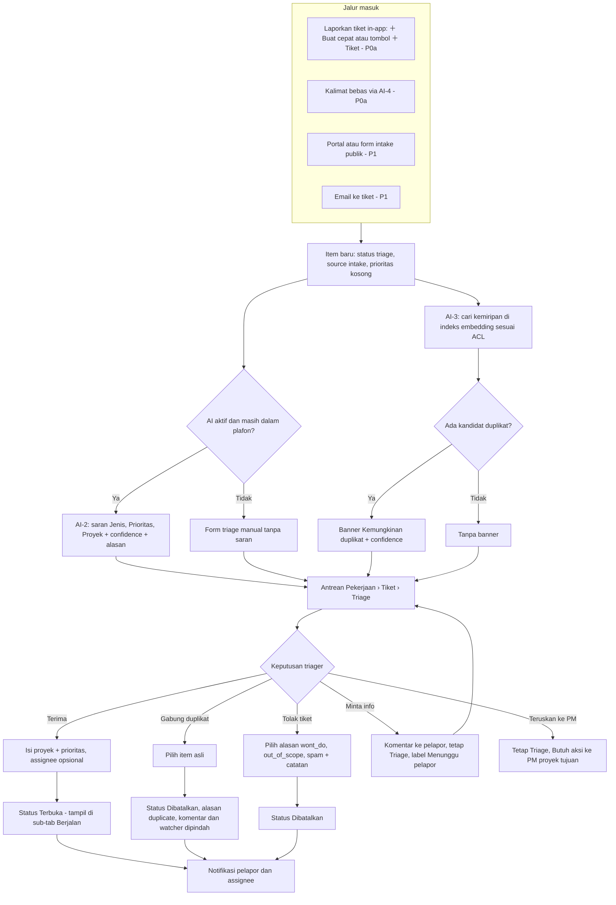

### Langkah

1. **Pelapor mengisi** mode "Laporkan tiket" di composer (judul, deskripsi, proyek opsional, lampiran; tanpa prioritas/assignee) atau mengetik kalimat bebas di ＋ Buat cepat (AI-4 menyusun draf; pelapor mengonfirmasi draf).
2. Saat pelapor mengetik judul, **AI-3** menampilkan "Mungkin sama dengan PRJ-88" (hanya item yang boleh dilihat pelapor). Pelapor bisa membuka item itu dan memilih **Ikuti saja** (jadi watcher) alih-alih membuat tiket baru.
3. Sistem membuat item: `status = triage`, `source = intake`, `priority` kosong, `reporter_id` = pelapor; pelapor otomatis menjadi watcher.
4. **AI-2** (asinkron, < 10 detik target) menulis `AISuggestion` untuk `kind`, `priority`, `project` — masing-masing dengan confidence (Tinggi/Sedang/Rendah) dan alasan satu kalimat yang mengutip teks tiket.
5. **AI-3** menulis kandidat duplikat (maks. 3) dengan confidence.
6. Item muncul di **Tiket › Triage** untuk triager yang berhak (**PM dan Member proyek**, sesuai T1 dan Matriks B) [R3-2]; Inbox triager menerima satu kartu bundel "N tiket menunggu triage" per hari (bukan per tiket), kecuali saran prioritas **Kritis** yang dikirim langsung.
7. Triager membuka baris: tiap saran tampil sebagai chip "Draf AI" dengan **Terima / Ubah / Tolak saran** (Tolak saran hanya membuang saran; item tetap Triage, F2).
8. Triager memilih salah satu keputusan (kolom Aksi: **Terima · Tolak tiket… · ⋯ (Gabung duplikat · Minta info · Teruskan ke PM…)**, F2):
   - **Terima** → proyek + prioritas wajib, assignee opsional → status **Terbuka** → pindah ke sub-tab **Berjalan**.
   - **Gabung duplikat** → pilih item asli → status **Dibatalkan** (`cancel_reason = duplicate`, `duplicate_of_id`), komentar & watcher dipindah, pelapor diberi tahu tautan item asli.
   - **Tolak tiket** → alasan (`wont_do` / `out_of_scope` / `spam`) + catatan → **Dibatalkan**; pelapor diberi tahu alasannya. Boleh oleh PM, atau pelapor untuk itemnya sendiri (F3).
   - **Minta info** → komentar ke pelapor; item tetap di Triage dan diberi label "Menunggu pelapor".
   - **Teruskan ke PM…** → item tetap Triage, PM proyek tujuan menerima Butuh aksi (lihat Aturan / guard).
9. Semua keputusan dicatat di `ActivityEvent`; setiap saran AI ditandai `accepted` / `edited` / `rejected` (F18; nilai pengganti manusia pada `edited` disimpan sebagai label koreksi untuk evaluasi).
10. **Bulk triage:** pilih banyak baris → "Terima saran confidence Tinggi" atau ubah massal; > 20 item → dialog konfirmasi eksplisit.

### Aturan / guard

- AI **tidak pernah** mengubah field tiket sendiri; semua saran L1. Auto-apply per properti adalah opsi **P1** (opt-in per proyek, L3).
- Duplikat **tidak pernah** ditutup otomatis; "Gabung duplikat" selalu klik manusia.
- Triager hanya bisa menerima ke proyek tempat ia PM/Member. Jika AI menyarankan proyek lain → tombol **Teruskan ke PM proyek X** (item tetap Triage, PM proyek X menerima Butuh aksi).
- Saran dan kandidat duplikat difilter ACL saat retrieval: item dari proyek yang tidak bisa diakses triager tidak pernah ditampilkan, bahkan judulnya.
- Konten tiket diperlakukan sebagai **data tidak tepercaya** (prompt injection guard di gateway, W-10).
- Kolom wajib saat Terima: proyek, prioritas. Jenis default = Tugas bila tidak diubah.

### Titik AI

| Titik | ID | Level | Fase | Fallback |
|---|---|---|---|---|
| Kalimat bebas → draf tiket | AI-4 | L2 (draf dikonfirmasi pelapor) | P0a | Form biasa |
| Saran Jenis, Prioritas, Proyek + confidence + alasan | AI-2 | L1 | P0a | Form triage tanpa saran |
| Deteksi duplikat saat mengetik dan saat triage | AI-3 | L1 | P0a | Pencarian keyword manual |
| Saran assignee (histori + beban) | A3-F2 | L1 | P1 | Pilih manual |
| Auto-apply saran per properti (opt-in proyek) | A3-F2 | L3 | P1 | L1 |
| Readiness check (deskripsi kabur, repro kurang) → pertanyaan ke pelapor | A3-F11 | L1 | P2 | Minta info manual |

### Edge case

- **Item asli duplikat sudah Selesai:** pilihan "Buka ulang item asli" (T9, alasan wajib) atau "Terima sebagai item baru + relasi `relates`".
- **Kandidat duplikat ada di proyek yang tidak bisa diakses triager:** tidak ditampilkan (cegah kebocoran); Admin melihat semua.
- **Pelapor Guest:** hanya melihat item yang ia laporkan; semua komentar di item itu terlihat olehnya — tidak ada komentar internal di P0 [ASUMSI A-10].
- **Tiket di Triage > 7 hari:** chip **Mandek**, naik ke atas antrean, dan masuk bundel Inbox triager.
- **Saran AI datang setelah triager sudah memutuskan:** saran diabaikan dan ditandai `expired` otomatis (F18).
- **Spam massal dari portal (P1):** rate limit + CAPTCHA + verifikasi domain email; bulk Tolak tiket `spam` oleh Admin/PM.
- **Prioritas Kritis disarankan AI:** tetap L1, tetapi notifikasi Butuh aksi langsung ke triager (tanpa bundel).

---

## W-3 Siklus Rapat

**Tujuan:** mengubah rapat menjadi hasil yang terlacak — notulensi, Keputusan, Pertanyaan, Informasi, dan Pekerjaan — dengan bukti dan konfirmasi manusia, sambil menjaga privasi rekaman (D3, D4, D7).
**Pemicu:** event dibuat di Rapat & Events (atau, P1, disinkron dari kalender).

**Aktor:** pembuat event, **notulis** (default = pembuat event; bisa didelegasikan ke peserta internal), peserta internal, peserta eksternal/Guest, PIC (calon assignee), PM/Lead proyek terhubung, Admin (kebijakan retensi), sistem (AI-5 capture & draf, AI-6 ekstraksi).

### Diagram 1 — Siklus lengkap

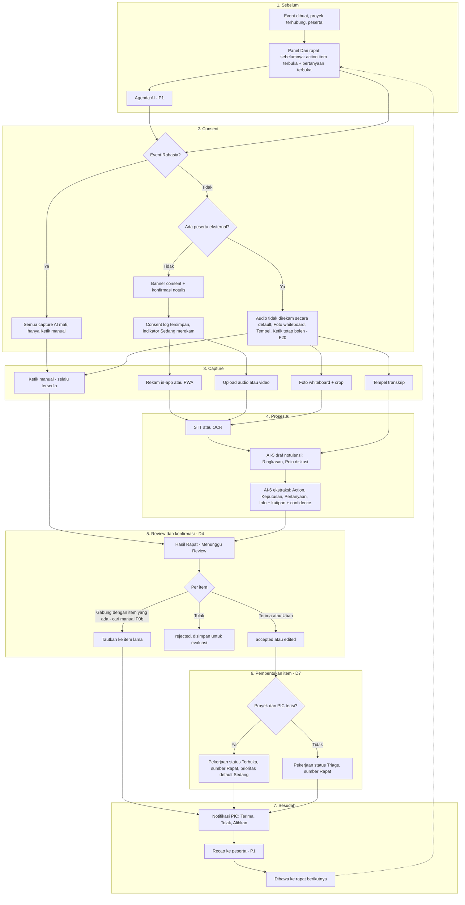

### Diagram 2 — State item Hasil Rapat (`MeetingItem`)

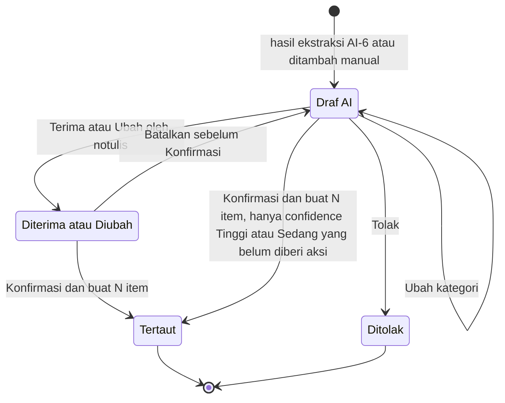

### Diagram 3 — Retensi rekaman (D3)

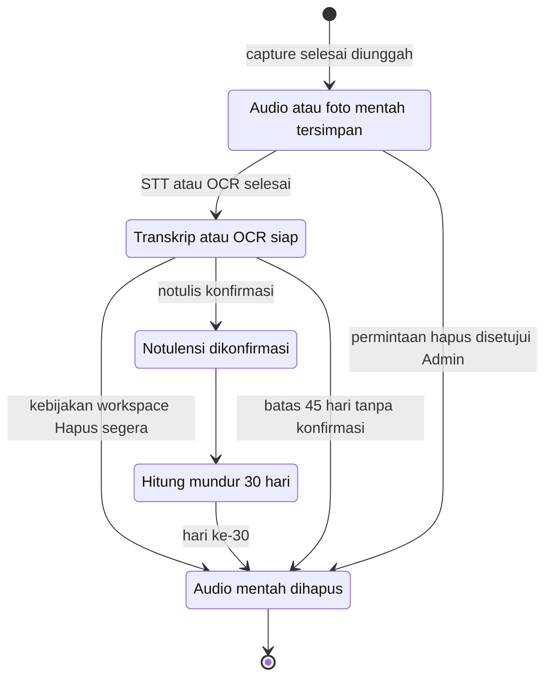

### Langkah

**Sebelum rapat**
1. Pembuat event mengisi judul, waktu, lokasi, **proyek terhubung** (opsional), peserta (anggota workspace + tamu email), dan flag **Rahasia** (opsional).
2. Detail event menampilkan panel **Dari rapat sebelumnya** (deterministik, P0b): action item yang belum Selesai dan pertanyaan terbuka dari rapat sebelumnya di seri yang sama atau proyek yang sama.
3. (P1) **Agenda AI** menyusun draf agenda dari panel itu + item Telat/Terblokir proyek; notulis menerima/mengubah.

**Consent**
4. Sistem memeriksa peserta. Jika ada **peserta eksternal** (Guest atau email di luar domain workspace) → tombol Rekam dan Upload rekaman **nonaktif secara default** (Admin bisa mengizinkan lewat kebijakan workspace, tetap dengan consent eksplisit); **Foto whiteboard, Tempel transkrip, dan Ketik manual tetap boleh** (F20). Jika event **Rahasia** → semua capture AI nonaktif; hanya ketik manual.
5. Sebelum merekam/mengunggah audio, notulis melihat **banner consent** dan mencentang "Semua peserta sudah diberi tahu dan setuju direkam". Sistem menyimpan consent log (siapa, kapan, daftar peserta, metode).
6. Selama merekam, detail event menampilkan indikator **Sedang merekam** untuk semua peserta yang membukanya.

**Capture**
7. Notulis memilih satu atau kombinasi: **Rekam** (in-app/PWA; disimpan lokal lalu diunggah bertahap/resumable), **Upload** audio/video, **Foto** whiteboard (pratinjau + crop sebelum diproses), **Tempel transkrip** (Meet/Zoom/Teams), atau **Ketik manual**. Beberapa capture dalam satu event digabung ke satu draf.

**Proses AI**
8. STT (audio) / OCR (foto) → teks. Label pembicara bisa diisi manual (diarization otomatis P1).
9. **AI-5** menyusun **draf notulensi**: Ringkasan · Poin diskusi (bahasa mengikuti bahasa rapat; mendukung campuran Indonesia–Inggris).
10. **AI-6** mengekstrak item berkategori **Action item / Keputusan / Pertanyaan / Informasi** (Risiko disimpan sebagai Informasi di P0). Tiap item wajib membawa **kutipan bukti** (timestamp audio / potongan teks / area foto) dan **confidence**; PIC & tenggat hanya diisi bila disebut, selain itu kosong dengan flag "PIC tidak disebut" / "Tenggat tidak disebut".

**Review & konfirmasi (D4)**
11. Notulis menerima Butuh aksi **"Hasil Rapat menunggu review"**; card event mendapat badge **Menunggu review**.
12. Di layar **Hasil Rapat**, untuk tiap item (semua kategori, termasuk Informasi): **Terima · Ubah · Ubah kategori · Tolak · Gabung…** [R3-5] (Gabung… = gabung dengan item yang ada, cari manual, **P0b**; saran kemiripan otomatis = P1, F5). Action item punya field **Prioritas** (default Sedang). Item yang menyebut pergeseran **milestone** mendapat aksi **"Buka Rencana untuk menggeser milestone"** — dialog Ubah deadline (E2) hanya untuk deadline proyek (F20). Notulis juga mengedit dan mengonfirmasi teks notulensi.
13. **Bulk** "Terima semua confidence Tinggi" tetap satu klik eksplisit; item confidence **Rendah** harus dibuka (diperluas) sebelum bisa diterima [R3-5].
14. Notulis menekan **Konfirmasi & buat N item** [R3-5] (N dihitung dengan aturan langkah 15 sebelum tombol ditekan; > 20 → konfirmasi eksplisit).

**Pembentukan item (D7)**
15. **Action item** → Pekerjaan `kind = task`, `source = meeting`, `source_ref` = event + capture + kutipan. Status **Terbuka** bila proyek **dan** PIC terisi; selain itu **Triage** (masuk Tiket › Triage, W-2). **Prioritas default Sedang** bila tidak disebut di rapat (bisa diubah di layar Review Hasil Rapat), sehingga item Terbuka selalu punya prioritas (F1; lihat W-1 Langkah 1).
   - **Belum ditinjau** = item yang belum diberi aksi apa pun. Tombol konfirmasi membuat item Tinggi/Sedang yang tidak ditolak + item yang sudah diterima/diubah; item confidence Rendah yang belum diterima eksplisit tidak dibuat. Aturan ini berlaku untuk semua kategori (Keputusan/Pertanyaan "dibuat" = disimpan) [R3-5].
16. **Keputusan** → disimpan di Hasil Rapat dan tampil di notulensi (P0b); masuk **Decision Log** proyek (P1).
17. **Pertanyaan** → disimpan dengan owner opsional dan muncul di panel "Dari rapat sebelumnya" pada rapat berikutnya (P0b); tracker pertanyaan terbuka P1.
18. **Informasi** → tetap di notulensi.

**Sesudah**
19. **PIC** menerima Butuh aksi "Kamu ditugaskan dari rapat X" berisi kutipan bukti dengan aksi **Terima · Tolak (alasan) · Alihkan (pilih orang)**. Tolak → assignee dikosongkan, notulis + PM/Lead menerima Butuh aksi untuk menugaskan ulang. PM/Lead bisa mengedit item kapan saja.
20. (P1) **Recap**: draf ringkasan + item baru + keputusan → notulis meninjau → kirim in-app + email ke peserta. Pengiriman ke peserta **eksternal** selalu butuh klik persetujuan manusia.
21. Card event menampilkan progres tindak lanjut: "Dikonfirmasi · 5 item (2 Selesai)". Siklus kembali ke langkah 2 untuk rapat berikutnya.

### Aturan / guard

- **Consent wajib** sebelum rekam/upload audio; tanpa consent log, tombol proses nonaktif.
- **Item tanpa kutipan bukti tidak ditampilkan.** Lebih baik kosong daripada dikarang.
- **PIC = anggota proyek terhubung ber-role PM/Member**; Guest/Viewer hanya boleh disebut di teks (tidak bisa menjadi PIC). Nama yang tidak cocok atau milik Guest/Viewer tampil sebagai teks + "pilih orang" [R3-3].
- Tanggal relatif ("Jumat depan") dikonversi dari tanggal rapat dan ditampilkan bersama kutipan aslinya.
- Tidak ada auto-create: item hanya terbentuk dari langkah 14 (klik manusia).
- Hak konfirmasi: notulis (atau delegasinya). PM/Lead proyek terhubung boleh mengedit kapan saja; peserta lain hanya berkomentar.
- **Akses (D3):** audio mentah → notulis, pembuat event, PM/Lead proyek terhubung. Transkrip → peserta internal + PM/Lead. Guest → hanya notulensi yang sudah dikonfirmasi dari rapat yang ia hadiri [ASUMSI A-11].
- **Retensi (D3):** audio/foto mentah dihapus **30 hari setelah notulensi dikonfirmasi**; opsi workspace **Hapus segera** setelah transkrip jadi; transkrip mengikuti retensi workspace; batas maksimum 45 hari bila tidak pernah dikonfirmasi [ASUMSI A-12]. Penyedia STT/LLM wajib zero-retention + no-training + DPA; review legal (UU PDP 27/2022, DPIA) sebelum rilis P0b.

### Titik AI

| Titik | ID | Level | Fase | Fallback |
|---|---|---|---|---|
| STT/OCR + draf notulensi | AI-5 | L1 (draf baca-edit; konfirmasi formal ada di AI-6, F5) | P0b | Tempel transkrip / ketik manual |
| Ekstraksi Action/Keputusan/Pertanyaan/Info + kutipan + confidence | AI-6 | L2 (dikonfirmasi per item) | P0b | Notulis menambah item manual |
| Pembentukan Pekerjaan dari item terkonfirmasi | AI-6 + D7 | L2 | P0b | Buat item manual dari notulensi |
| Diarization otomatis | — | L1 | P1 | Label pembicara manual |
| Saran duplikat dengan item Aktif saat review | A1-N13b | L1 | P1 | Gabung manual via cari (P0b, F5) |
| Agenda AI pra-rapat | A1-N16 | L1 | P1 | Panel deterministik "Dari rapat sebelumnya" |
| Recap ke peserta | A1-N17 | L2 (eksternal selalu manusia) | P1 | Notulis menulis recap |
| Bot ikut rapat online | A1-N11d | L2 | P2 | Rekam/Upload |

### Edge case

- **Satu peserta menolak direkam:** notulis menghapus centang consent → rekam nonaktif; capture beralih ke foto/tempel/ketik.
- **Rapat dengan peserta eksternal:** audio tidak direkam, tetapi Foto whiteboard, Tempel, dan Ketik tetap tersedia dan diproses AI seperti biasa (F20). Event **Rahasia** tetap hanya Ketik manual.
- **Item rapat meminta milestone digeser:** tidak membuka dialog Ubah deadline; aksi "Buka Rencana untuk menggeser milestone" membawa notulis/PM ke W-5 Langkah 2 (F20).
- **Koneksi putus saat merekam (HP):** rekaman tetap tersimpan lokal; status "Menunggu upload" dan unggah dilanjutkan otomatis.
- **Rekaman sangat panjang:** batas 3 jam per capture [ASUMSI A-13]; lebih dari itu diminta dipecah.
- **AI/STT gagal atau plafon habis:** draf tidak dibuat, notulis diberi tahu; audio tetap tersimpan (dalam masa retensi) dan bisa **Proses ulang** saat AI pulih.
- **Event tanpa proyek terhubung:** semua Action item terbentuk sebagai **Triage** tanpa proyek kecuali notulis memilih proyek per item.
- **Notulis tidak meninjau:** pengingat hari ke-2, ke-7, dan ke-14 [ASUMSI A-12]; PM/Lead bisa mengambil alih review.
- **Edit setelah konfirmasi:** notulensi bisa diedit PM/Lead/notulis; item yang sudah terbentuk tidak berubah otomatis; perubahan tercatat di aktivitas.
- **Peserta meminta rekaman dihapus (hak hapus):** permintaan masuk ke Admin; setelah disetujui audio dihapus segera, transkrip bisa disamarkan.
- **Foto menangkap informasi di luar rapat:** crop wajib ditinjau sebelum diproses; foto asli mengikuti retensi audio.

---

## W-4 Planner "Proyek dari cerita"

**Tujuan:** membuat proyek siap kerja dalam hitungan menit — fase, milestone, pekerjaan, estimasi kasar, risiko — dari cerita teks, dengan review manusia per item (D8). Ditambah jalur **Kosong** dan **Dari template**.
**Pemicu:** Proyek › **Proyek baru**.

**Aktor:** pembuat proyek (Admin atau Member workspace; menjadi PM + Lead), anggota yang ditambahkan, sistem (AI-7).

### Diagram 1 — Tiga jalur pembuatan proyek

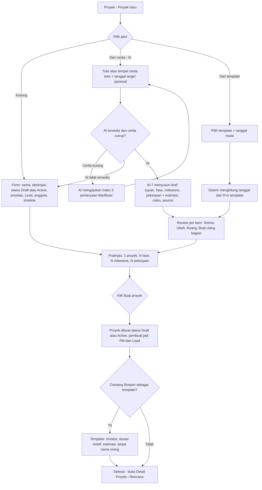

### Diagram 2 — Urutan sistem untuk jalur "Dari cerita"

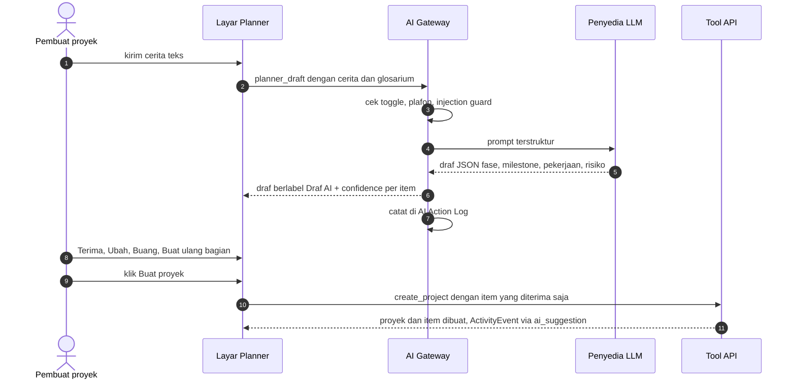

### Langkah

1. Pembuat membuka **Proyek › Proyek baru** dan memilih **Kosong**, **Dari cerita (AI)**, atau **Dari template**.
2. **Kosong:** isi form — nama, deskripsi, status (**hanya Draft/Active**, E4), prioritas (Rendah/Sedang/Tinggi/Kritis), Lead (default pembuat), anggota + role, timeline (mulai–selesai, pintasan 1 minggu / 2 minggu / 1 bulan / 3 bulan) → lanjut ke langkah 8.
3. **Dari cerita:** tulis/tempel cerita teks (minimal ±30 kata [ASUMSI A-14]); opsional tanggal target dan anggota tim.
4. Jika cerita terlalu kabur, AI-7 mengajukan **maks. 3 pertanyaan klarifikasi**; jawaban ditambahkan ke cerita.
5. **AI-7** menyusun draf: ringkasan & tujuan · **Fase** (rentang tanggal) · **Milestone** (titik cek + kriteria selesai) · **Pekerjaan** (judul, Jenis, Prioritas, estimasi jam kasar, fase) · **Risiko** · **Asumsi** · **Pertanyaan terbuka**. Setiap item berlabel **Draf AI** + confidence; item yang berasal langsung dari cerita menampilkan kutipan kalimatnya.
6. **Review per item** dalam tampilan outline: **Terima · Ubah · Buang**, dan **Buat ulang bagian ini** per fase. Pembuat bisa menambah item manual. Draf disimpan otomatis.
7. **Dari template:** pilih template → isi nama + tanggal mulai → sistem menghitung tanggal dari offset H+n → tampil di layar review yang sama (tanpa label AI).
8. **Pratinjau** ringkas: "1 proyek · 4 fase · 5 milestone · 32 pekerjaan" (angka = item berstatus Diterima/Diubah saja). Klik **Buat proyek** mengonfirmasi **semua item berstatus Diterima/Diubah** (termasuk bila > 20); item **Belum direview** atau **Dibuang** tidak dibuat (m16).
9. Sistem membuat Project, Phase, Milestone, dan Pekerjaan berstatus **Terbuka** (proyek & prioritas sudah terisi), assignee kosong kecuali diisi pembuat. Risiko & asumsi disimpan di Overview › Risiko & blocker.
10. Opsi **Simpan sebagai template**: menyimpan struktur fase/milestone/pekerjaan, durasi relatif (H+n), estimasi, dan role (bukan nama orang).
11. Pembuat diarahkan ke **Detail Proyek › Rencana**.

### Aturan / guard

- Planner **tidak pernah** membuat proyek atau item tanpa klik **Buat proyek** (L2).
- Hanya item berstatus "Diterima/Diubah" yang dibuat; item "Belum direview" tidak dibuat, item "Dibuang" disimpan di log draf untuk evaluasi.
- Status saat create hanya **Draft** atau **Active** (E4). Health baru dihitung saat proyek Active (E3).
- Guest tidak bisa membuat proyek. Pembuat otomatis PM + Lead; Lead bisa dipindah ke PM lain.
- Tanggal pekerjaan dan fase harus berada di dalam timeline proyek; pelanggaran tampil sebagai peringatan per item sebelum Buat proyek.
- Cerita diproses lewat AI Gateway dengan kebijakan data D3 (zero-retention); layar menampilkan catatan "Cerita dikirim ke penyedia AI sesuai kebijakan workspace".
- Item yang dibuat: `source = manual`, `source_ref.planner_draft_id`, `ActivityEvent.via = ai_suggestion` [ASUMSI A-15 — glosarium tidak punya sumber "Planner"].

### Titik AI

| Titik | ID | Level | Fase | Fallback |
|---|---|---|---|---|
| Cerita teks → draf rencana + pertanyaan klarifikasi | AI-7 | L2 | P0b | Jalur Kosong (cerita disalin ke deskripsi) |
| Buat ulang bagian | AI-7 | L2 | P0b | Ubah manual |
| Input dokumen/PRD, voice, repo | A2-F1 | L2 | P1 | Tempel teks |
| Saran assignee dari keahlian & beban | A2-F1 | L1 | P1 | Pilih manual |
| Kalibrasi estimasi dengan cycle time (D13) | A2-F1a | L1 | P1 | Estimasi AI apa adanya, berlabel "kasar" |
| Saran template mirip | A2-F3 | L1 | P1 | Pilih manual dari library |
| Template otomatis dari proyek Completed | A2-F3 | L2 | P1 | Simpan template manual |
| Template bawaan "Software delivery" + generik | X15 | — | P1 | Template buatan user |

### Edge case

- **AI gagal di tengah:** draf parsial ditampilkan dengan banner "Sebagian draf gagal dibuat — Buat ulang bagian"; tidak ada yang tersimpan sebagai proyek.
- **Draf sangat besar:** AI membatasi 60 pekerjaan per draf [ASUMSI A-14] dan menyarankan memecah proyek.
- **Pembuat meninggalkan layar:** draf tersimpan 14 hari di "Draf Planner saya" [ASUMSI A-14].
- **Nama proyek sama dengan proyek lain:** peringatan, tidak memblokir.
- **Template berisi role yang tidak ada di tim baru:** pekerjaan dibuat tanpa assignee + chip "Belum ditugaskan".
- **Tanggal mulai di masa lalu:** diizinkan dengan peringatan; pekerjaan yang tenggatnya sudah lewat langsung Telat.

---

## W-5 Rencana & jadwal

**Tujuan:** satu tempat untuk "kapan & apa" proyek — Fase, Milestone, tautan pekerjaan (`task.phaseId`), perubahan deadline yang akuntabel (E2), dan Health v1 yang bisa dijelaskan (E3).
**Pemicu:** Detail Proyek › **Rencana**; aksi **Ubah deadline** di header proyek; perubahan data pekerjaan (memicu hitung ulang Health).

**Aktor:** PM, Lead (atribut pada satu PM), Member (menautkan pekerjaan ke fase), anggota proyek (penerima notifikasi), sistem (mesin Health, hitung impact).

### Diagram 1 — Status Fase dan Milestone

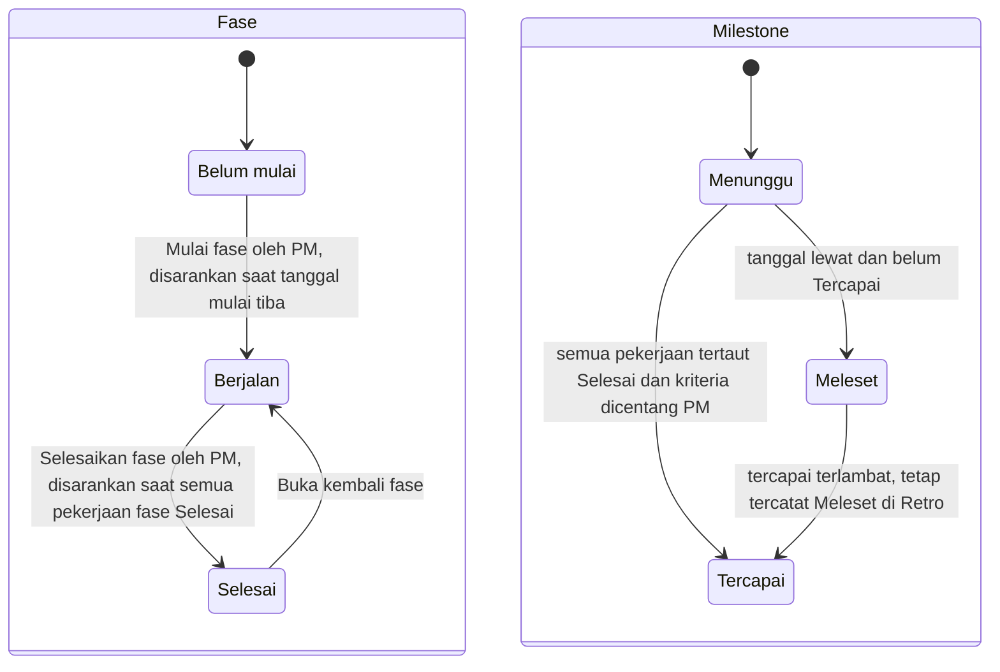

### Diagram 2 — Ubah deadline proyek (E2)

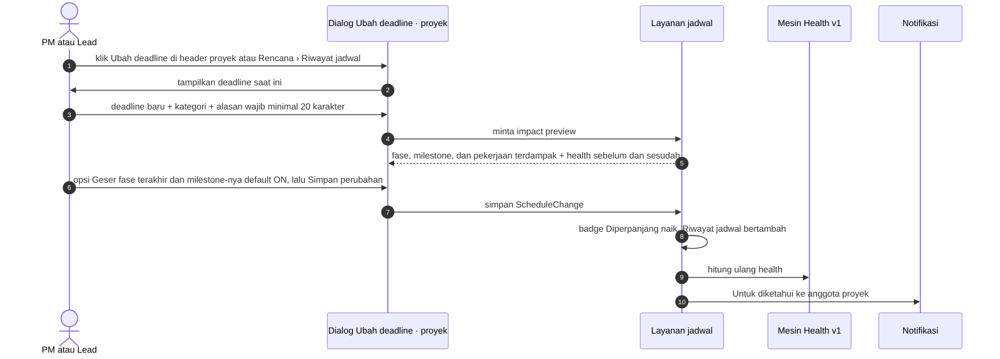

### Diagram 3 — Health v1 (E3)

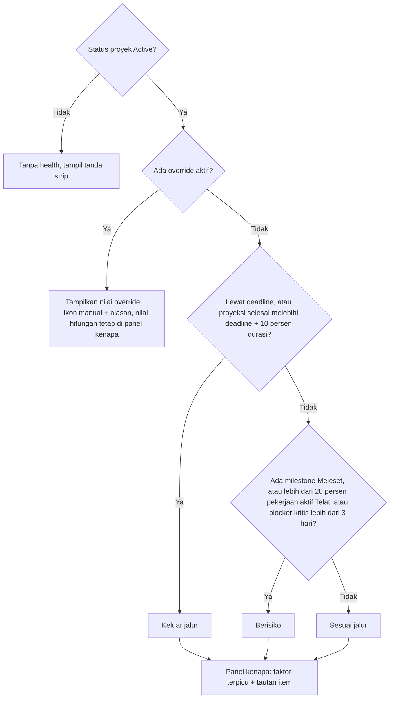

### Langkah — Fase & Milestone

1. PM menambah **Fase** (nama, tujuan, mulai–selesai) di Rencana; tampilan utama **timeline + stepper**, alternatif **list** (aksesibel). Grid dihapus (X4).
2. PM menambah **Milestone** (judul, tanggal, kriteria selesai) di dalam fase; default di akhir fase.
3. PM/Member menautkan pekerjaan ke fase (`task.phaseId`) dari detail item, bulk action, atau drag di timeline (dengan alternatif menu "Pindah ke fase…"). Pekerjaan bisa juga ditautkan ke milestone (`milestone_id`, opsional).
4. Progres fase = pekerjaan Selesai ÷ pekerjaan fase (bobot estimasi jam bila tersedia, fallback jumlah item).
5. Sistem **menyarankan** transisi fase (tanggal mulai tiba → "Mulai fase?"; semua pekerjaan Selesai → "Selesaikan fase?"); PM yang mengeklik.
6. Saat fase Selesai, Lead menerima pengingat **Buat retro fase** (W-9).

### Langkah — Ubah deadline (E2)

7. PM/Lead klik tombol **Ubah deadline** (header proyek atau Rencana › Riwayat jadwal; satu nama untuk perpanjangan maupun percepatan, F7). Dialog berjudul **"Ubah deadline · {proyek}"**. Semua perubahan tanggal selesai proyek **wajib lewat dialog ini** — form edit proyek menampilkan deadline read-only + tautan ke dialog.
8. Isi **deadline baru** (sama dengan saat ini → error "Sama dengan deadline saat ini", tombol simpan nonaktif), **kategori wajib** (Scope bertambah / Dependensi eksternal / Estimasi meleset / Sumber daya / Lainnya), dan **alasan wajib minimal 20 karakter** (F7; kurang dari itu → pesan validasi, tombol simpan nonaktif).
9. Sistem menampilkan **impact preview** deterministik: fase & milestone yang berakhir setelah atau pada deadline lama, pekerjaan aktif yang tenggatnya melewati deadline baru/lama, serta Health sebelum → sesudah.
10. Satu opsi: **Geser fase terakhir & milestone-nya ke deadline baru** (**default ON**). Tenggat pekerjaan **tidak** ikut digeser. Geser proporsional semua fase & milestone = **P1** (bagian Saran re-plan) (F7).
11. Klik **Simpan perubahan** → `ScheduleChange` (lama, baru, kategori, alasan, aktor, waktu, snapshot impact). Header menampilkan badge **Diperpanjang ×N** (hanya perpanjangan; percepatan dicatat sebagai "Dipercepat" dan tidak menambah N). Riwayat ada di **Rencana › Riwayat jadwal**.
12. Health dihitung ulang; anggota proyek menerima **Untuk diketahui**.

### Langkah — Health v1 (E3)

13. Mesin Health berjalan setiap ada perubahan pekerjaan/fase/milestone di proyek (debounce ±5 menit) dan batch malam hari.
14. Hanya proyek **Active** yang punya health. Draft/On Hold/Completed/Cancelled tampil tanpa health.
15. **Keluar jalur** jika lewat deadline **atau** proyeksi selesai > deadline + 10% durasi proyek. **Berisiko** jika ≥ 1 milestone Meleset, **atau** > 20% pekerjaan aktif Telat, **atau** blocker kritis (item Kritis dengan kondisi Terblokir) > 3 hari. Selainnya **Sesuai jalur**.
   - **Penyebut "pekerjaan aktif"** (F9) = item proyek dengan status ∉ {Selesai, Dibatalkan} dan **tidak termasuk Triage**, yaitu agregat **Aktif** (Terbuka + Dikerjakan + Siap QC). Pembilang = item Aktif yang Telat. Contoh: proyek 52 item = 25 Selesai + 14 Terbuka + 9 Dikerjakan + 4 Siap QC → Aktif = 27; 5 Telat ÷ 27 aktif = **19% → tidak terpicu**; dengan 6 Telat = **22% → terpicu** (Berisiko) [R3-1]. Penyebut **bukan** total item proyek. Semua contoh angka di wireframe wajib memakai definisi ini.
16. **Proyeksi selesai** = hari ini + sisa pekerjaan ÷ throughput 14 hari terakhir (jam estimasi, fallback jumlah item) [ASUMSI A-18]. Bila throughput 0 atau < 5 item selesai, faktor proyeksi ditandai "Belum cukup data" dan tidak dipakai.
17. Chip health di header, daftar Proyek, dan Beranda punya **▸ kenapa**: daftar faktor terpicu + tautan ke item penyebab.
18. **Override:** PM/Lead memilih nilai lain + **alasan wajib** → tercatat (siapa, kapan, alasan), tampil dengan ikon "manual". Override kedaluwarsa otomatis 7 hari [ASUMSI A-19]; Lead diberi tahu saat kedaluwarsa. Setiap override dikirim sebagai **Untuk diketahui** "Health di-override" ke anggota proyek (nilai baru, alasan, oleh siapa; P0b, m17).

### Aturan / guard

- Ubah deadline: **hanya PM/Lead manusia**; agen dan AI tidak pernah bisa (selalu butuh manusia). Alasan & kategori wajib; draf alasan oleh AI **tidak** disediakan (R1 K21).
- Hapus fase → pekerjaan fase pindah ke **Tanpa fase** (`phaseId = null`), tidak ikut terhapus; milestone di fase itu ikut terhapus setelah konfirmasi.
- Fase boleh tumpang tindih (peringatan, tidak memblokir). Tanggal fase di luar timeline proyek → peringatan.
- Ambang Health (10%, 20%, 3 hari) adalah **default yang bisa diatur per workspace** di Pengaturan › Workspace, bukan hardcode.
- Health dihitung **deterministik**; LLM tidak pernah menentukan nilai health.
- Perubahan health ke **Keluar jalur** → Butuh aksi untuk Lead; perubahan lain → Untuk diketahui [ASUMSI A-20].

### Titik AI

| Titik | ID | Level | Fase | Fallback |
|---|---|---|---|---|
| Ringkasan AI 3 kalimat di Overview (menarasikan faktor health & progres) | R1 K19 | L1 | P0b | Daftar faktor tanpa narasi |
| Saran re-plan saat ubah deadline (kurangi scope, tambah orang, geser proporsional) | A2§2.3, A4§3.8 | L1 → L2 (Terapkan geser) | P1 | Impact preview deterministik |
| Health v2: penjelasan LLM + forecast | A2-F2 | L1 | P1 | Health v1 |
| Saran pengelompokan pekerjaan lama ke fase (migrasi) | A2§5 | L2 | P1 | Tautkan manual |
| Monte Carlo P50/P85 | R1 K14 | L1 | P2 | Health v1/v2 |
| Baseline & pelacak scope creep | A2-F8 | — (deterministik) | P1 | — |

### Edge case

- **Proyek Active tanpa deadline:** faktor deadline & proyeksi tidak dihitung; health dari faktor lain + label "Deadline belum diisi".
- **Deadline baru lebih awal (percepatan):** alur sama, kategori tetap wajib, dicatat "Dipercepat".
- **Proyek di-set On Hold:** health hilang; saat kembali Active, health dihitung ulang dan override lama tidak dipakai.
- **Milestone tanpa pekerjaan tertaut:** Tercapai hanya lewat centang kriteria oleh PM; Meleset tetap otomatis dari tanggal.
- **Dua PM mengubah deadline bersamaan:** `version` konflik → yang kedua melihat perubahan terbaru dan harus mengisi ulang.
- **Override saat nilai hitungan berubah:** override tetap sampai kedaluwarsa, tetapi panel kenapa menampilkan "Nilai hitungan saat ini: …".

---

## W-6 Ide → pekerjaan

**Tujuan:** ide tidak hilang, ditinjau berkala, dan yang layak dikerjakan dinaikkan menjadi pekerjaan atau proyek dengan riwayat utuh.
**Pemicu:** ide dicatat lewat ＋ Buat cepat › Ide atau **Pekerjaan › Ide & Pengembangan › Catat ide**; jadwal review berkala.

**Aktor:** pencatat ide (PM, Member; **Guest tidak mencatat ide**, Guest hanya Laporkan tiket [ASUMSI A-03] [R3-2]), peninjau (PM proyek; untuk ide lintas proyek: PM proyek tujuan atau Admin, F3), sistem (AI-3).

### Diagram

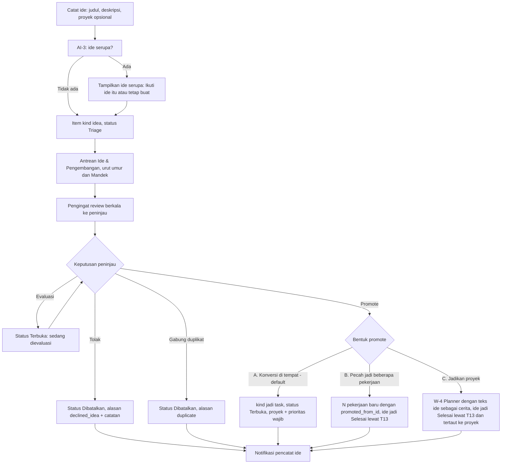

### Langkah

1. Pencatat mengisi judul, deskripsi, proyek (opsional — ide boleh lintas proyek), dan prioritas (opsional).
2. **AI-3** menampilkan ide/pekerjaan serupa; pencatat bisa **Ikuti** yang sudah ada (jadi watcher) atau tetap membuat.
3. Sistem membuat item `kind = idea`, `status = triage`, `source = manual`.
4. Ide tampil di **Pekerjaan › Ide & Pengembangan** dengan chip Mandek (> 7 hari tanpa aktivitas) dan kolom umur, plus filter **Prioritas · Assignee · Proyek**. Ide berstatus Triage **tidak** muncul di Tiket › Triage (F19).
5. Peninjau menerima pengingat **Review ide** di Inbox sesuai jadwal (default 2 minggu sekali per proyek, bisa diatur) [ASUMSI A-21].
6. Untuk setiap ide, peninjau memilih: **Evaluasi** (→ Terbuka), **Tolak** (→ Dibatalkan, `declined_idea` + catatan), **Gabung duplikat**, atau **Promote**.
7. **Promote — A. Konversi di tempat (default):** `kind → task`, status → Terbuka, proyek + prioritas wajib. Riwayat, komentar, dan watcher tetap.
8. **Promote — B. Pecah:** buat beberapa pekerjaan (manual di P0; saran AI "Pecah jadi sub-item" di P1) yang membawa `promoted_from_id`; ide → **Selesai** lewat transisi **T13** (`promoted_to_ids` + `completed_at`, W-1).
9. **Promote — C. Jadikan proyek:** membuka W-4 jalur "Dari cerita" dengan teks ide terisi; setelah proyek dibuat, ide → **Selesai** lewat **T13** (`project_id` + `completed_at`) dan tertaut ke proyek [ASUMSI A-22].
10. Pencatat ide menerima notifikasi keputusan (Untuk diketahui).

### Aturan / guard

- Label status ide memakai **glosarium yang sama** (Triage, Terbuka, Selesai, Dibatalkan); UI boleh menambah teks bantuan kontekstual ("sedang dievaluasi", "sudah dipecah"), bukan label status baru. Ide **tidak** memakai Dikerjakan/Siap QC.
- Ide boleh tanpa proyek selama Triage/Terbuka; **promote A/B wajib memilih proyek**.
- Promote & Tolak: PM proyek terkait (ide lintas proyek: **PM proyek tujuan atau Admin**, F3). Evaluasi & komentar: PM/Member; Viewer boleh berkomentar (F3).
- Promote ke proyek Completed/Cancelled diblokir.
- Ide dari rapat: notulis bisa mengubah Action item menjadi ide dengan **Ubah kategori → Informasi**, lalu membuat ide manual dari notulensi [ASUMSI A-23 — kategori Hasil Rapat tidak punya "Ide"].

### Titik AI

| Titik | ID | Level | Fase | Fallback |
|---|---|---|---|---|
| Deteksi ide/pekerjaan serupa saat mencatat & meninjau | AI-3 | L1 | P0a | Cari keyword |
| Kalimat bebas → draf ide (＋ Buat cepat) | AI-4 | L2 | P0a | Form biasa |
| Pecah ide jadi sub-item | A3-F5 | L2 | P1 | Buat manual |
| Promote C lewat Planner | AI-7 | L2 | P0b | Proyek Kosong |
| Skor impact/effort/confidence + pengelompokan ide mirip | A3-F10 | L1 | P2 | Penilaian manual |
| Usulan naik jadi pekerjaan berdasarkan dukungan | A4§3.5 | L1 | P2 | — |

### Edge case

- **Ide sudah dipromote lalu ternyata salah:** konversi A dibatalkan lewat **Batalkan** (alasan) — tidak bisa "kembali menjadi ide"; buat ide baru bila perlu.
- **Ide lintas proyek dipromote oleh PM yang tidak punya akses ke semua komentar:** komentar tetap ikut item; ACL mengikuti proyek tujuan setelah konversi, pencatat tetap bisa melihat.
- **Dua ide digabung:** satu → Dibatalkan `duplicate`, watcher & komentar pindah.
- **Ide tanpa aktivitas > 90 hari:** disarankan untuk ditolak saat review (tidak otomatis).

---

## W-7 Briefing harian & Fokus Saya

**Tujuan:** pengganti 14 widget Ringkasan lama — user paham kondisi dalam < 30 detik (Briefing) dan tahu harus mengerjakan apa duluan (Fokus Saya). Semua angka deterministik; AI hanya menarasikan.
**Pemicu:** jadwal pagi per zona waktu user, buka Beranda, atau klik **Perbarui**.

**Aktor:** Member, PM (+ KPI strip), sistem (mesin sinyal, AI-1).

### Diagram 1 — Pembentukan Briefing

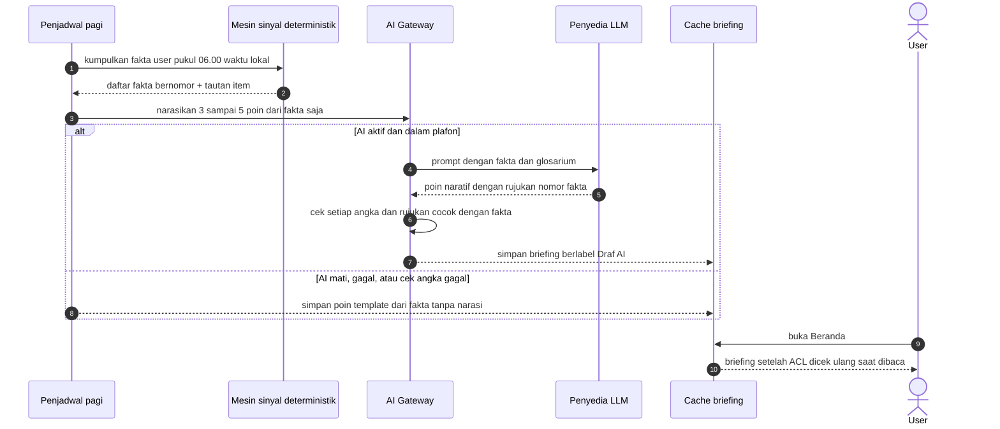

### Diagram 2 — Ranking Fokus Saya

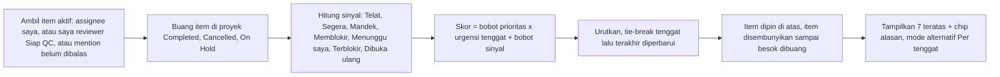

### Sinyal & chip alasan (deterministik)

| Sinyal | Chip | Aturan default | Bobot skor [ASUMSI A-16] |
|---|---|---|---|
| `OVERDUE` | **Telat** | `due_at` < hari ini, status aktif | urgensi tenggat = 3 |
| `DUE_SOON` | **Segera** | `due_at` ≤ +2 hari kerja | urgensi tenggat = 2 (minggu ini = 1,5; lainnya = 1) |
| `STALE` | **Mandek** | flag `stale` (> 7 hari tanpa aktivitas) | + 2 |
| `BLOCKING` | **Memblokir** | item ini memblokir item aktif orang lain | + 1 per item, maks. + 3 |
| `WAITING_ME` | **Menunggu saya** | mention belum dibalas / saya reviewer item Siap QC | + 2 |
| `BLOCKED` | **Terblokir** | flag `blocked` | − 3 (tidak bisa dikerjakan sekarang) |
| `REOPENED` | **Dibuka ulang** | flag `reopened` | + 1 |
| `AT_RISK` | **Berisiko** (P1) | estimasi sisa > waktu sisa | + 2 |

Bobot prioritas: Kritis 4 · Tinggi 3 · Sedang 2 · Rendah 1. **Skor = bobot prioritas × urgensi tenggat + Σ bobot sinyal.** Semua bobot bisa diatur per workspace dan ditampilkan di tooltip "Kenapa urutan ini?".

Setiap sinyal warna (chip, tenggat, health) wajib punya teks/ikon pendamping; warna tidak pernah menjadi satu-satunya penanda (F16) [R3-N1].

### Langkah

1. Pukul 06.00 waktu lokal, penjadwal memproses user yang aktif dalam 14 hari terakhir [ASUMSI A-24]; user lain diproses saat pertama membuka Beranda.
2. **Mesin sinyal** mengumpulkan fakta: item Fokus teratas, perubahan pada item saya sejak login terakhir, rapat hari ini & besok (termasuk Hasil Rapat Menunggu review), perubahan health proyek saya, jumlah mention belum dibalas.
3. **AI-1** menarasikan 3–5 poin. Setiap poin wajib merujuk nomor fakta dan menautkan item; gateway memeriksa bahwa setiap angka cocok dengan fakta. Gagal cek → poin template tanpa narasi.
4. Bila tidak ada yang penting, output sah adalah **"Tidak ada yang mendesak hari ini."**
5. Toggle **Harian | Mingguan**: mode Mingguan (default Senin) berisi capaian, slip, keputusan penting — pengganti widget Snapshot minggu ini & Ditutup 14 hari (X5, X6).
6. **Fokus Saya** dihitung sesuai Diagram 2; tiap baris punya aksi cepat (Ubah status, Tambah catatan, Minta bantuan) dan chip alasan. User bisa **pin** atau **sembunyikan sampai besok**.
7. Mode alternatif **Per tenggat**: Telat · Hari ini · Besok · Minggu ini · Nanti · Tanpa tenggat.
8. **PM** juga melihat **KPI strip ≤ 4** dengan Δ: Item aktif, Bug kritis, Tenggat terlewat minggu ini, dan **KPI ke-4 per gelombang** (Diputuskan: F6, A-25). Setiap angka bisa diklik untuk drill-down.
   - **P0a:** "Item menunggu Triage" (data tersedia sejak P0a);
   - **P0b:** diganti "Proyek Berisiko/Keluar jalur" (Health v1 baru ada di P0b);
   - **P1:** diganti "Kapasitas tim %".
9. **Perbarui** manual maks. 3× per hari per user [ASUMSI A-24]; fakta deterministik (Fokus, KPI) selalu realtime, hanya narasi yang di-cache.

### Aturan / guard

- **LLM tidak menentukan urutan** Fokus dan tidak menghitung angka.
- Briefing dan Fokus hanya memuat item yang boleh dilihat user; ACL dicek ulang saat cache dibaca (R1 R2).
- Satu item muncul **satu kali** di Fokus (meski punya beberapa sinyal — semua chip ditampilkan).
- Beban/kapasitas individu orang lain tidak pernah tampil di Briefing Member (D10).
- Briefing bisa dimatikan per user (Pengaturan › Notifikasi); Fokus tidak bisa dimatikan.

### Titik AI

| Titik | ID | Level | Fase | Fallback |
|---|---|---|---|---|
| Briefing harian/mingguan | AI-1 | L1 (hanya baca) | P0a | Poin template dari fakta |
| Kalimat alasan per item Fokus | A1-N2b | L1 | P1 | Chip alasan saja |
| "Tanyakan ke data proyek" di Beranda (⌘K NL) | A1-N3 | L1 | P1 | Filter manual |
| Kirim briefing ke email/chat | A1-N1 | L1 | P1 | In-app |
| Kalimat AI di kartu KPI | R1 K20 | L1 | P1 | Angka + Δ |

### Edge case

- **User baru tanpa item:** Fokus kosong dengan ajakan "Ambil pekerjaan dari Tiket" (jika boleh) atau "Belum ada pekerjaan".
- **Item dipin lalu Selesai:** pin otomatis hilang.
- **Zona waktu user berubah:** jadwal 06.00 mengikuti zona baru mulai hari berikutnya.
- **Libur nasional/akhir pekan:** "hari kerja" memakai kalender kerja workspace (R1 R11); briefing tetap dibuat tetapi singkat.
- **Plafon AI habis:** semua user mendapat versi template; banner kecil "Ringkasan AI sedang tidak tersedia".

---

## W-8 Notifikasi & Inbox

**Tujuan:** satu tempat untuk semua yang perlu diketahui atau diputuskan, termasuk **persetujuan AI**, tanpa banjir notifikasi (E1).
**Pemicu:** setiap event domain (penugasan, mention, perubahan status, Hasil Rapat siap, saran AI, perubahan jadwal/health, dll.).

**Aktor:** penerima (siapa pun yang menjadi watcher atau target aksi), sistem (router notifikasi), Admin (kebijakan kanal).

### Diagram 1 — Routing notifikasi

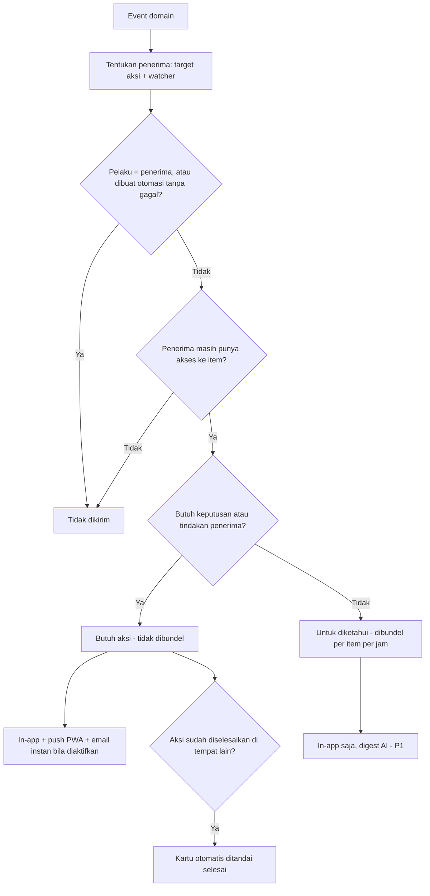

### Diagram 2 — Persetujuan AI dari Inbox

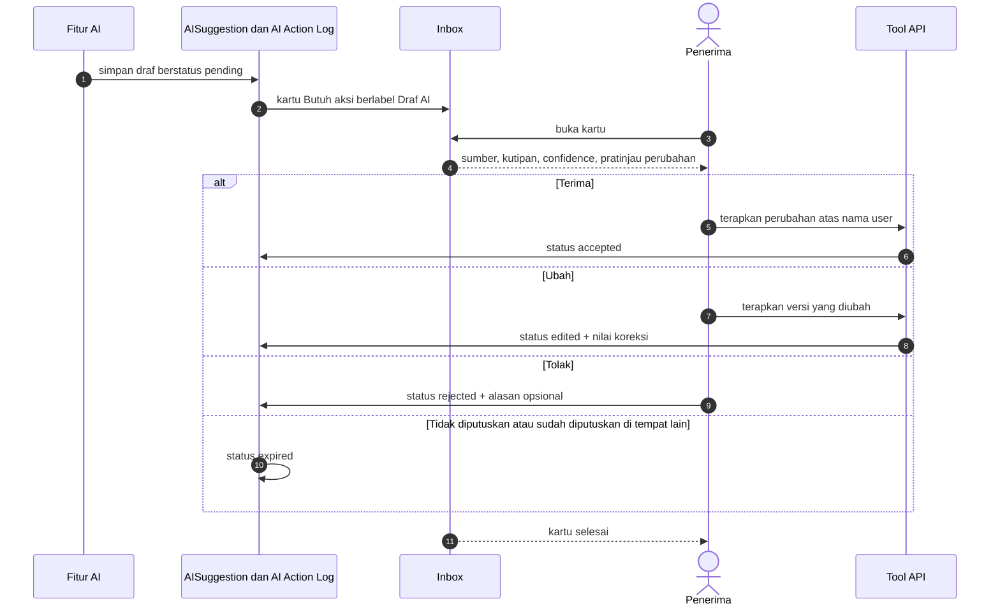

### Jenis notifikasi

| Kelompok | Jenis | Penerima | Aksi di kartu | Fase |
|---|---|---|---|---|
| **Butuh aksi** | Mention | yang di-mention | Balas, Buka | P0a |
| | Penugasan (termasuk dari rapat) | assignee baru | Terima · Tolak · Alihkan (untuk item dari rapat) | P0a / P0b |
| | Review QC | reviewer item Siap QC | QC lulus · QC tolak (buka item) | P0a |
| | Tiket menunggu triage (bundel harian; Kritis langsung) | triager | Buka Tiket › Triage | P0a |
| | Diteruskan dari triage | PM proyek tujuan | Terima · Kembalikan | P0a |
| | Minta buka ulang | assignee, PM | Buka ulang · Tolak | P0a |
| | **Hasil Rapat menunggu review** (persetujuan AI) | notulis / delegasi | Buka review | P0b |
| | Health Keluar jalur | Lead | Buka panel kenapa | P0b |
| | Pengingat retro fase · review ide | Lead / peninjau | Buka | P0b / P0a |
| | Plafon AI 80% · permintaan hapus rekaman | Admin | Buka Pengaturan › AI & Data | P0a / P0b |
| | Permintaan agen · draf status update AI | assignee / Lead | Setujui · Tolak | P1 |
| **Untuk diketahui** | Perubahan status / field item yang diikuti | watcher | — (dibundel "5 perubahan di PRJ-12") | P0a |
| | Komentar baru di item yang diikuti | watcher | Buka | P0a |
| | Tiket saya diterima / ditolak / selesai | pelapor | Buka | P0a |
| | Deadline proyek diubah · health berubah | anggota proyek | Buka Riwayat jadwal | P0b |
| | Health di-override (nilai, alasan, oleh siapa) | anggota proyek | Buka panel kenapa | P0b |
| | Recap rapat | peserta | Buka notulensi | P1 |

### Langkah

1. Event domain dipublikasikan oleh Tool API (bukan oleh UI) agar semua jalur (UI, import, AI, agen) konsisten.
2. Router menentukan penerima: **target aksi** + **watcher**. Watcher otomatis: pelapor, assignee, reviewer, yang di-mention; manual: **Ikuti / Berhenti mengikuti**.
3. Filter: tidak ada notifikasi untuk perubahan oleh diri sendiri; perubahan oleh otomasi/AI tidak dikirim kecuali gagal atau butuh keputusan; penerima tanpa akses dilewati.
4. Klasifikasi **Butuh aksi** vs **Untuk diketahui** sesuai tabel di atas.
5. **Untuk diketahui** dibundel per item per jam; **Butuh aksi** tidak pernah dibundel (kecuali tiket triage harian).
6. Kanal: in-app (semua); **push PWA** untuk Butuh aksi; **email instan** untuk Butuh aksi (default ON, bisa dimatikan) [ASUMSI A-17]. Digest email/chat, jam tenang, dan "kurangi yang seperti ini" di P1.
7. Kartu Butuh aksi **otomatis selesai** bila aksinya dilakukan di tempat lain (mis. item sudah di-QC dari Board).
8. Persetujuan AI dari Inbox mengikuti Diagram 2; kartu multi-item (Hasil Rapat) membuka layar review, bukan menyetujui dari kartu. **Pratinjau saran triage di Inbox memanggil aksi Tool API yang sama** dengan Tiket › Triage (Terima · Ubah · Tolak saran · Tolak tiket), sehingga tidak ada logika triage kedua. Aksi **Gabung duplikat, Minta info, dan Teruskan ke PM hanya tersedia di Tiket › Triage**; kartu Inbox menyediakan tautan "Buka di Tiket › Triage" (m19).
9. User bisa **Tandai dibaca**, **Tandai semua dibaca** (Untuk diketahui), dan memfilter per proyek.

### Aturan / guard

- **Inbox** hanya untuk notifikasi & persetujuan (E1).
- Persetujuan AI yang menyangkut aksi "selalu butuh manusia" tidak pernah punya tombol "Setujui semua" lintas kartu.
- Guest hanya menerima notifikasi dari item yang ia ikuti di proyek yang diundang.
- Preferensi P0 minimal: on/off per jenis + kanal (Pengaturan › Notifikasi, tabel jenis × kanal in-app/push/email).
- Status `AISuggestion` (F18): `pending` → `accepted` (Terima) · `edited` (Ubah, diterapkan dengan koreksi) · `rejected` (Tolak) · `expired` (tidak diputuskan, item sudah diputuskan di tempat lain, atau akses hilang). Metrik akurasi AI menghitung `edited` terpisah dari `rejected`.
- Notifikasi memuat ID dan judul item, bukan isi sensitif (mis. transkrip) di email/push.

### Titik AI

| Titik | ID | Level | Fase | Fallback |
|---|---|---|---|---|
| Kartu persetujuan AI (Hasil Rapat, saran triage diteruskan) | AI-2, AI-6 | L1/L2 (sesuai fitur asal) | P0a/P0b | Layar asal fitur |
| Digest harian/mingguan AI | A4§3.6 | L1 | P1 | Daftar Untuk diketahui |
| "Kenapa kamu melihat ini" + kurangi yang seperti ini | A4§3.6 | L1 | P1 | Preferensi manual |
| Persetujuan permintaan agen | D5 | L2 | P1 | — |

### Edge case

- **Satu event memicu banyak notifikasi ke orang yang sama** (mis. di-mention dan ditugaskan): digabung jadi satu kartu Butuh aksi dengan dua alasan.
- **User dikeluarkan dari proyek:** kartu Inbox dari proyek itu disembunyikan.
- **Push gagal / PWA tidak terpasang:** in-app tetap; email sebagai cadangan untuk Butuh aksi.
- **Ratusan perubahan dari import:** satu kartu Untuk diketahui "Import 120 item ke Proyek X" untuk anggota, bukan 120 kartu.

---

## W-9 Retro per fase/periode

**Tujuan:** retro menjawab bukan hanya "berapa" tetapi juga "apa yang kita ubah", dengan action item yang benar-benar menjadi pekerjaan dan ditinjau di retro berikutnya.
**Pemicu:** fase ditandai **Selesai** (pengingat ke Lead), atau PM/Lead membuka Detail Proyek › **Retro** dan memilih periode.

**Aktor:** Lead/PM (pemilik retro), Member (menambah catatan), Viewer (membaca), sistem (kartu metrik, P1: Retro AI).

### Diagram

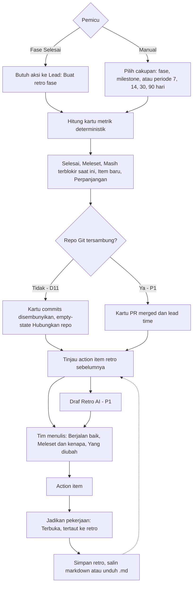

### Langkah

1. Saat fase Selesai, Lead menerima Butuh aksi **Buat retro fase X**; atau PM/Lead membuka tab Retro dan memilih cakupan (fase, milestone, atau periode 7/14/30/90 hari).
2. Sistem menghitung **kartu metrik deterministik** (P0b; nama kartu sesuai F14):
   - **Selesai** = pekerjaan yang Selesai di periode.
   - **Meleset** = (Selesai dan `completed_at` > `due_at`) ∪ (Aktif dan `due_at` < akhir periode).
   - **Masih terblokir** = snapshot **saat ini** (diberi label "saat ini").
   - **Item baru** = dibuat di periode (dibandingkan dengan kartu Selesai sebagai indikator scope creep).
   - **Perpanjangan** = `ScheduleChange` di periode (dengan kategori & alasan).
   - **Commits** disembunyikan sampai integrasi Git tersambung (D11).
3. Daftar pendukung: daftar Selesai, daftar Meleset, dan **Deadline diubah** (lama → baru, oleh, kategori, alasan).
4. Panel **Action item retro sebelumnya** menampilkan status tiap action item (mis. "3 dari 4 Selesai").
5. Tim mengisi tiga bagian: **Berjalan baik · Meleset & kenapa · Yang kita ubah**. (P1) **Retro AI** menyusun draf tiga bagian + usulan action item dengan sitasi ke item, alasan perpanjangan, dan komentar.
6. Tiap action item bisa **Jadikan pekerjaan** → Pekerjaan `kind = task`, status **Terbuka**, `source = manual`, `source_ref.retro_id`, tag `retro`; assignee & tenggat diisi manusia.
7. Lead/PM **Simpan retro** (versi tersimpan, bisa diedit dengan riwayat); opsi **Salin markdown** / **Unduh .md**.

### Aturan / guard

- Tidak ada **peringkat kontributor** (X12) dan tidak ada metrik individu di retro (R1 R13). Kontribusi tim tanpa peringkat menyusul di P1.
- Angka retro dihitung query; Retro AI (P1) hanya menarasikan dan wajib menyitasi item sumber.
- Simpan retro: PM/Lead. Catatan & komentar: Member. Viewer: baca + komentar (F3) [R3-N2]. Guest: tidak punya akses Retro [ASUMSI A-32].
- Action item retro tidak pernah dibuat otomatis; "Jadikan pekerjaan" = klik manusia per item (atau bulk dengan konfirmasi > 20).

### Titik AI

| Titik | ID | Level | Fase | Fallback |
|---|---|---|---|---|
| Kartu metrik & daftar | — (deterministik) | — | P0b | — |
| Retro AI: narasi + pola vs retro sebelumnya + usulan action item | A2-F6 | L2 (action item dikonfirmasi) | P1 | Tim menulis manual |
| Kartu PR merged & lead time dari Git | A2-F5 | — | P1 | Kartu disembunyikan |
| Cycle time median (bahan kalibrasi estimasi, D13) | D13 | — | P1 | — |

### Edge case

- **Periode tanpa aktivitas:** kartu bernilai 0 dan pesan "Tidak ada aktivitas di periode ini"; retro tetap bisa disimpan.
- **Retro fase yang belum Selesai:** diizinkan dengan label "Retro sementara".
- **Pekerjaan pindah fase setelah retro disimpan:** angka retro tersimpan sebagai snapshot saat disimpan; tampilan "hitung ulang" tersedia.
- **Proyek Completed:** retro final proyek; (P1) tawaran "Jadikan template" dari struktur nyata.

---

## W-10 Governance AI

**Tujuan:** setiap pemanggilan AI aman, terlacak, bisa dimatikan, bisa dibatalkan, dan biayanya terkendali (AI-0).
**Pemicu:** setiap fitur AI (AI-1…AI-7, dan P1/P2: ⌘K NL, agen, MCP) memanggil AI Gateway.

**Aktor:** user (atas nama siapa AI bekerja), Admin (kebijakan, plafon, kill switch), PM (toggle AI per proyek di header Detail Proyek **⋯ › Pengaturan proyek › AI**, F17 [ASUMSI A-27]), agen/klien MCP (P1), sistem (AI Gateway, Tool API, AI Action Log).

### Diagram 1 — Alur permintaan AI sampai undo

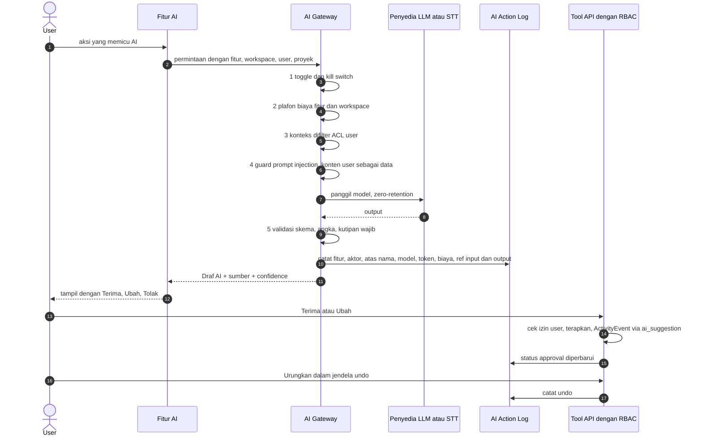

### Diagram 2 — Status fitur AI (kill switch, circuit breaker, plafon)

```mermaid
stateDiagram-v2
  state "Aktif" as g_on
  state "Peringatan plafon 80 persen" as g_warn
  state "Plafon habis - fallback" as g_cap
  state "Circuit breaker terbuka" as g_cb
  state "Mati L0" as g_off
  [*] --> g_on
  g_on --> g_warn: pemakaian bulan berjalan 80 persen
  g_warn --> g_cap: pemakaian 100 persen
  g_cap --> g_on: Admin menaikkan plafon atau periode baru
  g_warn --> g_on: periode baru
  g_on --> g_cb: error rate atau latensi melewati ambang
  g_cb --> g_on: uji ulang berhasil setelah 15 menit
  g_on --> g_off: Admin atau kill switch global
  g_warn --> g_off: Admin atau kill switch global
  g_off --> g_on: Admin mengaktifkan kembali
```

### Langkah

1. Semua fitur AI memanggil **AI Gateway** — tidak ada pemanggilan penyedia langsung dari fitur.
2. **Toggle & kill switch:** fitur mati (workspace, per proyek, atau global) → fitur langsung memakai **fallback**, tanpa error ke user. Toggle workspace ada di Pengaturan › AI & Data; toggle per proyek ada di header Detail Proyek **⋯ › Pengaturan proyek › AI** (drawer; bukan tab baru, F17).
3. **Plafon biaya:** per workspace dan per fitur, per bulan. 80% → Butuh aksi ke Admin. 100% → permintaan baru ditolak dan fitur jatuh ke fallback; pekerjaan yang sedang berjalan (mis. notulensi yang sedang diproses) diselesaikan [ASUMSI A-26].
4. **Konteks:** data diambil dengan izin user (ACL difilter saat retrieval, dan dicek ulang saat cache dibaca).
5. **Guard:** teks tiket, komentar, transkrip, OCR diperlakukan sebagai data tidak tepercaya; di P0 tidak ada fitur AI yang memegang tool tulis — semua output adalah draf.
6. **Penyedia:** zero-retention, no-training, DPA (D3); penyedia & region tercantum di Pengaturan › AI & Data.
7. **Validasi output:** skema JSON; angka harus cocok dengan fakta (AI-1); item tanpa kutipan dibuang (AI-6).
8. **AI Action Log** (append-only): waktu, fitur, aktor (user/agen/klien MCP), atas nama siapa, model + versi prompt, token & biaya, **referensi** input/output (bukan isi mentah), status approval. Konten (prompt, transkrip) disimpan terpisah dengan retensi sendiri sehingga hak hapus bisa dipenuhi tanpa merusak log (R1 R3).
9. **Draf AI di UI:** label/ikon AI, sumber/kutipan, confidence, Terima · Ubah · Tolak, plus 👍/👎 opsional untuk evaluasi.
10. **Approval:** perubahan diterapkan lewat Tool API dengan izin user; `AISuggestion.status` (`pending` · `accepted` · `edited` · `rejected` · `expired`, F18) dan log diperbarui.
11. **Undo (F15):** perubahan dari L2 bisa diurungkan dalam 24 jam — pembentukan item dari Hasil Rapat/Planner/bulk triage diurungkan sebagai satu batch (item dipindah ke Sampah) [ASUMSI A-31]. Aksi AI **L3** (P1) bisa diurungkan per aksi dalam **24 jam** dari AI Action Log. **Batch import** (non-AI, dipicu manusia) bisa diurungkan dalam **7 hari**.
12. **Circuit breaker:** error rate > 20% dalam 5 menit atau latensi p95 > 30 detik → fitur otomatis L0 selama 15 menit, banner "AI sedang tidak tersedia", Admin diberi tahu [ASUMSI A-30].
13. **Evaluasi:** golden set Bahasa Indonesia per fitur dengan ambang lulus sebelum GA (R1 R8); `AISuggestion` dipakai untuk memantau akurasi setelah rilis.

### Level default per fitur

| Fitur | ID | Level default | Bisa diturunkan ke | Bisa dinaikkan ke | Fase |
|---|---|---|---|---|---|
| Briefing harian | AI-1 | L1 | L0 | — | P0a |
| Saran triage (Jenis/Prioritas/Proyek) | AI-2 | L1 | L0 | L3 per properti, opt-in proyek | P0a (L3: P1) |
| Deteksi duplikat | AI-3 | L1 | L0 | — (tidak pernah auto-close) | P0a |
| Quick-add bahasa alami | AI-4 | L2 | L0 | — | P0a |
| Capture & draf notulensi | AI-5 | **L1** (draf baca-edit; konfirmasi formal terjadi di AI-6 L2 — Diputuskan: F5) | L0 (per workspace/event Rahasia) | — | P0b |
| Ekstraksi Hasil Rapat → item | AI-6 | L2 | L0 | — | P0b |
| Planner v1 | AI-7 | L2 | L0 | — | P0b |
| ⌘K NL read-only | — | L1 | L0 | — | P1 |
| Status update stakeholder (D14) | — | L2 + approval Lead | L0 | — | P1 |
| Agen internal (Triage/Status/Notulen/Retro) | D5 | L2 | L0 | L3 untuk komentar | P1 |
| MCP read-only (D9) | — | L1 | L0 | — | P1 |
| MCP write, aksi tulis ⌘K, agen eksternal | D9, D5 | L2/L4 di balik toggle Admin | L0 | — | P2 |

**Selalu butuh manusia (tidak terpengaruh level):** hapus, → Selesai/Dibatalkan, Ubah deadline proyek (extend), ubah role/anggota, kirim ke pihak eksternal, bulk > 20 item.

### Aturan / guard

- AI **bertindak atas nama user dengan izin user** (least privilege); agen punya identitas sendiri + human owner (P1).
- Menaikkan level di atas default hanya lewat Pengaturan › AI & Data oleh Admin, dan hanya untuk fitur yang mendukungnya.
- Event **Rahasia** dan proyek dengan AI dimatikan tidak pernah dikirim ke penyedia.
- AI Action Log bisa difilter & diekspor oleh Admin; PM melihat log proyeknya; Member melihat aksi AI atas namanya.
- Perubahan kebijakan AI (toggle, plafon, level, retensi) tercatat di audit log workspace.

### Titik AI

Alur ini adalah fondasi semua titik AI (**AI-0**, L0 kontrol Admin, **P0a**). Fallback per fitur tercantum di tabel Titik AI tiap alur W-1…W-9.

### Edge case

- **Kill switch saat draf sedang direview:** draf yang sudah ada tetap bisa dikonfirmasi (sudah di sisi produk); permintaan baru ditolak.
- **User kehilangan akses setelah draf dibuat:** Terima gagal di Tool API (403); draf ditandai `expired` (F18).
- **Permintaan hapus data pribadi:** konten di penyimpanan konten dihapus; entri log tetap dengan referensi yang sudah tidak bisa di-resolve.
- **Penyedia mengubah model/harga:** versi model tercatat per entri; golden set dijalankan ulang sebelum mengganti model default.

---

## Matriks peran & izin

**Model (D6):** role workspace **Admin / Member / Guest** + role proyek **PM / Member / Viewer** + atribut **Lead** (satu PM per proyek) + entitas **Agen** (P1, delegate).
Legenda: ✅ boleh · ⚠️ boleh dengan syarat (lihat catatan) · ❌ tidak boleh · 🧑 selalu butuh klik manusia (bukan agen/AI).

### Tabel A — Aksi tingkat workspace

| Aksi | Admin | Member | Guest | Agen (P1) |
|---|---|---|---|---|
| Pengaturan workspace (kalender kerja, ambang Health/Mandek, retensi) | ✅ | ❌ | ❌ | ❌ |
| Undang/keluarkan anggota, ubah role workspace 🧑 | ✅ | ❌ | ❌ | ❌ |
| Pengaturan › AI & Data: toggle, level, kill switch, plafon | ✅ | ❌ | ❌ | ❌ |
| Integrasi & MCP (P1) | ✅ | ❌ | ❌ | ❌ |
| Buat proyek (Kosong / Dari cerita / Dari template) | ✅ | ✅ | ❌ | ❌ |
| Lihat semua proyek (baca) | ✅ | ⚠️ ringkasan semua proyek; isi detail hanya proyek yang ia ikuti [A-34] | ⚠️ hanya proyek yang diundang | ⚠️ proyek di allowlist |
| Menu Tim & Kapasitas | ✅ agregat + individu | ⚠️ agregat + ketersediaan + dirinya (D10) | ❌ | ❌ |
| Sampah global: lihat & pulihkan | ✅ semua | ⚠️ item yang ia hapus | ❌ | ❌ |
| AI Action Log | ✅ semua + ekspor | ⚠️ aksi AI atas namanya | ❌ | ❌ |
| Triage item tanpa proyek | ✅ | ⚠️ hanya jika PM di proyek mana pun [A-09] | ❌ | ❌ |
| Promote ide lintas proyek (T13) 🧑 | ✅ | ⚠️ hanya bila PM proyek tujuan (F3) | ❌ | ❌ |
| Setujui permintaan hapus rekaman | ✅ | ❌ | ❌ | ❌ |

### Tabel B — Aksi tingkat proyek

Admin tidak otomatis menjadi anggota proyek; Admin bisa membaca semua proyek dan mengubah anggota/role untuk administrasi, selebihnya mengikuti role proyeknya bila diundang. Guest selalu dibatasi seperti kolom Guest, apa pun role proyeknya; role proyek Guest **default Viewer, maksimal Member** (Diputuskan: F3).
**Matriks ini adalah sumber tunggal izin (F3);** wireframe dan layar Pengaturan › Peran & izin (read-only) menampilkan nilai yang sama.

| Aksi | PM | Lead | Member | Viewer | Guest | Agen (P1) |
|---|---|---|---|---|---|---|
| Lihat proyek, pekerjaan, Rencana | ✅ | ✅ | ✅ | ✅ | ⚠️ pekerjaan yang ia laporkan/ikuti + Rencana ringkas | ⚠️ allowlist |
| Edit info proyek, ubah status proyek (E4) | ✅ | ✅ | ❌ | ❌ | ❌ | ❌ |
| Arsip/hapus proyek 🧑 | ✅ | ✅ | ❌ | ❌ | ❌ | ❌ |
| Kelola anggota & role proyek, pindah Lead 🧑 | ✅ | ✅ | ❌ | ❌ | ❌ | ❌ |
| Ubah deadline proyek (E2) 🧑 | ✅ | ✅ | ❌ | ❌ | ❌ | ❌ |
| Override health (E3) | ✅ | ✅ | ❌ | ❌ | ❌ | ❌ |
| Kelola fase & milestone | ✅ | ✅ | ⚠️ tautkan pekerjaan ke fase | ❌ | ❌ | ❌ |
| Buat pekerjaan | ✅ | ✅ | ✅ | ❌ | ⚠️ Laporkan tiket → Triage [R3-2] | ⚠️ sub-item draf |
| Edit field pekerjaan | ✅ | ✅ | ✅ | ❌ | ⚠️ deskripsi/lampiran item laporannya selama Triage | ⚠️ komentar, evidence, checklist |
| Triage: Terima, Gabung duplikat | ✅ | ✅ | ✅ | ❌ | ❌ | ❌ (P1: saran saja) |
| Triage: Tolak tiket… (→ Dibatalkan, F2) | ✅ | ✅ | ⚠️ item laporannya sendiri | ❌ | ⚠️ tarik laporannya sendiri | ❌ |
| Triage: Tolak saran (buang saran AI, item tetap Triage) | ✅ | ✅ | ✅ | ❌ | ❌ | ❌ |
| Promote ide (T13 / konversi) 🧑 | ✅ (lintas proyek: PM proyek tujuan; Admin juga boleh, lihat Tabel A) | ✅ | ❌ | ❌ | ❌ | ❌ |
| Mulai, Kirim ke QC (T4–T6) | ✅ | ✅ | ✅ | ❌ | ❌ | ⚠️ item yang didelegasikan |
| QC lulus → Selesai 🧑 | ✅ (reviewer atau bila reviewer kosong) | ✅ | ⚠️ bila ditunjuk reviewer | ❌ | ❌ | ❌ |
| Batalkan → Dibatalkan 🧑 | ✅ | ✅ | ⚠️ item laporannya di Triage/Terbuka | ❌ | ❌ | ❌ |
| Buka ulang | ✅ | ✅ | ✅ | ❌ | ⚠️ Minta buka ulang [A-07] | ❌ |
| Pulihkan dari Dibatalkan | ✅ | ✅ | ❌ | ❌ | ❌ | ❌ |
| Hapus pekerjaan (ke Sampah) 🧑 | ✅ | ✅ | ⚠️ item buatannya (pembuat item, F3) | ❌ | ❌ | ❌ |
| Bulk > 20 item 🧑 | ✅ konfirmasi | ✅ konfirmasi | ✅ konfirmasi | ❌ | ❌ | ❌ |
| Komentar & mention | ✅ | ✅ | ✅ | ✅ (Diputuskan: F3, A-28) | ⚠️ hanya item yang ia laporkan/ikuti (F3) | ✅ |
| Komentar Guest vs Viewer — cakupan item (perbedaan disengaja, F3) | semua item proyek | semua item proyek | semua item proyek | semua item proyek yang bisa ia lihat | hanya item yang ia laporkan atau ikuti; tidak bisa mention anggota di luar item itu | item yang didelegasikan (P1) |
| Import CSV | ✅ | ✅ | ✅ | ❌ | ❌ | ❌ |
| Export CSV (P0a, KEEP, F5) / retro .md (tercatat audit) | ✅ | ✅ | ✅ | ✅ | ❌ | ❌ |
| Delegasi item ke agen (P1) | ✅ | ✅ | ⚠️ item miliknya | ❌ | ❌ | — |
| Buat event & jadi notulis | ✅ | ✅ | ✅ | ❌ | ❌ | ❌ |
| Rekam/upload capture rapat | ⚠️ notulis + consent | ⚠️ notulis + consent | ⚠️ notulis + consent | ❌ | ❌ | ❌ |
| Konfirmasi Hasil Rapat (D4) | ⚠️ bila notulis; edit kapan saja | ⚠️ bila notulis; edit kapan saja | ⚠️ bila notulis/delegasi | ❌ | ❌ | ❌ (P1 Notulen Agent: draf saja) |
| Terima/Tolak/Alihkan penugasan dari rapat | ✅ | ✅ | ✅ (sebagai PIC) | ❌ | ❌ | ❌ |
| Dengar audio mentah rapat | ✅ | ✅ | ⚠️ bila notulis/pembuat event | ❌ | ❌ | ❌ |
| Baca transkrip | ✅ | ✅ | ⚠️ bila peserta | ⚠️ bila peserta | ❌ | ❌ |
| Baca notulensi terkonfirmasi | ✅ | ✅ | ✅ | ✅ | ⚠️ rapat yang ia hadiri | ⚠️ allowlist |
| Buat & simpan Retro | ✅ | ✅ | ⚠️ tambah catatan | ⚠️ baca + komentar (F3) [R3-N2] | ❌ | ❌ (P1 Retro Agent: draf) |
| Lihat beban individu anggota (D10) | ✅ | ✅ | ⚠️ dirinya + agregat | ⚠️ agregat | ❌ | ❌ |
| Pakai AI pembuat draf (AI-4, AI-7) | ✅ | ✅ | ✅ | ❌ | ⚠️ AI-4 untuk Laporkan tiket [A-29] | — |
| ⌘K NL read-only (P1) | ✅ | ✅ | ✅ | ✅ | ❌ [A-29] | — |
| Setujui draf status update AI (P1, D14) 🧑 | ⚠️ | ✅ | ❌ | ❌ | ❌ | ❌ |
| Matikan AI di proyek ini (⋯ › Pengaturan proyek › AI, F17) | ✅ [A-27] | ✅ | ❌ | ❌ | ❌ | ❌ |

---

## Roadmap per alur

| Alur | P0a | P0b | P1 | P2 |
|---|---|---|---|---|
| **W-0** Navigasi & persona | Sidebar IA final, ⌘K keyword, ＋ Buat cepat (teks, AI-4), PWA bottom bar Beranda · Pekerjaan · ＋ · Rapat · Inbox (F4), Tampilan Guest, pengalihan link lama | 5 tab Detail Proyek lengkap (Rencana, Retro) | ⌘K NL read-only, capture foto/voice di ＋ | Aksi tulis ⌘K, native app, kustomisasi Beranda |
| **W-1** State machine | Enum & guard T1–T13, flag turunan, Sampah 30 hari, optimistic locking, migrasi data, **Export CSV** (KEEP, ikut filter + kolom, tercatat audit, F5) | — | Agen internal delegate, AI evidence check, ringkasan thread | Agen eksternal/coding, sub-item bertingkat |
| **W-2** Intake & triage | Laporkan tiket in-app (composer + ＋ Tiket), Tiket › Triage/Berjalan, AI-2, AI-3, bulk triage, import sebagai Tiket | Item Rapat tanpa proyek/PIC masuk Triage | Portal/email intake (F5), saran assignee, auto-apply L3 opt-in | Readiness check |
| **W-3** Siklus Rapat | — | Consent & retensi, capture (rekam/upload/foto/tempel/ketik), AI-5 (L1), AI-6, review & konfirmasi, item D7 (prioritas default Sedang), **Gabung manual dengan item yang ada** (F5), notifikasi PIC, panel "Dari rapat sebelumnya" | Diarization, saran duplikat, Agenda AI, recap, Decision Log, tracker pertanyaan, sinkron kalender | Bot ikut rapat, notulen resmi butuh persetujuan peserta |
| **W-4** Planner | Form Kosong (perbaikan E4) | AI-7 cerita teks → draf → review → create, simpan & pakai template | Input dokumen/voice/repo, saran assignee, kalibrasi cycle time, template bawaan & otomatis | — |
| **W-5** Rencana & jadwal | — | Tab Rencana (fase, milestone, `task.phaseId`), Ubah deadline E2 + impact preview deterministik, Health v1 E3 + override, Ringkasan AI 3 kalimat | Saran re-plan AI, Health v2, baseline & scope creep | Monte Carlo P50/P85, risk register |
| **W-6** Ide → pekerjaan | Catat ide, AI-3, review berkala, promote A/B | Promote C via Planner | Pecah jadi sub-item AI | Skor & pengelompokan ide AI, dukungan/vote |
| **W-7** Briefing & Fokus | Mesin sinyal, Fokus Saya + chip, AI-1 harian/mingguan, KPI strip PM (KPI ke-4: Item menunggu Triage) | Sinyal rapat Menunggu review & health di briefing; KPI ke-4 → Proyek Berisiko/Keluar jalur (F6) | Kalimat alasan per item, sinyal Berisiko, briefing via email/chat, KPI ke-4 → Kapasitas tim % | — |
| **W-8** Notifikasi & Inbox | Inbox minimal (Butuh aksi / Untuk diketahui), watcher, bundling, preferensi, push PWA, email Butuh aksi | Kartu Hasil Rapat, penugasan dari rapat, health, pengingat retro | Digest AI, jam tenang, "kenapa kamu melihat ini", persetujuan agen | — |
| **W-9** Retro | — | Kartu metrik deterministik, catatan tiga bagian, action item → pekerjaan, simpan & .md | Retro AI, kartu Git, cycle time, kontribusi tanpa peringkat | — |
| **W-10** Governance AI | AI-0: gateway, toggle & kill switch, plafon, AI Action Log, `AISuggestion`, golden set, circuit breaker | Kebijakan retensi audio, provider STT/OCR | Dashboard biaya, redaksi PII lanjutan, MCP read-only, identitas agen | MCP write, BYO key/self-host |
| **Tim & Kapasitas** (menu) [R3-m14] | Item aktif · Telat per orang (deterministik, visibilitas D10) | — | Kapasitas tertimbang (KPI ke-4 "Kapasitas tim %", F6) | — |

---

## Peta alur → layar wireframe

Setiap alur dipetakan ke ID layar di dua file wireframe: **S1–S13** di `wireframes/01-beranda-proyek.html` dan **P1–P19** di `wireframes/02-pekerjaan-rapat-tim.html` (P17–P19 adalah layar baru dari F10/F11). Bila wireframe dan dokumen ini berbeda, nilai di dokumen ini yang berlaku (Addendum F); layar wajib disesuaikan.

**Daftar layar**

| ID | Layar | ID | Layar |
|---|---|---|---|
| S1 | App shell & navigasi (sidebar, bottom bar PWA) | P1 | Pekerjaan › Tugas saya (List) |
| S2 | Beranda (Member): Briefing + Fokus Saya | P2 | Pekerjaan › Board & Table |
| S3 | Beranda (PM): Briefing + KPI strip | P3 | Pekerjaan › Timeline (ringkas) |
| S4 | Inbox (Butuh aksi / Untuk diketahui, persetujuan AI) | P4 | Pekerjaan › Tiket (sub-tab Triage \| Berjalan) |
| S5 | Daftar Proyek | P5 | Pekerjaan › Ide & Pengembangan |
| S6 | Proyek baru (modal pilihan jalur) | P6 | Detail Work Item |
| S7 | Planner AI "Proyek dari cerita" (AI-7) | P7 | Composer ＋ Buat cepat (termasuk mode Laporkan tiket) |
| S8 | Detail Proyek › Overview | P8 | Import wizard |
| S9 | Detail Proyek › Rencana (+ Riwayat jadwal) | P9 | Rapat & Events › daftar |
| S10 | Modal Ubah deadline (E2, F7) | P10 | Detail event + Capture + consent |
| S11 | Detail Proyek › Tim | P11 | Draf notulensi AI (AI-5) |
| S12 | Detail Proyek › Retro (+ Catatan retro P0) | P12 | Review & Konfirmasi Hasil Rapat (AI-6) |
| S13 | Drawer Health & override | P13 | Tim & Kapasitas |
| | | P14 | Command palette ⌘K |
| | | P15 | Pengaturan › AI & Data |
| | | P16 | Mobile PWA: Fokus Saya · Capture rapat · Approval Inbox |
| | | P17 | Tampilan Guest (baru, F10) |
| | | P18 | Sampah (baru, F11) |
| | | P19 | Pengaturan › Notifikasi & Peran dan izin (baru, F11) |

**Pemetaan alur**

| Alur | Layar file 01 | Layar file 02 | Langkah/aturan yang digambar |
|---|---|---|---|
| **W-0** Navigasi & persona | S1, S2, S3, S5 | P14, P16, P17, P19 | Sidebar IA final, bottom bar PWA (F4), ⌘K keyword, perjalanan Guest (P17), menu sesuai role |
| **W-1** State machine | S8 (chip Aktif/Telat) | P1, P2, P3, P6, P8, P18 | Transisi T1–T13 di detail item & Board (drag guard), Buka ulang, Pulihkan, Hapus → Sampah, status awal import |
| **W-2** Intake & triage | S4 (pratinjau triage di Inbox) | P4, P6, P7, P8, P17 | Laporkan tiket (P7, ＋ Tiket), Triage \| Berjalan + filter (P4), Tolak saran vs Tolak tiket (F2), Sumber item import (F19), Guest memantau tiket (P17) |
| **W-3** Siklus Rapat | S2, S3 (Agenda), S4 (Hasil Rapat menunggu review) | P9, P10, P11, P12, P16 | Consent & varian eksternal (F20), capture, draf notulensi L1, review per item + Gabung manual P0b, D7 prioritas default Sedang, capture mobile |
| **W-4** Planner | S5, S6, S7 | — | Tiga jalur Proyek baru, review per item, Buat proyek hanya item Diterima/Diubah (m16) |
| **W-5** Rencana & jadwal | S8, S9, S10, S13 | P3 | Fase & milestone (Menunggu · Tercapai · Meleset), Ubah deadline (F7), Riwayat jadwal, Health v1 dengan penyebut Aktif (F9), override + notifikasi |
| **W-6** Ide → pekerjaan | — | P5, P6, P7 | Catat ide, review berkala, Promote A/B/C (T13), izin promote lintas proyek (F3) |
| **W-7** Briefing & Fokus Saya | S2, S3 | P1, P16 | Briefing 3–5 poin, Fokus Saya + chip alasan, KPI strip PM per gelombang (F6), Fokus di HP |
| **W-8** Notifikasi & Inbox | S4 | P16, P19 | Butuh aksi / Untuk diketahui, persetujuan AI (Diagram 2), approval Inbox mobile, preferensi jenis × kanal |
| **W-9** Retro | S12 | — | Kartu Selesai · Meleset · Masih terblokir · Item baru · Perpanjangan (F14), Catatan retro P0 tiga bagian, agregat tim saja (F8) |
| **W-10** Governance AI | S2, S7, S8 (blok Draf AI) | P6, P15 | Pengaturan › AI & Data (level per fitur, AI-5 = L1), toggle per proyek di ⋯ › Pengaturan proyek › AI (F17), tab Aktivitas item |
| **Tim & Kapasitas** (beban tim) [R3-m14] | S11 | P13 | Item aktif · Telat per orang (P0a, deterministik); beban individu hanya untuk ybs + PM/Lead, anggota lain agregat + ketersediaan (D10); kapasitas tertimbang = P1 |
| **Matriks peran & izin** | S11 | P17, P18, P19 | Kelola anggota & role, Tampilan Guest, Sampah per role, Peran & izin read-only (F3) |

---

## Asumsi & pertanyaan terbuka

### Asumsi yang diambil dokumen ini

| ID | Asumsi | Alur | Dasar / alasan |
|---|---|---|---|
| A-01 | Tidak ada tim QA dengan backlog sendiri; pekerjaan QA = tag `qa` + reviewer di Siap QC | W-1 | DECISIONS D1 [ASUMSI] |
| A-02 | Penyedia LLM/STT zero-retention + no-training + DPA; review legal (UU PDP, DPIA) sebelum P0b | W-3, W-10 | DECISIONS D3 [ASUMSI] |
| A-03 | **Diputuskan: F3.** Guest: role proyek default Viewer (maks. Member), tetapi selalu boleh Laporkan tiket di proyek yang diundang (tidak bisa mencatat ide) [R3-2]; komentar hanya pada item yang ia laporkan/ikuti | W-0, W-2, W-6 | D6 tidak merinci Guest → ditetapkan Addendum F3 |
| A-04 | Proyek Completed/Cancelled read-only; item aktif harus dibatalkan atau dipindah dulu | W-0, W-1 | R1 C8 |
| A-05 | **Diputuskan: F4.** Navigasi PWA = bottom bar **Beranda · Pekerjaan · ＋ · Rapat · Inbox**; "Lainnya" lewat menu avatar di header | W-0 | D15 + Addendum F4 |
| A-06 | Bulk perubahan status bisa diurungkan 24 jam sebagai satu batch. **Diputuskan: F15** untuk jendela lain: batch **import** = 7 hari (dipicu manusia), aksi AI **L3** = 24 jam | W-1, W-10 | Pola undo A4 + Addendum F15 |
| A-07 | Guest/pelapor tidak reopen langsung; memakai "Minta buka ulang" | W-1 | Akuntabilitas status di anggota proyek |
| A-08 | **Diputuskan: F19.** Sub-tab Tiket › Triage = antrean tunggal semua item berstatus Triage (semua sumber) **kecuali `kind = idea`** (ditinjau di Ide & Pengembangan); Berjalan = tiket `source = intake` yang Aktif. Import punya pilihan Sumber item: Import (default) · Tiket (intake) | W-2, W-6 | D1 + R1 K4, K9 + Addendum F19 |
| A-09 | Triager item tanpa proyek = Admin + semua PM | W-2 | Tidak diatur DECISIONS |
| A-10 | Tidak ada komentar internal di P0; pelapor Guest melihat semua komentar item laporannya | W-2 | Menjaga P0 ramping |
| A-11 | Akses audio: notulis, pembuat event, PM/Lead; transkrip: peserta internal + PM/Lead; Guest: notulensi terkonfirmasi saja | W-3 | A1 §6.1 |
| A-12 | Audio tanpa konfirmasi dihapus maks. 45 hari setelah capture; pengingat review hari ke-2, 7, 14 | W-3 | D3 hanya mengatur kasus terkonfirmasi |
| A-13 | Batas 3 jam per capture rekaman | W-3 | Biaya & keandalan upload |
| A-14 | Planner: cerita min. ±30 kata, maks. 60 pekerjaan per draf, draf tersimpan 14 hari | W-4 | Batas biaya & kualitas |
| A-15 | Item dari Planner: `source = manual` + `source_ref.planner_draft_id` | W-4 | Glosarium Sumber tidak punya "Planner" |
| A-16 | Bobot ranking Fokus Saya (tabel W-7), bisa diatur workspace | W-7 | A1 §4.1 tanpa angka |
| A-17 | Email instan untuk Butuh aksi aktif di P0 (default ON, bisa dimatikan) | W-8 | Guest & PWA tanpa push butuh kanal cadangan |
| A-18 | Proyeksi selesai = sisa ÷ throughput 14 hari; "+10%" = 10% durasi proyek (mulai → deadline) | W-5 | E3 tidak mendefinisikan basis 10% |
| A-19 | Override health kedaluwarsa otomatis 7 hari | W-5 | A2-F2 |
| A-20 | Health menjadi Keluar jalur → Butuh aksi untuk Lead; lainnya Untuk diketahui | W-5, W-8 | Mencegah notifikasi bising |
| A-21 | Review ide default 2 minggu sekali per proyek | W-6 | note.md "ditinjau berkala" |
| A-22 | Promote ide ke proyek lewat Planner (opsi C) | W-6 | Ide besar sering setara proyek |
| A-23 | Kategori Hasil Rapat tidak termasuk "Ide"; ide dicatat manual dari notulensi | W-3, W-6 | D-list kategori A1 §4.3 |
| A-24 | Briefing batch untuk user aktif 14 hari terakhir; Perbarui maks. 3× per hari | W-7 | Biaya AI (R1 R4) |
| A-25 | **Diputuskan: F6.** KPI strip PM: Item aktif, Bug kritis, Tenggat terlewat minggu ini + KPI ke-4 per gelombang: P0a "Item menunggu Triage" → P0b "Proyek Berisiko/Keluar jalur" → P1 "Kapasitas tim %" | W-0, W-7 | Layanan kapasitas P1 (D10), Health v1 di P0b (E3) + Addendum F6 |
| A-26 | Plafon 100%: permintaan baru ditolak + fallback; pekerjaan berjalan diselesaikan | W-10 | A4 §6.1 |
| A-27 | PM boleh mematikan (bukan menaikkan) fitur AI di proyeknya. Lokasi toggle **Diputuskan: F17** — header Detail Proyek ⋯ › Pengaturan proyek › AI | W-10 | A4 §6.3 "toggle per proyek" + Addendum F17 |
| A-28 | **Diputuskan: F3 (diubah).** Viewer boleh membaca **dan berkomentar**, tetapi tidak mengubah field/status; Guest berkomentar hanya pada item yang ia laporkan/ikuti | Matriks | Semula "Viewer tanpa komentar" (note.md); diubah agar Viewer internal tidak punya hak lebih sedikit dari Guest (R2 m18) |
| A-29 | Guest hanya boleh AI-4 untuk Laporkan tiket; tidak memakai ⌘K NL | Matriks | Risiko kebocoran data lintas proyek |
| A-30 | Circuit breaker: error > 20% dalam 5 menit atau p95 > 30 detik → L0 selama 15 menit | W-10 | R1 R7 |
| A-31 | Undo batch L2 (Hasil Rapat, Planner, bulk triage) 24 jam → item ke Sampah. **Diputuskan: F15** untuk jendela lain: aksi AI L3 = 24 jam per aksi; batch import (non-AI) = 7 hari | W-10 | Pola undo A4 §6.2 + Addendum F15 |
| A-32 | Guest tidak punya akses tab Retro | W-9 | Retro bersifat internal tim |
| A-33 | Mandek = > 7 hari **kalender** tanpa aktivitas, bisa diubah ke hari kerja per workspace | W-1, W-7 | DECISIONS D1 (R1 K10 menyarankan hari kerja) |
| A-34 | Member workspace melihat ringkasan semua proyek (nama, status, health, Lead) di Proyek › Semua; detail hanya bila anggota | Matriks | note.md filter "semua proyek" |

### Pertanyaan terbuka (tidak memblokir; dibawa dari DECISIONS + baru)

1. Apakah ada tim QA dengan backlog sendiri? (D1)
2. Apakah "ticket" dulu dipakai sebagai jenis pekerjaan, bukan jalur masuk? (D1)
3. Kebijakan data & legal untuk rekaman rapat — termasuk retensi transkrip default workspace dan batas 45 hari untuk audio tanpa konfirmasi (D3, A-12).
4. Kebijakan visibilitas beban kerja individu (D10).
5. Apakah sudah ada integrasi GitHub/GitLab? (D11)
6. Ukuran tim & anggaran MVP (D12, D17).
7. Preferensi bahasa label (D16).
8. **Baru:** apakah perlu komentar internal (tidak terlihat Guest) di P0, atau cukup P1? (A-10)
9. **Baru:** apakah portal intake publik tanpa login dibutuhkan, atau cukup Guest yang diundang? (W-2, P1)
10. **Baru:** siapa yang boleh men-triage item tanpa proyek — Admin + semua PM, atau peran "Triager" khusus? (A-09)
11. **Baru:** apakah email instan untuk Butuh aksi diterima di P0, mengingat target mengurangi kanal dorong? (A-17)
12. ~~**Baru:** apakah Viewer boleh berkomentar? (A-28)~~ **Diputuskan: F3** — Viewer boleh berkomentar; Guest hanya pada item yang ia laporkan/ikuti.

Keputusan Addendum F lain yang menutup celah dokumen ini (bukan pertanyaan terbuka sebelumnya): **F1** T13 Promote ide + prioritas default Sedang untuk item rapat · **F2** Tolak saran vs Tolak tiket · **F5** fase Export CSV, intake portal/email, Gabung manual, AI-5 = L1 · **F7** dialog Ubah deadline · **F9** penyebut Health · **F12** istilah Aktif · **F14** status milestone & kartu retro · **F18** enum `AISuggestion.status` · **F20** capture rapat eksternal & pergeseran milestone.
