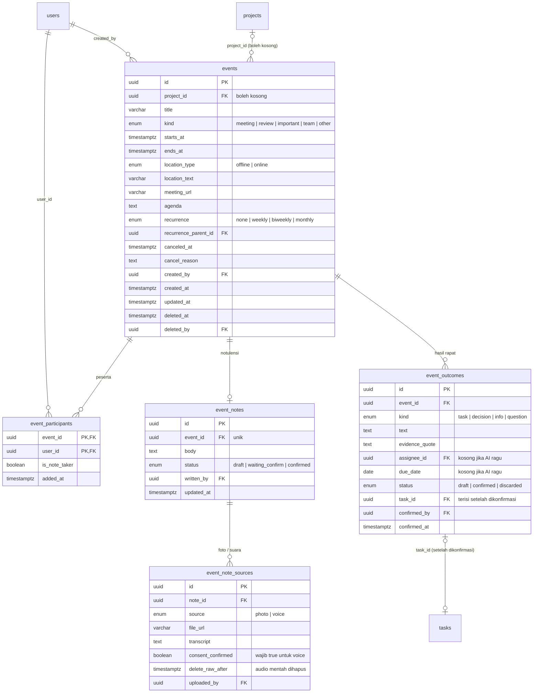

# Diskusi & Rencana Kerja: Wireframe 05 · Events (per role)

> Tanggal: 9 Oktober 2026, diperbarui 12 Oktober 2026. Status: **wireframe PM, Admin, dan Member selesai** (Daftar ringkas, Event baru dua tahap, Kalender satu warna). Semua keputusan di bawah adalah **usulan Claude** yang belum dikonfirmasi user, kecuali disebut lain.
> Lokasi wireframe: Penpot, file **PM-New**, halaman **WIREFRAME NICO**, bagian **Events** di dalam grup `A · Member — Wireframe`, `B · Project Manager — Wireframe`, `C · Admin — Wireframe`.
> Sumber: `note.md` › Menu Events (spesifikasi lama), `tahapan-proyek/02-analisis/hasil-orchestrasi/analysis/A1-dashboard-tim-events.md` §2.3, §3, §4.3 (analisis), dan ERD modul 01–03 (`tahapan-proyek/03-desain/erd/user-profile.md`, `tahapan-proyek/03-desain/erd/project.md`, `tahapan-proyek/03-desain/erd/task.md`). Kalau bertentangan, dokumen ini yang berlaku.
> ERD Events belum digambar di Penpot dan belum punya `tahapan-proyek/03-desain/erd/event.md`. Usulan tabel ada di §4 dan baru dipindah ke `tahapan-proyek/03-desain/erd/event.md` setelah user setuju.

## 1. Keputusan (usulan)

| # | Keputusan | Asal |
|---|---|---|
| 1 | Menu samping tetap **Events**. Judul halaman "Events" dengan subjudul "Rapat dan acara tim" | Claude |
| 2 | Dua tampilan: **Daftar (default)** dan **Kalender** (Bulan, tombol Minggu). **Grid dihapus** karena event berbasis waktu (A1 E6) | Claude + A1 |
| 3 | Daftar dikelompokkan per jadwal, sama dengan Tugas: **Hari ini · Besok · Minggu ini · Nanti**. Chip **Akan datang saja** menyala secara default. Kalau dimatikan, muncul kelompok **Sudah lewat** | note.md + Claude |
| 4 | **Tag diganti Jenis acara** dengan daftar tetap: Rapat · Review · Acara penting · Acara tim · Lainnya. Alasan: tag di modul 03 berlaku per proyek, sedangkan event bisa tanpa proyek. Daftar tetap juga lebih mudah untuk segmen awam. Filter dan "kelompokkan per jenis" memakai jenis ini | Claude (perlu dikonfirmasi, note.md minta tag) |
| 5 | Status **dihitung dari waktu**: Akan datang · Berlangsung · Selesai. Hanya **Dibatalkan** yang diisi manual (dengan alasan) | A1 E10 |
| 6 | Event **boleh tanpa proyek**. Proyek **wajib** kalau hasil rapat mau dijadikan tugas | A1 E11 |
| 7 | Notulensi punya tiga cara: **Ketik**, **Foto ✦**, **Suara ✦**. Foto dan suara diubah AI menjadi **draf teks**. Sebelum merekam suara, user wajib mencentang "Peserta sudah diberi tahu rapat ini direkam". Alur suara diperjelas di #16 | note.md + A1 risiko privasi |
| 8 | **Hasil rapat**: AI memilah notulensi menjadi **Tugas · Keputusan · Informasi · Pertanyaan**. Tiap item dikonfirmasi, diubah, atau dibuang oleh manusia. **Tidak ada tugas yang dibuat tanpa klik Konfirmasi**. Tugas dari hasil rapat masuk ke `tasks` proyek itu | note.md + A1 §4.3 |
| 9 | Kalau AI tidak yakin (nama atau tanggal), kolomnya **dikosongkan**, bukan ditebak, dan diberi tanda "Isi dulu" | A1 risiko halusinasi |
| 10 | Kartu event menampilkan **badge notulensi**: Belum ada · Draf · Menunggu dikonfirmasi · Dikonfirmasi (N tugas) | A1 E8 |
| 11 | Hapus event = pindah ke **Sampah 30 hari**, sama dengan Proyek dan Tugas | Claude |
| 12 | **Ulangi**: Tidak · Tiap minggu · Tiap 2 minggu · Tiap bulan. **Pengingat**: 1 hari dan 30 menit sebelum (in-app). Sinkron Google Calendar ditunda | Claude + A1 N18 (ditunda) |
| 13 | **Form Event baru dibuat dua tahap** (untuk segmen awam dan lansia). Layar awal (③a) hanya berisi **Judul, Tanggal + jam, Lokasi, Peserta**. Tombol **+ Tambah detail lain** membuka sisanya di halaman yang sama (③b): Jenis acara, Proyek, Agenda, Ulangi, Pengingat. Nilai bawaan kalau dilewati: Jenis = Rapat, Proyek = kosong, Ulangi = Tidak, Pengingat = 1 hari & 30 menit sebelum (in-app). Nilai bawaan yang tersembunyi tetap ditulis di layar awal ("Sudah diatur otomatis…"). Peserta dipilih dari anggota tim; kalau proyek dipilih, anggota proyek itu disarankan lebih dulu | User (ide dua tahap + Peserta di layar awal) + Claude |
| 14 | **Daftar Events dibuat ringkas** (segmen awam dan lansia). Toolbar: tab **Akan datang · Sudah lewat**, kolom cari, tombol **Filter ▾** (Proyek, Jenis, Kelompokkan ada di dalamnya), toggle Daftar/Kalender, **+ Event baru**. Kartu hanya berisi jam, judul, satu baris "jam · tempat" (+ "Selesai" bila sudah lewat hari itu), dan satu tombol. Jenis, proyek, peserta, pembuat, dan badge notulensi dipindah ke halaman detail ④. Panel **Filter ▾** (layar ①b) berisi Proyek, Jenis acara (Semua · Rapat · Review · Acara penting · Acara tim · Lainnya), Kelompokkan (Jadwal · Jenis), serta Atur ulang dan Terapkan; di Member pilihan Proyek hanya proyek yang ia ikuti. Tombol **Periksa hasil** hanya muncul pada event yang notulensinya menunggu konfirmasi. Istilah "Saring" tidak dipakai (user: terdengar aneh), tetap **Filter** | User + Claude |
| 15 | **Kalender (②) mengikuti Daftar yang ringkas**: semua blok event satu warna abu-abu (warna per jenis dan keterangan "Warna blok = jenis acara" dihapus karena Jenis tidak lagi tampil di Daftar), diganti petunjuk "Ketuk acara untuk melihat detailnya." Toggle Bulan/Minggu dipertahankan | User + Claude |
| 16 | **Rekam suara terjadi saat rapat berlangsung, bukan sesudahnya.** Tombol **Mulai rekam** aktif **sejak jam mulai sampai rapat selesai** (sebelum jam mulai nonaktif, setelah selesai tidak bisa merekam lagi). Mulai rekam butuh centang izin; saat merekam ada timer, **Jeda**, dan **Selesai merekam**. **Ketik dan Foto bisa dipakai kapan saja.** Sesudah rapat selesai, pengganti merekam adalah **Unggah rekaman lain** (file mp3, m4a, wav). Sumber suara hanya **mikrofon perangkat dan unggah file**; untuk rapat online, suara diputar lewat speaker. Integrasi langsung ke Google Meet/Zoom ditunda. Layar rekam memberi peringatan "Biarkan layar menyala" dan menyimpan rekaman setiap 30 detik | User (12 Okt) + Claude |
| 17 | **Layar dibuat satu pekerjaan per layar** karena ④b/④c/⑤/⑥ semula terlalu padat untuk awam dan lansia (penilaian Claude, belum diuji ke pengguna). **Mode rekam** (④b, ④c) tetap memakai **top bar dan menu samping** (Events aktif) seperti layar lain, tetapi isinya tanpa kartu info: hanya satu tombol besar. **Sesudah rapat dibuat tiga langkah**: ⑤a Rekaman selesai → ⑤b Periksa teksnya → ⑥ Tugas dari rapat. Ketik, Foto, dan Unggah file menjadi "Cara lain" yang kecil. Teks minimal 14 px dan tidak ada tombol hanya berupa ikon | User (12 Okt, "kerjakan semua") + Claude |
| 18 | **⑥ disederhanakan.** Layar hanya berisi daftar **Tugas yang akan dibuat** (judul, untuk siapa, tenggat, tombol **Ubah** dan **Buang**) dan satu tombol besar **Buat 2 tugas**. Keputusan, Informasi, dan Pertanyaan dilipat jadi baris "Ringkasan rapat ▾" yang hanya dibaca dan ikut tersimpan saat tugas dibuat. Peringatan duplikat ("Mirip #16") dan pengisian tenggat dipindah ke dialog Ubah. Aturan #8 tetap berlaku: **tidak ada tugas yang dibuat sebelum Buat tugas ditekan**. Bagi Member yang bukan pembuat event: tombol diganti "Menunggu dikonfirmasi oleh Nico" | User + Claude |
| 19 | **Hapus dan Batalkan event berulang** menanyakan dua pilihan besar: **Hanya yang ini** (kejadian lain tetap berjalan) dan **Semua yang berulang** (kejadian ini dan seterusnya; untuk Hapus, seluruh rangkaian masuk Sampah sebagai satu item). Event yang tidak berulang memakai kotak ⑧ yang lama. Lihat `08-sampah.md` #12 | User (13 Okt) |

## 2. Matriks izin

Peran aplikasi dari `users.role`. "Pengelola" = `project_members.role = manager` di proyek yang terhubung.

| Aksi | Admin | Project Manager | Member |
|---|---|---|---|
| Lihat event | Semua | Semua event proyek (sama dengan izin lihat proyek) + event tanpa proyek yang ia ikuti/buat | Event yang ia ikuti sebagai peserta, event di proyek yang ia ikuti, event tanpa proyek yang ia ikuti/buat |
| **+ Event baru** | ✅ | ✅ | ✅ (note.md: "semua anggota bisa menambah event"). Proyek yang bisa dipilih hanya proyek tempat ia Anggota/Pengelola, bukan Pemantau |
| Ubah, Batalkan, Hapus event | ✅ semua | Event yang ia buat, atau event di proyek yang ia kelola | Hanya event yang ia buat |
| Tulis notulensi (Ketik/Foto/Suara) | ✅ | Pembuat, peserta, Pengelola proyek | Jika ia peserta |
| Konfirmasi hasil rapat (membuat tugas) | ✅ | Pembuat event atau Pengelola proyek | Hanya event yang ia buat. Di event orang lain: hanya baca, dengan keterangan siapa yang mengonfirmasi |

**Dikonfirmasi user (12 Oktober 2026):** hak Ubah, Batalkan, dan Hapus **tidak** diperluas. PM hanya bisa mengubah event yang ia buat atau event di proyek yang ia kelola; event tanpa proyek buatan Member hanya bisa diubah pembuatnya dan Admin. Alternatif "PM boleh mengubah semua event tanpa proyek" ditolak.

## 3. Layar (sama nomornya di ketiga role)

Frame 1280×800, gaya lo-fi abu-abu sama dengan grup 01–04. Menu samping: Beranda, Inbox, Proyek, Tugas, **Events** aktif, Tim, Sampah, Pengaturan (+ Pengguna untuk Admin).

| No | Layar | Isi |
|---|---|---|
| ① | Events · Daftar | Judul, **+ Event baru**, toggle Daftar/Kalender, tab Akan datang · Sudah lewat, cari, **Filter ▾** (Proyek, Jenis, Kelompokkan). Kartu: jam, judul, "jam · tempat", satu tombol (Lihat, atau Periksa hasil bila notulensi menunggu). Lihat keputusan #14 |
| ② | Events · Kalender | Oktober 2026, hari ini ditandai, event sebagai blok berwarna per jenis, tombol Bulan/Minggu |
| ③a | Event baru (ringkas) | Judul*, Tanggal*, Jam mulai–selesai, Lokasi (Tatap muka / Online + teks atau tautan), Peserta (dari anggota tim). Baris "Sudah diatur otomatis: pengingat 1 hari & 30 menit sebelum · tidak berulang". Tombol **+ Tambah detail lain ▾**. Batal · **Simpan** |
| ③b | Event baru (detail terbuka) | Isi ③a di kolom kiri. Kolom kanan: Jenis acara, Proyek (opsional), Agenda, Ulangi, Pengingat. Tombol **Sembunyikan detail ▴**. Batal · **Simpan** |
| ④ | Detail · Akan datang | ← Kembali, judul, status, jenis, waktu, lokasi, proyek, agenda, peserta, pembuat, dibuat/diperbarui. Tombol Ubah · ⋯ (Batalkan, Hapus). Bagian Notulensi: Ketik dan Foto aktif, **Suara abu-abu** dengan keterangan "Rekam suara aktif sejak jam mulai (14.00) sampai rapat selesai" |
| ④b | Mode rekam · Siap merekam | **Tetap ada top bar dan menu samping, isi hanya satu pekerjaan.** Judul rapat, tautan "Lihat detail rapat", centang izin besar, tombol **● Mulai rekam** (abu-abu sampai dicentang), "Cara lain": Ketik catatan, Foto papan tulis. Catatan mikrofon dan rapat online. Contoh pukul 14.05 |
| ④c | Mode rekam · Sedang merekam | Dengan top bar dan menu samping: "Sedang merekam", timer besar, gelombang suara, izin tercentang, **Jeda** dan **Selesai merekam**, peringatan "Biarkan layar menyala. Rekaman disimpan setiap 30 detik" |
| ⑤a | Langkah 1 · Rekaman selesai | Dengan top bar dan menu samping. Indikator "Langkah 1 dari 3". Kartu rekaman (pemutar, durasi), tombol besar **Ubah jadi teks ✦**, "Cara lain": Ketik sendiri, Foto catatan, Unggah rekaman |
| ⑤b | Langkah 2 · Periksa teksnya | "Langkah 2 dari 3". Kotak teks besar berisi draf AI yang bisa diubah, keterangan penulis, **Simpan dan keluar**, tombol besar **Lanjut ›** ("Berikutnya: AI memilah tugas dari teks ini") |
| ⑥ | Langkah 3 · Tugas dari rapat | "Langkah 3 dari 3". Dua kartu tugas dengan **Ubah** dan **Buang** (penanda "Isi tenggat dulu" bila kosong), baris "Ringkasan rapat ▾", tombol besar **Buat 2 tugas** |
| ⑦ | Detail · Hasil dikonfirmasi | Badge "Dikonfirmasi · 3 tugas (1 selesai)", daftar tugas yang dibuat (#nomor + status), keputusan, informasi, pertanyaan terbuka |
| ⑧ | Modal Batalkan + Modal Hapus | Batalkan: alasan wajib, peserta diberi tahu. Hapus: "Pindah ke Sampah 30 hari" |
| ⑧b | Modal Hapus dan Batalkan · event berulang | Dua kotak yang sama, ditambah pilihan **Hanya yang ini** / **Semua yang berulang** (radio besar). Contoh PM dan Admin: Sprint review Atlas (tiap 2 minggu, Jum 9 Okt); Member: Latihan presentasi (tiap minggu, buatan Dodi) |
| ⑨ | Events kosong | "Belum ada event. Rapat atau acara yang Anda ikuti akan muncul di sini." + Event baru |

### Beda per role

| Layar | Member (Dodi) | PM (Nico) | Admin (Ayu) |
|---|---|---|---|
| ① ② | Hanya event yang ia ikuti / proyeknya (tanpa Presentasi PT Sinar; kelompok "Besok" hilang). Tombol di kartu Rapat harian: **Lihat hasil** (bukan Periksa hasil, karena ia hanya membaca) | Semua proyek | Semua, filter "Semua proyek" |
| ③ | Proyek: hanya Atlas (proyek yang ia ikuti) | Semua proyek yang ia ikuti | Semua proyek |
| ④ | Event buatan Rina: tanpa Ubah/⋯, keterangan "Hanya pembuat, pengelola proyek, atau Admin yang bisa mengubah" | Lengkap | Lengkap |
| ⑤a ⑤b | Bisa menulis (ia peserta, notulis) | ✅ | ✅ |
| ⑥ | Hanya baca: tombol diganti "Menunggu dikonfirmasi oleh Nico" | Lengkap | Lengkap |
| ⑦ | ✅ | ✅ | ✅ |
| ⑧ | Hanya untuk event buatannya (contoh: Latihan presentasi) | ✅ | ✅ |
| ⑨ | ✅ (contoh layar kosong) | – | – |

### Lokasi di Penpot

Bagian `<Role> · Events` (**11360** × 4300, dilebarkan dari 8080 untuk mode rekam dan wizard tiga langkah) ada di dalam tiap grup role pada y relatif 14500, di bawah bagian Tugas. Tinggi ketiga grup diubah menjadi 19000.

| Baris | Isi |
|---|---|
| 1 (y 600) | ① Daftar · ② Kalender · ③a Event baru (ringkas) · ③b Event baru (detail terbuka) · catatan matriks izin (digeser ke ujung kanan, `hidden`; di Member digeser ke baris 2) · ⑨ Kosong (Member saja, x 6680) |
| 2 (y 1900) | ④ Detail akan datang · ④b Mode rekam siap · ④c Mode rekam merekam · ⑤a Langkah 1 · ⑤b Langkah 2 · ⑥ Langkah 3 · ⑦ Hasil dikonfirmasi (x 120, 1760, 3400, 5040, 6680, 8320, 9960) |
| 3 (y 3200) | ⑧ Modal Batalkan + Hapus · catatan alur notulensi & hasil rapat · ①b Daftar dengan Filter ▾ terbuka (x 5040) |

Panah: ① ↔ ② (Daftar/Kalender), ① → ③a (+ Event baru), ③a → ③b (Tambah detail lain), ③a → Tersimpan, ① → ④ (klik kartu), ① → ⑥ (Periksa hasil), ④ → ④b (jam mulai tiba) → ④c (centang izin, Mulai rekam) → ⑤a (Selesai merekam) → ⑤b (Ubah jadi teks) → ⑥ (Lanjut) → ⑦ (Buat tugas), ④ → ⑧ (⋯ Batalkan/Hapus), ⑦ → menu Tugas.

Admin = salinan PM ditambah menu **Pengguna** (badge 2) di menu samping dan catatan akses semua event.

## 4. Usulan tabel (belum masuk ERD)

Nilai yang **dihitung**, tidak disimpan: status Akan datang/Berlangsung/Selesai (dari `starts_at`, `ends_at`, `canceled_at`), badge notulensi (dari `event_notes.status` dan jumlah `event_outcomes` bertipe task).

## 5. Data dummy (hari ini Rabu 7 Oktober 2026, pukul 10.00)

| Event | Waktu | Lokasi | Proyek | Jenis | Pembuat | Peserta | Notulensi |
|---|---|---|---|---|---|---|---|
| Rapat harian Atlas | 7 Okt 09.00–09.15 (Selesai) | Online · Google Meet | Atlas | Rapat | Nico | Nico, Rina, Dodi | Menunggu dikonfirmasi |
| Review desain onboarding | 7 Okt 14.00–15.00 | Ruang Rapat 2 | Atlas | Review | Rina | Nico, Rina, Dodi | Belum ada |
| Presentasi progres ke PT Sinar | 8 Okt 10.00–11.00 | Online · Zoom | Portal Klien PT Sinar | Acara penting | Nico | Nico, Rina | Belum ada |
| Sprint review Atlas | 9 Okt 13.00–14.00, tiap 2 minggu | Ruang Rapat 1 | Atlas | Review | Nico | Nico, Rina, Dodi | – |
| Latihan presentasi | 13 Okt 15.00–16.00 | Ruang Rapat 3 | Atlas | Rapat | Dodi | Dodi, Rina | – |
| Syukuran ulang tahun kantor | 15 Okt 16.00–17.00 | Pantry lantai 3 | – | Acara tim | Ayu | Semua | – |
| Kickoff Atlas | 1 Okt 10.00–11.00 (Selesai) | Ruang Rapat 1 | Atlas | Rapat | Nico | Nico, Rina, Dodi | Dikonfirmasi · 3 tugas (1 selesai) |

Hasil rapat "Rapat harian Atlas" (draf AI dari suara):
- Tugas: Perbaiki halaman login sebelum Jumat → Rina · 9 Okt · Atlas
- Tugas: Siapkan data uji setelah SSO beres → Dodi · tenggat **kosong** ("AI tidak yakin, isi dulu")
- Keputusan: Rilis staging diundur ke Senin 12 Okt
- Informasi: Server staging maintenance Kamis malam
- Pertanyaan: Apakah klien perlu demo sebelum rilis? → untuk Nico

## 6. Pertanyaan terbuka untuk user

1. Setuju **Jenis acara (daftar tetap)** menggantikan tag bebas? (§1 #4)
2. Member boleh membuat event (note.md bilang ya). Apakah juga boleh mengonfirmasi hasil rapat event buatannya sendiri sehingga membuat tugas untuk orang lain?
3. Audio mentah disimpan berapa lama? Usulan: dihapus 30 hari setelah notulensi dikonfirmasi.
4. Peserta di layar awal (③a) dipilih dari anggota tim, karena proyek belum dipilih. Apakah Member boleh mengundang siapa saja di tim, atau hanya anggota proyek yang ia ikuti? (§1 #13)
