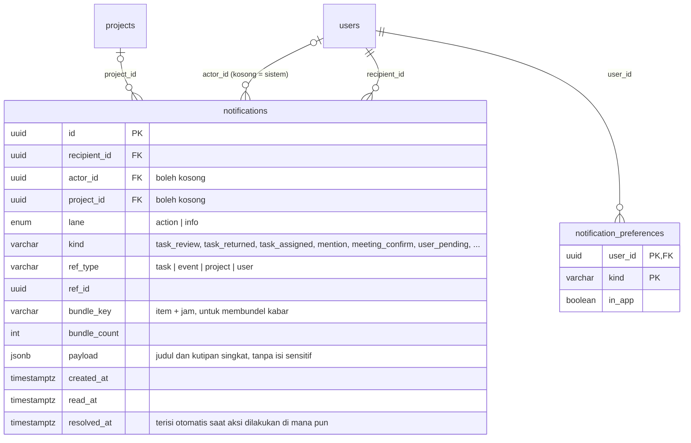

# Diskusi & Rencana Kerja: Wireframe 06 · Inbox (per role)

> Tanggal: 12 Oktober 2026. Status: **wireframe PM, Admin, dan Member selesai** (tiga layar per role: ① Perlu Anda tanggapi, ② Kabar terbaru, ③ Kosong). Keputusan bertanda "User" sudah dikonfirmasi, sisanya **usulan Claude**.
> Lokasi wireframe: Penpot, file **PM-New**, halaman **WIREFRAME NICO**, bagian **`<Role> · Inbox`** (8080 × 1620) di dalam grup `A · Member`, `B · Project Manager`, `C · Admin`, pada y relatif 19000, di bawah bagian Events.
> Sumber: `tahapan-proyek/02-analisis/hasil-orchestrasi/deliverables/workflow.md` W-8 (Notifikasi & Inbox), `analysis/A4-ai-landscape-crosscutting.md` §3.6, `analysis/A1-dashboard-tim-events.md` N5/R13, `orchestration/DECISIONS.md` E1, `tahapan-proyek/03-desain/erd/diskusi/03-tugas.md` (tindak lanjut Inbox), `tahapan-proyek/03-desain/erd/diskusi/05-events.md`. Kalau bertentangan, dokumen ini yang berlaku.
> ERD Inbox belum digambar di Penpot dan belum punya `tahapan-proyek/03-desain/erd/notification.md`. Usulan tabel ada di §4.

## 1. Keputusan

| # | Keputusan | Asal |
|---|---|---|
| 1 | **Satu tempat.** Inbox adalah satu-satunya halaman pemberitahuan. Lonceng di top bar hanya menampilkan angka dan, kalau diklik, langsung membuka Inbox (tidak ada panel lonceng terpisah). Beranda tidak punya feed aktivitas sendiri | User |
| 2 | Nama menu tetap **Inbox** (tidak diganti "Kotak masuk") | User |
| 3 | Angka di lonceng **sama** dengan angka badge menu Inbox: jumlah kartu **Perlu Anda tanggapi**. Kabar yang belum dibaca tidak ikut dihitung (diberi titik hitam saja) | Claude |
| 4 | Dua tab dengan bahasa polos: **Perlu Anda tanggapi** (= "Butuh aksi" di W-8) dan **Kabar terbaru** (= "Untuk diketahui") | Claude |
| 5 | Kartu: inisial pengirim, satu kalimat tebal, isi atau kutipan, keterangan "proyek · waktu", dan **satu tombol aksi**. Titik hitam di kiri = belum dibaca | Claude |
| 6 | Kartu **Perlu Anda tanggapi** tidak dibundel dan hilang otomatis kalau aksinya sudah dilakukan di tempat lain (W-8 langkah 7). Kartu **Kabar terbaru** dibundel per item ("5 perubahan di tugas #12") dan dikelompokkan Hari ini · Kemarin | W-8 + Claude |
| 7 | Perubahan yang dibuat user sendiri tidak muncul di Inbox-nya | W-8 langkah 3 |
| 8 | **Tandai semua dibaca** hanya ada di tab Kabar terbaru | Claude |
| 9 | Keadaan kosong: "Semua beres" dan tombol **Lihat Kabar terbaru** | Claude |
| 10 | **Tidak ada filter** di Inbox untuk sekarang (W-8 langkah 9 menyebut filter per proyek; ditunda supaya layar tetap sederhana untuk awam dan lansia) | Claude |
| 11 | Kanal tahap ini: **di aplikasi saja**. Push PWA, email, digest, dan jam tenang ditunda (A4 P1). Layar Pengaturan › Notifikasi belum digambar | Claude |
| 12 | Tombol Terima/Tolak penugasan **tidak dipakai**, karena modul Tugas tidak punya alur itu. Kartu penugasan memakai **Lihat tugas** | Claude |
| 13 | **Pengajuan cuti** menjadi jenis kartu baru. Ini **satu-satunya kartu dengan dua tombol** (**Setujui** dan **Tolak**), karena keputusan tidak bisa diwakili satu tombol. Kartu menampilkan rentang tanggal, jumlah hari, dan jumlah tugas yang jatuh tempo saat cuti | User (14 Okt) |

## 2. Jenis pemberitahuan

| Tab | Jenis | Penerima | Tombol | Asal |
|---|---|---|---|---|
| Perlu Anda tanggapi | Tugas diminta diperiksa | Pemeriksa (Pengelola atau Admin) | Periksa | 03-tugas #7 |
| | **Pengajuan cuti** | Pengelola proyek pemohon atau Admin (cuti PM: Admin) | Setujui · Tolak | 09-pengaturan #9 |
| | Tugas dikembalikan | Yang mengerjakan | Lihat tugas | 03-tugas |
| | Ditunjuk mengerjakan tugas baru | Yang ditunjuk | Lihat tugas | 03-tugas |
| | Di-mention (`@nama`) | Yang disebut | Balas | `task_comments` |
| | Hasil rapat menunggu konfirmasi | Pembuat event, Pengelola proyek, atau Admin | Periksa hasil | 05-events #8 |
| | Pengguna baru menunggu persetujuan | Admin | Buka Pengguna | 01-login |
| | Pemeriksa jatuh ke Admin (proyek hanya punya 1 Pengelola) | Semua Admin | Periksa | 03-tugas #7 |
| Kabar terbaru | Tugas disetujui atau selesai | Yang mengerjakan dan pembuat tugas | Lihat | 03-tugas A1 |
| | **Cuti disetujui atau ditolak** | Pemohon | Lihat | 09-pengaturan #9 |
| | Komentar baru di tugas yang diikuti | Pengikut | Lihat | W-8 |
| | Beberapa perubahan di satu tugas (dibundel per jam) | Pengikut | Lihat | W-8 |
| | Diundang ke acara · acara diubah atau dibatalkan | Peserta | Lihat | 05-events |
| | Pengingat acara (1 hari dan 30 menit sebelum) | Peserta | Lihat | 05-events #12 |
| | Ditambahkan ke proyek atau peran berubah | Yang bersangkutan | Lihat | 02-proyek |
| | Tenggat proyek diperpanjang | Anggota proyek | Lihat | 02-proyek |

## 3. Layar (sama nomornya di ketiga role)

Frame 1280×800, gaya lo-fi abu-abu sama dengan grup 01–05. Menu samping: Beranda, **Inbox** aktif (badge angka), Proyek, Tugas, Events, Tim, Sampah, Pengaturan (+ Pengguna untuk Admin). Lonceng di top bar membawa badge angka yang sama.

| No | Layar | Isi |
|---|---|---|
| ① | Inbox · Perlu Anda tanggapi (default) | Judul Inbox, tab **Perlu Anda tanggapi (N)** aktif · Kabar terbaru. Kartu dengan tombol gelap (Periksa, Periksa hasil, Balas, Lihat tugas, Buka Pengguna) |
| ② | Inbox · Kabar terbaru | Tab Kabar terbaru aktif, tombol **Tandai semua dibaca**. Kelompok Hari ini dan Kemarin, tombol **Lihat** (garis tepi), titik hitam untuk yang belum dibaca |
| ③ | Inbox · Kosong (semua beres) | Tab Perlu Anda tanggapi (0), tanpa badge. "Semua beres", "Tidak ada yang perlu Anda tanggapi saat ini.", tombol Lihat Kabar terbaru |

Panah: ① → ② (tab Kabar terbaru). Dua catatan di bawah ① dan ②: arti lonceng dan badge, serta aturan pembundelan.

### Isi contoh per role (hari ini Rabu 7 Oktober 2026, pukul 10.00)

| | Perlu Anda tanggapi | Kabar terbaru |
|---|---|---|
| **PM (Nico)** | Dodi minta periksa #17 · Hasil rapat harian Atlas menunggu konfirmasi · Rina menyebut Nico di #12 · Dodi mengajukan cuti 14–16 Okt | Rina berkomentar di #14 · Rina mengundang ke Review desain onboarding · 5 perubahan di #12 · Dodi menyelesaikan #9 · Ayu membuat acara Syukuran · Cuti Nico disetujui Ayu |
| **Member (Dodi)** | Nico mengembalikan #12 · Nico menunjuk Dodi mengerjakan #14 · Rina menyebut Dodi di #12 | Diundang ke Review desain onboarding · Hasil Rapat harian Atlas menunggu Nico · Nico menyetujui #9 · Ditambahkan ke Proyek Atlas · Cuti Dodi disetujui Nico |
| **Admin (Ayu)** | 2 pengguna baru menunggu persetujuan (Sari Wulandari, Budi Santoso) · Jadi pemeriksa #22 karena proyek hanya punya 1 Pengelola · Nico menyebut Ayu di #20 · Nico mengajukan cuti 19–21 Okt | Nico menjawab komentar Ayu di #20 · 5 perubahan di #22 · Dijadikan Pemantau Proyek Portal Klien PT Sinar |

Nama tugas dan orang diambil dari wireframe Tugas dan Events. Tugas #20 dan #22 adalah data contoh baru khusus Inbox.

## 4. Usulan tabel (belum masuk ERD)

Nilai yang **dihitung**, tidak disimpan: angka badge = jumlah `notifications` milik user dengan `lane = action` dan `resolved_at` kosong. Kartu hilang dari tab Perlu Anda tanggapi saat `resolved_at` terisi. `notification_preferences` baru dipakai setelah layar Pengaturan › Notifikasi dibuat.

## 5. Pertanyaan terbuka untuk user

1. Setuju angka badge hanya menghitung kartu **Perlu Anda tanggapi** (bukan semua yang belum dibaca)? (§1 #3)
2. Kartu Kabar terbaru disimpan berapa lama? Usulan: 30 hari, sesudah itu dihapus.
3. Kartu "Pengguna baru menunggu persetujuan" dikirim ke **semua Admin**, dan hilang bagi semuanya begitu salah satu Admin memutuskan. Setuju?
4. Pengingat acara 30 menit sebelum mulai bersifat mendesak. Cukup sebagai kartu di Kabar terbaru, atau perlu kartu khusus di Perlu Anda tanggapi?
