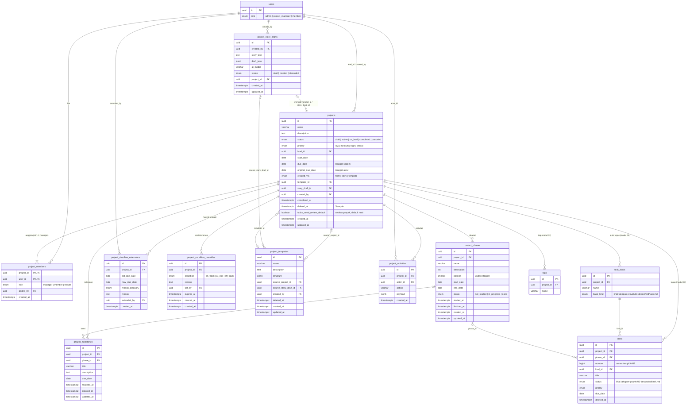

# ERD: Proyek

> Tanggal: 7 Oktober 2026. Cakupan: modul **02 · Proyek** (daftar proyek, proyek baru lewat form/cerita AI/template, detail proyek dengan tab Ringkasan · Tugas · Tahapan · Anggota, perpanjang tenggat).
> Gambar ERD ada di Penpot, file **PM-New**, halaman **ERD NICO**, grup `02 · Proyek — ERD`. Wireframe di halaman **WIREFRAME NICO**, grup `02 · Proyek — Wireframe`. Nomor layar ①–⑫ di dokumen ini sama dengan nomor frame di wireframe.
> Diskusi dan keputusan: `tahapan-proyek/03-desain/erd/diskusi/02-proyek.md`. Tabel `users` ada di `tahapan-proyek/03-desain/erd/user-profile.md`.
> Diperbarui 7 Oktober 2026: tasks dipindah ke tahapan-proyek/03-desain/erd/task.md, tambah jenis tugas default (keputusan modul 03 · Tugas).
> Diperbarui 8 Oktober 2026: tambah `projects.tasks_need_review_default` (setelan "Tugas baru perlu diperiksa"), `needs_review` dihapus dari jenis tugas di struktur template.
> Diperbarui 7 Oktober 2026 (sinkron dengan 03 · Tugas): ejaan `cancelled` → `canceled`, izin Setujui/Kembalikan tugas, rumus progres dipertegas, AI memilih jenis tugas di draf cerita (A5).

## Alur yang didukung

1. **Daftar proyek (①②)**: Admin dan Project Manager melihat semua proyek. Member hanya melihat proyek yang ada di `project_members` miliknya. Proyek di Sampah (`deleted_at` terisi) tidak tampil.
2. **Proyek baru (③)**: hanya Admin dan Project Manager. Tiga cara:
   - **Isi form sendiri (④)**: langsung membuat baris `projects` (`created_via = form`).
   - **Ceritakan proyeknya (⑤⑥)**: cerita disimpan di `project_story_drafts`, AI mengisi `draft_json`. User memeriksa dan mengubah draf, lalu klik **Buat proyek**. Baru saat itu sistem membuat `projects`, `project_phases`, `project_milestones`, dan `tasks` dari draf (`created_via = story`). AI memilih jenis tiap tugas dari 3 jenis default (Tugas, Bug, Ide) dan jenisnya tampil di draf supaya bisa dikoreksi (asumsi A5), lalu mengisi `project_story_drafts.project_id` dan `status = created`. Tidak ada yang tersimpan ke proyek sebelum tombol Buat diklik.
   - **Pakai template (⑦)**: struktur dari `project_templates.structure` disalin ke proyek baru, tanggal relatif dihitung dari tanggal mulai yang dipilih (`created_via = template`).
3. Pembuat proyek otomatis masuk `project_members` sebagai `manager` dan menjadi Lead (`projects.lead_id`). Sistem juga membuat 3 jenis tugas default di `task_kinds`: Tugas, Bug, Ide. Proyek dari template/cerita memakai jenis dari struktur tersebut (lihat `tahapan-proyek/03-desain/erd/task.md`).
4. **Detail proyek (⑧–⑪)**: header + 4 tab. Nilai progres dan kondisi **dihitung**, tidak disimpan (lihat "Nilai yang dihitung").
5. **Perpanjang tenggat (⑫)**: menambah baris `project_deadline_extensions`, lalu `projects.due_date` diganti tenggat baru. `original_due_date` tidak pernah diubah.
6. Kejadian penting tingkat proyek dicatat di `project_activities` untuk "Aktivitas terakhir" di tab Ringkasan.

## Hak akses

| Aksi | Admin | Project Manager | Member |
|---|---|---|---|
| Lihat tombol **+ Proyek baru** dan membuat proyek (form, cerita, template) | ✅ | ✅ | ❌ tombol disembunyikan |
| Lihat daftar & detail proyek | Semua | Semua | Hanya yang diikuti |
| Ubah info proyek, status, tahapan, milestone, anggota, perpanjang tenggat, ganti kondisi manual, pindah ke Sampah | ✅ semua proyek | ✅ hanya jika `manager` di proyek itu | ✅ hanya jika `manager` di proyek itu |
| Tambah/ubah tugas di proyek | Rincian izin tugas ada di `tahapan-proyek/03-desain/erd/task.md` › Hak akses | | |
| Setujui / Kembalikan tugas | ✅ | Hanya jika `manager` di proyek itu | Hanya jika `manager` di proyek itu |
| Simpan proyek sebagai template | ✅ | ✅ | ❌ |

Aturan:
- Peran aplikasi (`users.role`: admin · project_manager · member) **terpisah** dari peran di proyek (`project_members.role`: manager · member · viewer).
- **Lead** = satu pengelola utama yang tampil di header. Lead wajib ber-`role = manager` di proyek itu.
- Proyek **wajib punya minimal 1 pengelola**. Pengelola terakhir tidak bisa dikeluarkan atau diturunkan perannya. Aturan ini dijaga di service, bukan constraint database.

## Diagram



## Enum

| Enum | Nilai | Label UI |
|---|---|---|
| `project_status` | draft, active, on_hold, completed, canceled | Draf, Berjalan, Ditunda, Selesai, Dibatalkan |
| `project_priority` | low, medium, high, critical | Rendah, Sedang, Tinggi, Kritis |
| `project_member_role` | manager, member, viewer | Pengelola, Anggota, Pemantau |
| `project_condition` | on_track, at_risk, off_track | ✓ Lancar, ! Perlu perhatian, ⏰ Terlambat |
| `project_created_via` | form, story, template | – |
| `phase_status` | not_started, in_progress, done | Belum mulai, Berjalan, Selesai |
| `extension_reason` | scope_added, external_dependency, estimate_missed, resources, other | Scope bertambah, Menunggu pihak luar, Perkiraan meleset, Kekurangan orang, Lainnya |
| `story_draft_status` | draft, created, discarded | – |

Semua `id` bertipe `uuid` dengan default `gen_random_uuid()`. Semua `created_at` / `updated_at` bertipe `timestamptz` dengan default `now()`.

## Tabel `projects`: data utama proyek

| Kolom | Tipe | Null | Default | Keterangan |
|---|---|---|---|---|
| id | uuid | tidak | `gen_random_uuid()` | PK |
| name | varchar(150) | tidak | | Nama proyek |
| description | text | ya | | Deskripsi |
| status | `project_status` | tidak | `'draft'` | Diubah manual. Saat dibuat hanya boleh `draft` atau `active` (dijaga di service) |
| priority | `project_priority` | tidak | `'medium'` | |
| lead_id | uuid | tidak | | FK → `users.id`. Pengelola utama di header. Wajib `manager` di `project_members` |
| start_date | date | ya | | Tanggal mulai |
| due_date | date | ya | | Tenggat **saat ini**, berubah saat diperpanjang |
| original_due_date | date | ya | | Tenggat **awal**, tidak pernah diubah setelah terisi |
| created_via | `project_created_via` | tidak | | Cara proyek dibuat |
| template_id | uuid | ya | | FK → `project_templates.id`, `ON DELETE SET NULL` |
| story_draft_id | uuid | ya | | FK → `project_story_drafts.id`, `ON DELETE SET NULL` |
| created_by | uuid | tidak | | FK → `users.id` |
| completed_at | timestamptz | ya | | Diisi saat status menjadi `completed` |
| deleted_at | timestamptz | ya | | Terisi = di Sampah. Bisa dipulihkan 30 hari (asumsi A2) |
| tasks_need_review_default | boolean | tidak | `false` | Setelan **"Tugas baru perlu diperiksa"**. Menjadi nilai awal `tasks.needs_review` saat tugas dibuat. Diubah Pengelola/Admin di Pengaturan proyek (⑫ modul Tugas). Tugas yang sudah ada tidak ikut berubah. Aturan lengkap: `tahapan-proyek/03-desain/erd/task.md` › Aturan tombol Perlu diperiksa |
| created_at | timestamptz | tidak | `now()` | |
| updated_at | timestamptz | tidak | `now()` | |

CHECK: `due_date >= start_date`.

## Tabel `project_members`: anggota dan peran di proyek

| Kolom | Tipe | Null | Default | Keterangan |
|---|---|---|---|---|
| project_id | uuid | tidak | | PK bersama, FK → `projects.id`, `ON DELETE CASCADE` |
| user_id | uuid | tidak | | PK bersama, FK → `users.id`, `ON DELETE CASCADE` |
| role | `project_member_role` | tidak | `'member'` | Pengelola, Anggota, atau Pemantau |
| added_by | uuid | ya | | FK → `users.id`. Siapa yang menambahkan |
| created_at | timestamptz | tidak | `now()` | Waktu bergabung |

PK: `(project_id, user_id)`.

## Tabel `project_phases`: tahapan proyek (stepper di tab Tahapan)

| Kolom | Tipe | Null | Default | Keterangan |
|---|---|---|---|---|
| id | uuid | tidak | `gen_random_uuid()` | PK |
| project_id | uuid | tidak | | FK → `projects.id`, `ON DELETE CASCADE` |
| name | varchar(100) | tidak | | Contoh: Perencanaan, Pengembangan |
| description | text | ya | | |
| position | smallint | tidak | | Urutan di stepper. UNIQUE per proyek |
| start_date | date | ya | | |
| end_date | date | ya | | |
| status | `phase_status` | tidak | `'not_started'` | Diubah lewat tombol Mulai / Selesaikan tahapan |
| started_at | timestamptz | ya | | |
| finished_at | timestamptz | ya | | |
| created_at | timestamptz | tidak | `now()` | |
| updated_at | timestamptz | tidak | `now()` | |

## Tabel `project_milestones`: titik penting proyek

| Kolom | Tipe | Null | Default | Keterangan |
|---|---|---|---|---|
| id | uuid | tidak | `gen_random_uuid()` | PK |
| project_id | uuid | tidak | | FK → `projects.id`, `ON DELETE CASCADE` |
| phase_id | uuid | ya | | FK → `project_phases.id`, `ON DELETE SET NULL`. Tahapan tempat milestone ditampilkan |
| title | varchar(150) | tidak | | |
| description | text | ya | | |
| due_date | date | tidak | | Target tanggal |
| reached_at | timestamptz | ya | | Terisi = tercapai |
| created_at | timestamptz | tidak | `now()` | |
| updated_at | timestamptz | tidak | `now()` | |

Status milestone **dihitung**: **Tercapai** (`reached_at` terisi), **Terlewat** (`due_date` < hari ini dan belum tercapai), **Menunggu** (selain itu).

## Tabel `project_deadline_extensions`: riwayat perpanjangan tenggat

| Kolom | Tipe | Null | Default | Keterangan |
|---|---|---|---|---|
| id | uuid | tidak | `gen_random_uuid()` | PK |
| project_id | uuid | tidak | | FK → `projects.id`, `ON DELETE CASCADE` |
| old_due_date | date | tidak | | Tenggat sebelum diperpanjang |
| new_due_date | date | tidak | | Tenggat baru. CHECK `new_due_date > old_due_date` (asumsi A3) |
| reason_category | `extension_reason` | tidak | | Wajib (asumsi A3) |
| reason | text | tidak | | Alasan bebas, wajib |
| extended_by | uuid | tidak | | FK → `users.id` |
| created_at | timestamptz | tidak | `now()` | |

## Tabel `project_condition_overrides`: kondisi yang diganti manual

| Kolom | Tipe | Null | Default | Keterangan |
|---|---|---|---|---|
| id | uuid | tidak | `gen_random_uuid()` | PK |
| project_id | uuid | tidak | | FK → `projects.id`, `ON DELETE CASCADE` |
| condition | `project_condition` | tidak | | Kondisi pilihan pengelola |
| reason | text | tidak | | Alasan, ditampilkan sebagai "kenapa" di header |
| set_by | uuid | tidak | | FK → `users.id` |
| expires_at | timestamptz | ya | | Kosong = berlaku sampai dibatalkan |
| cleared_at | timestamptz | ya | | Terisi = override dibatalkan, kembali ke hasil hitungan |
| created_at | timestamptz | tidak | `now()` | |

Override yang berlaku = baris **terbaru** yang `cleared_at` kosong dan belum melewati `expires_at`.

## Tabel `project_story_drafts`: draf dari "Ceritakan proyeknya"

| Kolom | Tipe | Null | Default | Keterangan |
|---|---|---|---|---|
| id | uuid | tidak | `gen_random_uuid()` | PK |
| created_by | uuid | tidak | | FK → `users.id` |
| story_text | text | tidak | | Cerita asli dari user |
| draft_json | jsonb | ya | | Hasil AI: info proyek, tahapan, milestone, tugas awal. Ikut diperbarui saat user mengedit draf |
| ai_model | varchar(100) | ya | | Model AI yang menyusun draf |
| status | `story_draft_status` | tidak | `'draft'` | `created` setelah Buat proyek, `discarded` jika dibuang |
| project_id | uuid | ya | | FK → `projects.id`, `ON DELETE SET NULL`. Terisi setelah Buat proyek |
| created_at | timestamptz | tidak | `now()` | |
| updated_at | timestamptz | tidak | `now()` | |

Alasan disimpan: draf tidak hilang saat halaman ditutup, ada jejak hasil AI vs edit manusia, dan bisa jadi sumber template.

## Tabel `project_templates`: template proyek

| Kolom | Tipe | Null | Default | Keterangan |
|---|---|---|---|---|
| id | uuid | tidak | `gen_random_uuid()` | PK |
| name | varchar(150) | tidak | | |
| description | text | ya | | |
| structure | jsonb | tidak | | Struktur proyek dengan tanggal relatif (asumsi A4) |
| source_project_id | uuid | ya | | FK → `projects.id`, `ON DELETE SET NULL`. Proyek asal |
| source_story_draft_id | uuid | ya | | FK → `project_story_drafts.id`, `ON DELETE SET NULL`. Draf cerita asal |
| created_by | uuid | tidak | | FK → `users.id` |
| deleted_at | timestamptz | ya | | Template dihapus (soft delete) |
| created_at | timestamptz | tidak | `now()` | |
| updated_at | timestamptz | tidak | `now()` | |

Bentuk `structure` (hari dihitung dari tanggal mulai proyek):

```json
{ "duration_days": 60,
  "phases": [{ "name": "Perencanaan", "start_day": 0, "duration_days": 10,
    "milestones": [{ "title": "Rancangan disetujui", "day": 10 }],
    "tasks": [{ "title": "Kumpulkan kebutuhan", "kind": "Tugas", "base_kind": "task", "priority": "high", "estimate_hours": 8 }] }],
  "tasks_need_review_default": false,
  "task_kinds": [{ "name": "Tugas", "base_kind": "task" },
                 { "name": "Bug", "base_kind": "issue" }] }
```

## Tabel `project_activities`: aktivitas tingkat proyek

Sumber "Aktivitas terakhir" di tab Ringkasan. Hanya kejadian tingkat proyek; aktivitas tugas ada di modul Tugas.

| Kolom | Tipe | Null | Default | Keterangan |
|---|---|---|---|---|
| id | uuid | tidak | `gen_random_uuid()` | PK |
| project_id | uuid | tidak | | FK → `projects.id`, `ON DELETE CASCADE` |
| actor_id | uuid | tidak | | FK → `users.id`. Siapa yang melakukan |
| action | varchar(50) | tidak | | `created`, `status_changed`, `member_added`, `member_removed`, `role_changed`, `deadline_extended`, `phase_started`, `phase_finished`, `milestone_reached`, `condition_overridden` |
| payload | jsonb | ya | | Detail, misal `{ "from": "draft", "to": "active" }` |
| created_at | timestamptz | tidak | `now()` | |

## Tabel `tasks`, `task_kinds`, `tags` (milik modul 03 · Tugas)

Kolom lengkap, enum status, dan aturannya ada di `tahapan-proyek/03-desain/erd/task.md`. Modul Proyek memakai `tasks.status`, `priority`, `due_date`, `phase_id`, dan `deleted_at` untuk menghitung progres dan kondisi.

## Nilai yang dihitung, tidak disimpan

| Nilai | Rumus |
|---|---|
| Progres % proyek | tugas `status = done` ÷ semua tugas dengan `status <> 'canceled'` dan `deleted_at` kosong. Tugas `in_review` (Menunggu diperiksa) dihitung **belum** selesai. Kalau belum ada tugas, tampil **"Belum ada tugas"**, bukan 0% |
| Progres tahapan | rumus yang sama, khusus tugas dengan `phase_id` itu |
| Waktu berjalan % | (hari ini − `start_date`) ÷ (`due_date` − `start_date`) |
| Diperpanjang ×N | jumlah baris `project_deadline_extensions` proyek itu |
| Kondisi (hanya status `active`) | **Terlambat**: `due_date` < hari ini. **Perlu perhatian**: ada milestone terlewat, ATAU > 20% tugas aktif terlambat, ATAU ada tugas prioritas high/critical yang terlambat. **Lancar**: selain itu. Override manual yang berlaku menimpa hasil hitungan |

"Tugas aktif" dan "Terlambat" mengikuti definisi di `tahapan-proyek/03-desain/erd/task.md` › Nilai yang dihitung. Bug = tugas dengan jenis ber-`base_kind = issue`.

Ambang 20% disimpan sebagai **konfigurasi** (misal `PROJECT_AT_RISK_OVERDUE_RATIO = 0.2`), tidak di-hardcode. Kondisi selalu ditampilkan dengan ikon + teks + satu kalimat alasan, misal "! Perlu perhatian · 1 tugas penting terlambat".

## Index

- `projects(status, due_date)`: filter status + urut tenggat terdekat di daftar
- `projects(lead_id)`
- `projects(deleted_at)`: menyaring Sampah
- `project_members(user_id)`: "Proyek saya" dan daftar proyek Member
- `project_phases(project_id, position)` UNIQUE
- `project_milestones(project_id, due_date)`
- `project_deadline_extensions(project_id, created_at)`
- `project_activities(project_id, created_at)`
- `project_story_drafts(created_by, status)`

Daftar proyek **wajib paginated**.

## Alasan desain

- **Status dipisah dari kondisi.** Status (Draf, Berjalan, …) diubah manual oleh pengelola. Kondisi (Lancar, Perlu perhatian, Terlambat) dihitung sistem dari tenggat, milestone, dan tugas, supaya tidak basi. Pengelola tetap bisa menimpanya lewat `project_condition_overrides`, wajib dengan alasan.
- **`due_date` + `original_due_date` + tabel riwayat.** Header cukup membaca `due_date`, badge "Diperpanjang ×N" dan bagian Riwayat tenggat membaca tabel riwayat, dan tenggat awal tidak hilang.
- **Peran aplikasi ≠ peran proyek.** `users.role` menentukan siapa boleh membuat dan melihat semua proyek. `project_members.role` menentukan siapa boleh mengubah satu proyek. Karena itu Member bisa menjadi Pengelola sebuah proyek.
- **Draf cerita disimpan sebagai tabel**, bukan langsung jadi proyek, supaya AI tidak pernah membuat proyek tanpa persetujuan user.
- **Tanggal template relatif**, supaya template bisa dipakai ulang di tanggal mulai mana pun.
- **Relasi dua arah `projects.story_draft_id` ↔ `project_story_drafts.project_id`** sengaja dibuat: dari proyek bisa melihat cerita asalnya, dan dari draf bisa tahu sudah jadi proyek mana. Keduanya nullable, jadi tidak ada masalah urutan insert.

## Belum diputuskan

Asumsi Claude yang belum dikonfirmasi user:

1. **A1.** Project Manager yang bukan anggota sebuah proyek bisa membuka proyek itu tapi **hanya baca**, termasuk tugasnya.
2. **A2.** Proyek di Sampah bisa dipulihkan selama **30 hari**, setelah itu dihapus permanen.
3. **A3.** Tenggat baru saat perpanjangan harus **lebih lambat** dari tenggat sekarang. Kategori + alasan **wajib** diisi.
4. **A4.** Tanggal di template disimpan **relatif** (hari ke-N dari mulai proyek).
5. **A5.** Di draf "Ceritakan proyeknya", AI memilih jenis tiap tugas **hanya dari 3 jenis default** (Tugas, Bug, Ide), tidak membuat jenis baru. Petunjuk: "perbaiki/error/tidak bisa" → Bug, "usul/ide" → Ide, selain itu Tugas. Kalau ragu, pakai Tugas. Jenis tampil di draf dan bisa diganti sebelum Buat proyek. Jenis hanya label dan kategori hitungan, tidak menentukan perlu diperiksa atau tidak.

Pertanyaan terbuka:

6. Apakah status Ditunda/Dibatalkan butuh alasan wajib?
7. Apakah status Selesai otomatis ditawarkan saat semua tugas selesai?
8. Siapa yang boleh menghapus template?
