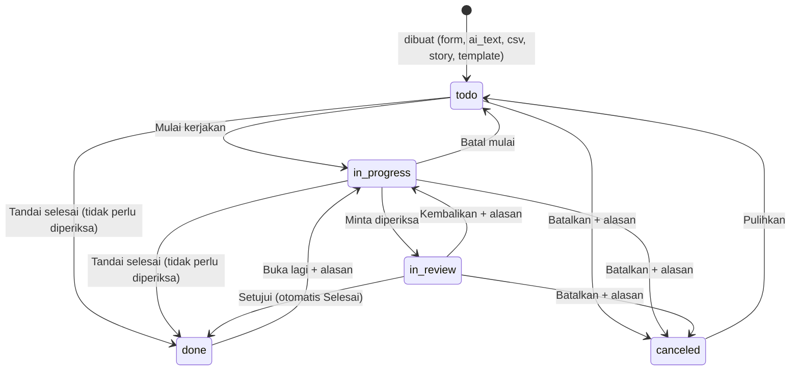
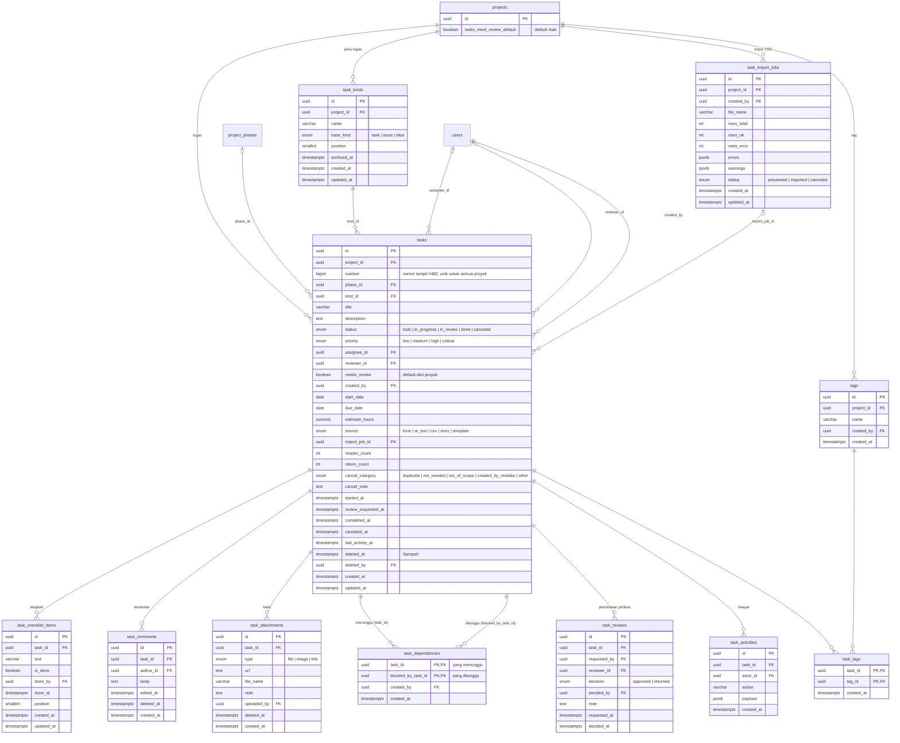

# ERD: Tugas

> Tanggal: 7 Oktober 2026. Cakupan: modul **03 · Tugas** (Semua tugas / Tugas saya, Tugas baru lewat Tulis saja ✦ / Isi form / Impor CSV, Detail tugas, alur periksa, jenis tugas & tag per proyek).
> Gambar ERD ada di Penpot, file **PM-New**, halaman **ERD NICO**, grup `03 · Tugas — ERD`. Wireframe di halaman **WIREFRAME NICO**, grup `03 · Tugas — Wireframe`. Nomor layar ①–⑫ di dokumen ini sama dengan nomor frame di wireframe.
> Diskusi dan keputusan: `tahapan-proyek/03-desain/erd/diskusi/03-tugas.md`. Tabel `users` ada di `tahapan-proyek/03-desain/erd/user-profile.md`, tabel `projects`, `project_members`, `project_phases` ada di `tahapan-proyek/03-desain/erd/project.md`.
> Menu Tiket dan Pengembangan ditunda. Tabel ini sudah disiapkan untuk keduanya (kategori dasar `issue` / `idea`).
> Diperbarui 8 Oktober 2026 (2): **Impor CSV dan Unduh CSV boleh dipakai Anggota** (bukan hanya Pengelola/Admin), supaya Anggota bisa membuat banyak tugas sekaligus. Pemantau tetap tidak.
> Diperbarui 8 Oktober 2026: "perlu diperiksa" tidak lagi ditentukan jenis tugas. Sekarang tombol on/off per tugas, nilai awalnya dari setelan proyek `projects.tasks_need_review_default` (default mati). Kolom `task_kinds.needs_review` dihapus. Lihat "Aturan tombol Perlu diperiksa".

## Alur yang didukung

1. **Tugas saya (①)**: tugas aktif yang `assignee_id` = user, dikelompokkan per jadwal. Di atasnya bagian **Menunggu diperiksa saya** untuk Pengelola/Admin.
2. **Semua tugas (②③)**: semua tugas di proyek yang boleh dilihat user, tampilan List atau Papan. Tugas di Sampah (`deleted_at` terisi) tidak tampil.
3. **Tugas baru**, tiga cara:
   - **Tulis saja ✦ (⑤)**: user menulis kalimat bebas, AI menyusun satu atau beberapa draf tugas. Tidak ada yang tersimpan sebelum **Simpan** diklik. Saat disimpan, `tasks.source = ai_text` dan tulisan asli dicatat di `task_activities.payload`.
   - **Isi form (⑥)**: `source = form`.
   - **Impor CSV (⑦)**: pratinjau disimpan di `task_import_jobs` (`status = previewed`). Setelah **Impor** diklik, baris yang valid menjadi `tasks` (`source = csv`) dan job menjadi `imported`.
   - Tugas dari "Ceritakan proyeknya" dan template proyek memakai `source = story` / `template` (modul 02).
4. Saat tugas dibuat: `needs_review` diisi dari setelan proyek `projects.tasks_need_review_default` (awalnya mati), `number` diisi nomor berikutnya dari satu urutan untuk semua proyek, dan pemeriksa diisi otomatis (lihat "Aturan pemeriksa").
5. **Detail tugas (⑧⑨⑩)**: satu halaman penuh berisi deskripsi, langkah-langkah, bukti, tugas yang ditunggu/ditahan, serta obrolan & riwayat (gabungan `task_comments` dan `task_activities`, urut waktu).
6. **Alur status**: lihat diagram di bawah. Setiap permintaan periksa menambah baris `task_reviews`, dan keputusannya mengisi baris itu.
7. **Pengaturan proyek · Tugas baru perlu diperiksa, Jenis tugas & Tag (⑫)**: Pengelola/Admin mengatur `projects.tasks_need_review_default`, serta mengelola `task_kinds` dan `tags` milik proyek.

| Transisi | Efek ke data |
|---|---|
| `todo → in_progress` | `started_at` diisi jika masih kosong. Jika `assignee_id` kosong, diisi user yang mengklik |
| `→ done` tanpa periksa | Hanya jika `needs_review = false`. `completed_at` diisi. Kalau `needs_review = true`, tombol Tandai selesai tidak ada: harus lewat Minta diperiksa |
| `in_progress → in_review` | Hanya dari tugas yang `needs_review = true`. Kalau mati, Anggota yang ragu menyalakannya dulu (A5), lalu tombol utama berubah menjadi **Minta diperiksa**. Tanpa bukti (`task_attachments` aktif) atau checklist belum lengkap = peringatan saja (A9). `review_requested_at` diisi, baris `task_reviews` baru dibuat |
| `in_review → done` | `task_reviews.decision = approved`, `decided_by`, `decided_at`. `completed_at` diisi |
| `in_review → in_progress` | `task_reviews.decision = returned` + `note` wajib (teks bebas; tombol cepat "Masih ada error" · "Belum sesuai permintaan" · "Bukti kurang jelas" hanya mengisi teks). `return_count + 1` |
| `done → in_progress` | Alasan wajib (dicatat di `task_activities`). `reopen_count + 1`, `completed_at` dikosongkan |
| `→ canceled` | `cancel_category` wajib, `cancel_note` wajib jika `other`. `canceled_at` diisi |
| `canceled → todo` | `cancel_category`, `cancel_note`, dan `canceled_at` dikosongkan |
| `needs_review` dinyalakan | Pemeriksa dihitung (lihat Aturan pemeriksa). Dicatat `task_activities.action = review_required_changed` |
| `needs_review` dimatikan | `reviewer_id` dikosongkan. Dicatat `review_required_changed`. Tidak bisa saat status `in_review` |

Status `in_progress` tidak wajib dilalui oleh tugas yang tidak perlu diperiksa, supaya tugas kecil bisa langsung ditandai selesai (asumsi A4).

## Hak akses

Peran proyek dari `project_members.role` (Pengelola = `manager`, Anggota = `member`, Pemantau = `viewer`). Project Manager yang bukan pengelola sebuah proyek hanya bisa melihat (asumsi A1 modul 02).

| Aksi | Admin | Pengelola | Anggota | Pemantau |
|---|---|---|---|---|
| Lihat tugas | Semua proyek | Proyek itu | Proyek itu | Proyek itu |
| Buat tugas (Tulis saja, Isi form) | ✅ | ✅ | ✅ | ❌ |
| Impor CSV, unduh CSV | ✅ | ✅ | ✅ | ❌ |
| Ubah isi tugas (judul, deskripsi, jenis, prioritas, tanggal, tag, checklist, yang mengerjakan) | ✅ | ✅ | Tugas yang ia buat atau kerjakan (A2) | ❌ |
| Mulai kerjakan, Tandai selesai, Minta diperiksa | ✅ | ✅ | Yang mengerjakan. Jika belum ada, siapa pun yang mengklik jadi yang mengerjakan | ❌ |
| Setujui, Kembalikan | ✅ | ✅ | ❌ | ❌ |
| **Nyalakan** "Perlu diperiksa" pada tugas | ✅ | ✅ | Tugas yang ia buat atau kerjakan (A2) | ❌ |
| **Matikan** "Perlu diperiksa" pada tugas | ✅ | ✅ | ❌ | ❌ |
| Ubah setelan proyek "Tugas baru perlu diperiksa" | ✅ | ✅ | ❌ | ❌ |
| Buka lagi (alasan wajib) | ✅ | ✅ | Pembuat atau yang mengerjakan | ❌ |
| Batalkan (alasan wajib), Hapus ke Sampah | ✅ | ✅ | Pembuat tugas | ❌ |
| Pulihkan dari Sampah | ✅ | ✅ | Yang menghapus | ❌ |
| Komentar | ✅ | ✅ | ✅ | ✅ |
| Lampirkan bukti | ✅ | ✅ | ✅ | ❌ |
| Kelola jenis tugas | ✅ | ✅ | ❌ | ❌ |
| Buat tag baru saat memberi tag | ✅ | ✅ | ✅ (A3) | ❌ |
| Ganti nama, gabung, hapus tag | ✅ | ✅ | ❌ | ❌ |

### Aturan tombol Perlu diperiksa

- Satu tombol on/off per tugas (`tasks.needs_review`). **Mati**: tombol utama **Tandai selesai**, tugas langsung Selesai. **Nyala**: tombol utama **Minta diperiksa**, lalu tugas menunggu diperiksa.
- Nilai awal tugas baru diambil dari `projects.tasks_need_review_default` (awalnya **mati**). Berlaku sama untuk Tulis saja, Isi form, Impor CSV, dan tugas dari cerita/template.
- **Menyalakan**: siapa pun yang boleh mengubah tugas (pembuat, yang mengerjakan, Pengelola, Admin). Anggota yang ragu boleh minta dicek.
- **Mematikan**: hanya Pengelola dan Admin. Anggota tidak bisa mematikan, termasuk saat tombol menyala karena default proyek.
- **Terkunci** saat status Menunggu diperiksa, Selesai, atau Dibatalkan. Tugas Menunggu diperiksa diselesaikan lewat Setujui/Kembalikan, bukan dengan mematikan tombol. Tugas Selesai yang perlu dicek lagi harus **Buka lagi**.
- Jenis tugas **tidak** memengaruhi aturan ini.

### Aturan pemeriksa

- Yang boleh **Setujui/Kembalikan** hanya **Pengelola proyek (termasuk Lead) dan Admin**. Semua Pengelola boleh, bukan hanya pemeriksa yang ditunjuk.
- Pemeriksa default dicari berurutan, melewati orang yang sama dengan yang mengerjakan:
  1. **Pembuat tugas**, jika ia Pengelola proyek itu
  2. **Lead** proyek
  3. **Pengelola lain** (yang paling lama bergabung)
  4. **Admin**: `reviewer_id` dikosongkan, UI menampilkan "Pemeriksa: Admin" dan saran **"Tambahkan pengelola kedua"**, semua Admin dapat notifikasi
- Pemeriksa hanya dihitung jika `needs_review = true`. Dihitung saat tombol dinyalakan, dan dihitung ulang jika yang mengerjakan diganti menjadi orang yang sama dengan pemeriksa, atau jika pemeriksa tidak lagi Pengelola.
- Pemeriksa bisa diganti manual oleh pembuat atau Pengelola, tapi hanya ke Pengelola atau Admin.
- Pembuat tugas yang Anggota tetap dapat notifikasi saat tugasnya diminta diperiksa dan saat selesai, dan bisa memberi masukan lewat komentar (A1).
- Semua aturan di bagian ini dijaga di service, bukan constraint database.

## Diagram

## Enum

| Enum | Nilai | Label UI |
|---|---|---|
| `task_base_kind` | task, issue, idea | Tugas, Masalah, Ide (kategori dasar; label jenis di UI memakai `task_kinds.name`) |
| `task_status` | todo, in_progress, in_review, done, canceled | Belum dikerjakan, Sedang dikerjakan, Menunggu diperiksa, Selesai, Dibatalkan |
| `task_priority` | low, medium, high, critical | Rendah, Sedang, Tinggi, Kritis |
| `task_source` | form, ai_text, csv, story, template | – |
| `task_review_decision` | approved, returned | Disetujui, Dikembalikan |
| `task_attachment_type` | file, image, link | File, Foto, Tautan |
| `task_import_status` | previewed, imported, canceled | – |
| `task_cancel_category` | duplicate, not_needed, out_of_scope, created_by_mistake, other | Dobel / sudah ada, Tidak jadi dikerjakan, Di luar cakupan proyek, Salah buat, Lainnya |

Semua `id` bertipe `uuid` dengan default `gen_random_uuid()`. Semua `created_at` / `updated_at` bertipe `timestamptz` dengan default `now()`.

## Tabel `task_kinds`: jenis tugas per proyek

| Kolom | Tipe | Null | Default | Keterangan |
|---|---|---|---|---|
| id | uuid | tidak | `gen_random_uuid()` | PK |
| project_id | uuid | tidak | | FK → `projects.id`, `ON DELETE CASCADE` |
| name | varchar(50) | tidak | | Label di UI, misal Tugas, Bug, Belanja |
| base_kind | `task_base_kind` | tidak | | Kategori dasar untuk hitungan dan aturan sistem |
| position | smallint | tidak | | Urutan di pilihan jenis |
| archived_at | timestamptz | ya | | Terisi = diarsipkan, tidak muncul di pilihan tapi tugas lama tetap memakainya |
| created_at | timestamptz | tidak | `now()` | |
| updated_at | timestamptz | tidak | `now()` | |

UNIQUE `(project_id, lower(name))`. Aturan di service: maksimal **6 jenis aktif** per proyek (konfigurasi `TASK_KINDS_MAX_ACTIVE = 6`), jenis yang sudah dipakai tugas tidak bisa dihapus, hanya diarsipkan, dan minimal 1 jenis aktif.

Jenis default saat proyek dibuat dengan form: **Tugas** (task) · **Bug** (issue) · **Ide** (idea). Jenis hanya label dan kategori untuk hitungan; **tidak menentukan perlu diperiksa atau tidak**.

## Tabel `tasks`: data utama tugas

| Kolom | Tipe | Null | Default | Keterangan |
|---|---|---|---|---|
| id | uuid | tidak | `gen_random_uuid()` | PK |
| project_id | uuid | tidak | | FK → `projects.id`. Tugas wajib punya proyek |
| number | bigint | tidak | `nextval('task_number_seq')` | Nomor tampil `#482`. UNIQUE untuk semua proyek, tidak dipakai ulang walau tugas dihapus |
| phase_id | uuid | ya | | FK → `project_phases.id`, `ON DELETE SET NULL` |
| kind_id | uuid | tidak | | FK → `task_kinds.id`. Wajib jenis dari proyek yang sama (dijaga di service) |
| title | varchar(200) | tidak | | |
| description | text | ya | | |
| status | `task_status` | tidak | `'todo'` | Diubah lewat tombol langkah berikutnya, lihat alur |
| priority | `task_priority` | tidak | `'medium'` | |
| assignee_id | uuid | ya | | FK → `users.id`. Yang mengerjakan. Kosong = belum ada yang pegang |
| reviewer_id | uuid | ya | | FK → `users.id`. Pemeriksa yang ditunjuk, hanya Pengelola/Admin. Hanya terisi jika `needs_review = true`. Kosong saat `needs_review = true` = jatuh ke Admin |
| needs_review | boolean | tidak | | Diisi dari `projects.tasks_need_review_default` saat dibuat. Nyalakan: yang boleh mengubah tugas. Matikan: hanya Pengelola/Admin. Terkunci saat `in_review`, `done`, `canceled` (lihat Aturan tombol Perlu diperiksa) |
| created_by | uuid | tidak | | FK → `users.id`. Pembuat tugas |
| start_date | date | ya | | |
| due_date | date | ya | | Tenggat |
| estimate_hours | numeric(6,1) | ya | | Estimasi jam |
| source | `task_source` | tidak | | Cara tugas dibuat |
| import_job_id | uuid | ya | | FK → `task_import_jobs.id`, `ON DELETE SET NULL`. Terisi jika `source = csv` |
| reopen_count | int | tidak | `0` | Untuk penanda "Dibuka lagi ×N" |
| return_count | int | tidak | `0` | Untuk penanda "Dikembalikan ×N" |
| cancel_category | `task_cancel_category` | ya | | Wajib saat `status = canceled` |
| cancel_note | text | ya | | Catatan pembatalan. Opsional, wajib jika `cancel_category = other` |
| started_at | timestamptz | ya | | Pertama kali Sedang dikerjakan |
| review_requested_at | timestamptz | ya | | Permintaan periksa terakhir |
| completed_at | timestamptz | ya | | Diisi saat Selesai, dikosongkan saat Buka lagi |
| canceled_at | timestamptz | ya | | |
| last_activity_at | timestamptz | tidak | `now()` | Diperbarui setiap ada perubahan, komentar, checklist, atau bukti. Dipakai untuk "Mandek" |
| deleted_at | timestamptz | ya | | Terisi = di Sampah. Bisa dipulihkan 30 hari |
| deleted_by | uuid | ya | | FK → `users.id` |
| created_at | timestamptz | tidak | `now()` | |
| updated_at | timestamptz | tidak | `now()` | |

CHECK:
- `due_date >= start_date`
- `reviewer_id IS NULL OR assignee_id IS NULL OR reviewer_id <> assignee_id`
- `status <> 'canceled' OR cancel_category IS NOT NULL`
- `cancel_category IS DISTINCT FROM 'other' OR cancel_note IS NOT NULL`
- `reopen_count >= 0 AND return_count >= 0`

`number` diambil dari sequence Postgres `task_number_seq` (satu urutan untuk semua proyek). Sequence tidak pernah mengulang nomor, jadi nomor tugas yang dihapus tidak dipakai lagi dan nomor bisa melompat. Alasannya: menu Tugas menampilkan tugas lintas proyek, jadi "#482" harus selalu menunjuk satu tugas, dan komentar lama yang menyebut nomor tidak boleh berpindah arti.

## Tabel `task_checklist_items`: langkah-langkah

| Kolom | Tipe | Null | Default | Keterangan |
|---|---|---|---|---|
| id | uuid | tidak | `gen_random_uuid()` | PK |
| task_id | uuid | tidak | | FK → `tasks.id`, `ON DELETE CASCADE` |
| text | varchar(300) | tidak | | |
| is_done | boolean | tidak | `false` | |
| done_by | uuid | ya | | FK → `users.id` |
| done_at | timestamptz | ya | | |
| position | smallint | tidak | | Urutan |
| created_at | timestamptz | tidak | `now()` | |
| updated_at | timestamptz | tidak | `now()` | |

## Tabel `task_comments`: komentar

| Kolom | Tipe | Null | Default | Keterangan |
|---|---|---|---|---|
| id | uuid | tidak | `gen_random_uuid()` | PK |
| task_id | uuid | tidak | | FK → `tasks.id`, `ON DELETE CASCADE` |
| author_id | uuid | tidak | | FK → `users.id`. Termasuk Pemantau |
| body | text | tidak | | Mention ditulis `@nama`, diproses jadi notifikasi |
| edited_at | timestamptz | ya | | Terisi = ditampilkan "(diubah)" |
| deleted_at | timestamptz | ya | | Ditampilkan "Komentar dihapus" di timeline |
| created_at | timestamptz | tidak | `now()` | |

## Tabel `task_attachments`: bukti

| Kolom | Tipe | Null | Default | Keterangan |
|---|---|---|---|---|
| id | uuid | tidak | `gen_random_uuid()` | PK |
| task_id | uuid | tidak | | FK → `tasks.id`, `ON DELETE CASCADE` |
| type | `task_attachment_type` | tidak | | File, foto, atau tautan |
| url | text | tidak | | Tautan, atau lokasi file di storage |
| file_name | varchar(255) | ya | | Nama asli file |
| note | text | ya | | Catatan, misal "masih error di Safari" |
| uploaded_by | uuid | tidak | | FK → `users.id` |
| deleted_at | timestamptz | ya | | |
| created_at | timestamptz | tidak | `now()` | |

## Tabel `task_dependencies`: tugas yang menunggu tugas lain

| Kolom | Tipe | Null | Default | Keterangan |
|---|---|---|---|---|
| task_id | uuid | tidak | | PK bersama, FK → `tasks.id`, `ON DELETE CASCADE`. Tugas yang **menunggu** |
| blocked_by_task_id | uuid | tidak | | PK bersama, FK → `tasks.id`, `ON DELETE CASCADE`. Tugas yang **ditunggu** |
| created_by | uuid | tidak | | FK → `users.id` |
| created_at | timestamptz | tidak | `now()` | |

CHECK `task_id <> blocked_by_task_id`. Di service: kedua tugas wajib di proyek yang sama (A7) dan tidak boleh membentuk siklus. Detail tugas menampilkan dua arah: "Menunggu tugas lain" dan "Menahan tugas lain".

## Tabel `task_reviews`: riwayat permintaan periksa

| Kolom | Tipe | Null | Default | Keterangan |
|---|---|---|---|---|
| id | uuid | tidak | `gen_random_uuid()` | PK |
| task_id | uuid | tidak | | FK → `tasks.id`, `ON DELETE CASCADE` |
| requested_by | uuid | tidak | | FK → `users.id`. Yang meminta diperiksa |
| reviewer_id | uuid | ya | | FK → `users.id`. Pemeriksa yang ditunjuk saat diminta. Kosong = Admin |
| decision | `task_review_decision` | ya | | Kosong = masih menunggu |
| decided_by | uuid | ya | | FK → `users.id`. Pengelola/Admin yang memutuskan, bisa berbeda dari `reviewer_id` |
| note | text | ya | | Wajib saat `returned` |
| requested_at | timestamptz | tidak | `now()` | |
| decided_at | timestamptz | ya | | |

Paling banyak satu baris dengan `decision` kosong per tugas: UNIQUE parsial `(task_id) WHERE decision IS NULL`. Setiap Kembalikan lalu Minta diperiksa lagi membuat baris (putaran) baru, jadi riwayat tiap putaran tetap ada. Jika pemeriksa diganti saat masih menunggu, `reviewer_id` di baris yang menunggu ikut diganti, tidak dibuat baris baru. Jika tugas dibatalkan saat menunggu diperiksa, baris yang masih menunggu ditutup oleh service (dihapus dari antrean, dicatat di `task_activities`).

## Tabel `task_activities`: riwayat tugas

Bersama `task_comments`, menjadi timeline **Obrolan & riwayat** di detail tugas.

| Kolom | Tipe | Null | Default | Keterangan |
|---|---|---|---|---|
| id | uuid | tidak | `gen_random_uuid()` | PK |
| task_id | uuid | tidak | | FK → `tasks.id`, `ON DELETE CASCADE` |
| actor_id | uuid | tidak | | FK → `users.id` |
| action | varchar(50) | tidak | | `created`, `status_changed`, `assigned`, `reviewer_changed`, `review_requested`, `approved`, `returned`, `reopened`, `canceled`, `restored`, `field_changed`, `review_required_changed`, `checklist_done`, `attachment_added`, `dependency_added`, `dependency_removed`, `deleted` |
| payload | jsonb | ya | | Detail, misal `{ "field": "due_date", "from": "2026-10-05", "to": "2026-10-09" }`. Untuk `created` dari Tulis saja: `{ "source": "ai_text", "input_text": "...", "ai_model": "..." }`. Untuk `reopened`: `{ "reason": "..." }`. Untuk `canceled`: `{ "category": "...", "note": "..." }` |
| created_at | timestamptz | tidak | `now()` | |

## Tabel `tags` dan `task_tags`: tag per proyek

**`tags`**

| Kolom | Tipe | Null | Default | Keterangan |
|---|---|---|---|---|
| id | uuid | tidak | `gen_random_uuid()` | PK |
| project_id | uuid | tidak | | FK → `projects.id`, `ON DELETE CASCADE` |
| name | varchar(40) | tidak | | Disimpan huruf kecil, tanpa spasi di awal/akhir |
| created_by | uuid | tidak | | FK → `users.id` |
| created_at | timestamptz | tidak | `now()` | |

UNIQUE `(project_id, lower(name))`. Saat mengetik tag, UI menampilkan saran tag yang sudah ada di proyek supaya tidak dobel. **Gabung tag** (⑫) memindahkan semua `task_tags` dari tag lama ke tag tujuan, lalu menghapus tag lama.

**`task_tags`**

| Kolom | Tipe | Null | Default | Keterangan |
|---|---|---|---|---|
| task_id | uuid | tidak | | PK bersama, FK → `tasks.id`, `ON DELETE CASCADE` |
| tag_id | uuid | tidak | | PK bersama, FK → `tags.id`, `ON DELETE CASCADE` |
| created_at | timestamptz | tidak | `now()` | |

Tag wajib dari proyek yang sama dengan tugasnya (dijaga di service).

## Tabel `task_import_jobs`: impor CSV

| Kolom | Tipe | Null | Default | Keterangan |
|---|---|---|---|---|
| id | uuid | tidak | `gen_random_uuid()` | PK |
| project_id | uuid | tidak | | FK → `projects.id`, `ON DELETE CASCADE` |
| created_by | uuid | tidak | | FK → `users.id`. Pembuat impor: Admin, Pengelola, atau Anggota proyek itu (bukan Pemantau) |
| file_name | varchar(255) | ya | | Kosong jika CSV ditempel |
| rows_total | int | tidak | `0` | |
| rows_ok | int | tidak | `0` | |
| rows_error | int | tidak | `0` | |
| errors | jsonb | ya | | Baris yang tidak diimpor: `[{ "row": 5, "message": "Jenis 'QC' tidak ada di proyek ini" }]` |
| warnings | jsonb | ya | | Baris yang tetap diimpor dengan catatan: `[{ "row": 3, "message": "budi@kantor.id bukan anggota Atlas, tugas diimpor tanpa yang mengerjakan" }]` |
| status | `task_import_status` | tidak | `'previewed'` | |
| created_at | timestamptz | tidak | `now()` | |
| updated_at | timestamptz | tidak | `now()` | |

Header CSV: `title,description,kind,priority,startsAt,dueAt,estimateHours,assigneeEmail,tagNames,needsReview`.
- `title` kosong = **galat**, baris tidak diimpor.
- `kind` dicocokkan dengan `task_kinds.name` aktif di proyek (tanpa beda huruf besar/kecil). Tidak cocok = **galat**, karena jenis tidak boleh ditebak. Kosong = jenis aktif pertama (`position` terendah).
- `priority` kosong = `medium`.
- `needsReview` (opsional): `ya` / `tidak`. Kosong = setelan proyek. Admin/Pengelola boleh memilih `tidak`. Anggota hanya boleh menyalakan: jika Anggota mengisi `tidak` saat setelan proyek menyala, nilainya diabaikan = **peringatan**, baris tetap diimpor dengan `needs_review = true`.
- `assigneeEmail` bukan Pengelola/Anggota proyek (termasuk Pemantau dan bukan anggota) = **peringatan**, tugas tetap diimpor tanpa yang mengerjakan.
- `tagNames` dipisah `;` (misal `sso;login`), karena koma sudah dipakai sebagai pemisah kolom CSV. Tag yang belum ada dibuat baru. File contoh memakai format ini.
- Baris galat tidak diimpor. Baris valid diimpor saat tombol **Impor N tugas** diklik.

## Nilai yang dihitung, tidak disimpan

| Nilai | Rumus |
|---|---|
| Tugas aktif | status ∈ {todo, in_progress, in_review} dan `deleted_at` kosong |
| Terlambat | tugas aktif dan `due_date` < hari ini |
| Tertahan | ada `blocked_by_task_id` yang masih aktif |
| Mandek | status `in_progress` dan `last_activity_at` lebih lama dari `TASK_STALE_DAYS` hari (konfigurasi, default 3, asumsi A8) |
| Menunggu diperiksa saya | status `in_review` dan (`reviewer_id` = saya, ATAU saya Pengelola proyek itu, ATAU saya Admin dan `reviewer_id` kosong) |
| Dibuka lagi ×N / Dikembalikan ×N | `reopen_count` / `return_count`, tampil jika > 0 |
| Kelompok jadwal | Terlambat · Hari ini · Besok · Minggu ini (s.d. Minggu) · Nanti · Tanpa tenggat |
| Bug terbuka (Ringkasan) | tugas aktif yang jenisnya ber-`base_kind = issue` |
| Progres langkah | `task_checklist_items` selesai ÷ semua, misal "2/3" |

Jika satu tugas memenuhi beberapa label, baris di daftar hanya menampilkan satu, dengan urutan: **Terlambat > Menunggu diperiksa saya > Tertahan > Mandek**. Detail tugas menampilkan semuanya. Setiap label selalu berupa ikon + teks, tidak hanya warna.

## Index

- `tasks(number)` UNIQUE
- `tasks(project_id, status)`: daftar per proyek + filter status
- `tasks(assignee_id, status, due_date)`: Tugas saya
- `tasks(reviewer_id, status)`: Menunggu diperiksa saya
- `tasks(phase_id)`, `tasks(kind_id)`
- `tasks(status, last_activity_at)`: Mandek
- `tasks(deleted_at)`: menyaring Sampah
- `task_kinds(project_id, lower(name))` UNIQUE
- `tags(project_id, lower(name))` UNIQUE
- `task_tags(tag_id)`: cari tugas per tag
- `task_dependencies(blocked_by_task_id)`: "Menahan tugas lain"
- `task_reviews(task_id) WHERE decision IS NULL` UNIQUE
- `task_comments(task_id, created_at)`, `task_activities(task_id, created_at)`, `task_reviews(task_id, requested_at)`
- `task_checklist_items(task_id, position)`

Daftar tugas **wajib paginated**. Pencarian judul memakai index trigram (`pg_trgm`) pada `tasks.title` jika volume sudah besar.

## Alasan desain

- **Jenis fleksibel dengan kategori dasar.** Nama jenis bebas supaya proyek non-IT tidak dipaksa memakai "Bug". `base_kind` membuat sistem tetap bisa menghitung "bug terbuka" lintas proyek. Aturan periksa **tidak** bergantung pada jenis, supaya proyek non-IT tidak terbebani istilah atau aturan khas IT.
- **`needs_review` ada di tugas, nilai awalnya dari setelan proyek.** Periksa itu soal risiko dan kebijakan tim, bukan soal jenis. Disalin ke tugas saat dibuat, jadi mengubah setelan proyek tidak mengubah tugas yang sudah ada. Menyalakan boleh bagi yang mengerjakan, mematikan hanya Pengelola/Admin: kalau yang mengerjakan boleh mematikan, pemeriksaan bisa dilewati begitu saja.
- **`reopened` dan "terlambat" bukan status.** Status menjawab "sekarang di langkah mana". Terlambat, tertahan, mandek, dan dibuka lagi adalah keadaan tambahan yang bisa bersamaan, jadi dihitung atau disimpan sebagai angka.
- **`task_reviews` dipisah dari `task_activities`.** Antrean "Menunggu diperiksa saya", alasan dikembalikan, dan siapa yang akhirnya menyetujui perlu di-query langsung, bukan dicari di dalam jsonb.
- **`reviewer_id` kosong = Admin**, bukan menunjuk satu Admin tertentu, supaya tidak ada Admin yang ditunjuk tanpa tahu konteks dan siapa pun Admin bisa mengambilnya.
- **Tulis saja tidak punya tabel draf.** Tulisannya pendek dan draf hanya hidup di layar sampai disimpan. Jejak AI cukup di `task_activities.payload`. Ini berbeda dengan cerita proyek yang panjang dan perlu disimpan (`project_story_drafts`).
- **Tag per proyek.** Tag lintas proyek cepat dobel dan sulit dirawat. Di dalam satu proyek, Pengelola bisa merapikan (ganti nama, gabung).
- **Kategori alasan hanya untuk Batalkan.** Pilihan lebih mudah daripada mengetik dan datanya bisa dihitung (misal berapa tugas yang ternyata dobel). Kembalikan dan Buka lagi tetap teks bebas, karena yang mengerjakan perlu tahu persis apa yang harus diperbaiki. Daftar kategori tetap di sistem: jika catatan "Lainnya" yang mirip sering muncul, tim developer menambah kategori di versi berikutnya.
- **Komentar + aktivitas jadi satu timeline di UI**, tapi tetap dua tabel: komentar bisa diubah/dihapus, aktivitas tidak.

## Belum diputuskan

Asumsi Claude yang belum dikonfirmasi user:

1. **A1.** Pembuat tugas yang Anggota dapat notifikasi saat tugasnya diminta diperiksa dan saat selesai, dan bisa memberi masukan lewat komentar.
2. **A2.** Anggota hanya boleh mengubah tugas yang ia buat atau kerjakan.
3. **A3.** Anggota boleh membuat tag baru. Mengelola tag tetap Pengelola/Admin.
4. **A4.** Tugas yang tidak perlu diperiksa boleh langsung **Tandai selesai** dari Belum dikerjakan.
5. **A5.** Anggota yang ragu pada hasilnya boleh **menyalakan** tombol Perlu diperiksa di tugasnya sendiri (sukarela), lalu **Minta diperiksa**. Setelah menyala, hanya Pengelola/Admin yang bisa mematikannya.
6. **A7.** Tugas hanya bisa menunggu tugas lain di proyek yang sama.
7. **A8.** Ambang Mandek 3 hari.
8. **A9.** Bukti **tidak lagi wajib** untuk jenis Masalah/Bug. Minta diperiksa tanpa bukti hanya memunculkan peringatan (sama seperti checklist belum lengkap). Alasannya: aturan wajib bukti tadinya menempel pada kategori `issue` yang khas IT.
9. **A10.** Nilai awal `projects.tasks_need_review_default` = **mati**, supaya proyek baru tidak langsung terbebani pemeriksaan.

Pertanyaan terbuka:

10. Apakah tugas boleh tanpa proyek (tugas pribadi)? Desain ini: tidak.
11. Apakah sub-tugas sungguhan dibutuhkan, atau checklist sudah cukup?
12. Apakah estimasi jam benar-benar dipakai? Kalau tidak, kolom disembunyikan di form.
