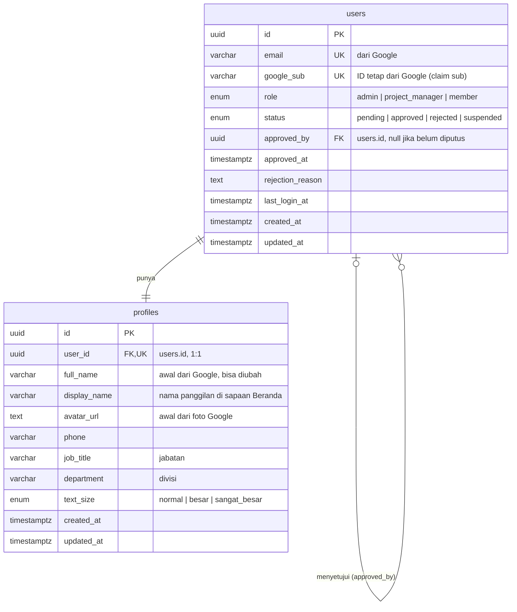

# ERD: User & Profile

> Tanggal: 7 Oktober 2026. Cakupan: login dengan akun Google dan persetujuan admin.
> Gambar ERD ada di Penpot, file **PM-New**, halaman **ERD NICO**. Wireframe alur login ada di halaman **WIREFRAME NICO**.
> Diperbarui 7 Oktober 2026: tambah peran project_manager (keputusan modul 02 · Proyek).

## Alur yang didukung

1. User membuka aplikasi dan diarahkan ke halaman Login (nama PM + tombol "Masuk dengan Google").
2. Setelah Google mengembalikan data, sistem mencari `users.google_sub`:
   - **Tidak ada** (login pertama): buat baris `users` dengan `status = pending` dan baris `profiles` yang diisi dari data Google, lalu arahkan ke halaman **Profil** dengan pesan "Menunggu persetujuan admin".
   - **Ada, `status = pending`**: arahkan lagi ke halaman Profil dengan pesan yang sama.
   - **Ada, `status = approved`**: masuk ke **Beranda**.
   - **Ada, `status = rejected` / `suspended`**: kembali ke halaman Login dengan pesan bahwa akses ditolak/dinonaktifkan.
3. Admin menyetujui user: `status` diubah ke `approved`, `approved_by` dan `approved_at` diisi.

## Diagram

## Tabel `users`: identitas login dan hak akses

Diubah oleh sistem dan admin, bukan oleh user sendiri.

| Kolom | Tipe | Null | Default | Keterangan |
|---|---|---|---|---|
| id | uuid | tidak | `gen_random_uuid()` | PK |
| email | varchar(255) | tidak | | UNIQUE. Disimpan untuk tampilan dan kontak, bukan untuk mencocokkan login |
| google_sub | varchar(255) | tidak | | UNIQUE. Kunci pencocokan login, karena email di akun Google bisa berubah |
| role | enum `user_role` | tidak | `'member'` | `admin`, `project_manager`, atau `member` |
| status | enum `user_status` | tidak | `'pending'` | `pending`, `approved`, `rejected`, `suspended` |
| approved_by | uuid | ya | | FK ke `users.id`, `ON DELETE SET NULL`. Admin yang memutuskan |
| approved_at | timestamptz | ya | | Waktu keputusan admin |
| rejection_reason | text | ya | | Diisi jika `rejected` / `suspended`, ditampilkan ke user |
| last_login_at | timestamptz | ya | | Diperbarui di setiap login berhasil |
| created_at | timestamptz | tidak | `now()` | Waktu login pertama |
| updated_at | timestamptz | tidak | `now()` | |

Index: `UNIQUE(email)`, `UNIQUE(google_sub)`, `INDEX(status)` untuk daftar "menunggu persetujuan" di halaman admin.

### Arti peran

| Peran | Bisa |
|---|---|
| admin | Menyetujui user, memberi peran, melihat & mengubah semua proyek |
| project_manager | Membuat proyek, melihat semua proyek, mengubah hanya proyek yang dia kelola |
| member | Melihat proyek yang diikuti. Bisa jadi pengelola proyek jika ditunjuk |

Catatan: peran di dalam proyek (`manager` / `member` / `viewer`) ada di `tahapan-proyek/03-desain/erd/project.md` dan **terpisah** dari peran aplikasi ini. Peran `project_manager` diberikan oleh Admin; user baru tetap `member`.

## Tabel `profiles`: data diri yang bisa diubah user

| Kolom | Tipe | Null | Default | Keterangan |
|---|---|---|---|---|
| id | uuid | tidak | `gen_random_uuid()` | PK |
| user_id | uuid | tidak | | FK ke `users.id`, `ON DELETE CASCADE`, UNIQUE (1 user = 1 profil) |
| full_name | varchar(150) | tidak | | Diisi dari nama akun Google saat login pertama |
| display_name | varchar(50) | ya | | Nama panggilan, dipakai di "Selamat pagi, Nico" |
| avatar_url | text | ya | | Diisi dari foto akun Google |
| phone | varchar(20) | ya | | Nomor HP |
| job_title | varchar(100) | ya | | Jabatan |
| department | varchar(100) | ya | | Divisi |
| text_size | enum `text_size` | tidak | `'normal'` | Usulan untuk segmen awam/lansia: ukuran teks yang dipilih user |
| created_at | timestamptz | tidak | `now()` | |
| updated_at | timestamptz | tidak | `now()` | |

## Kenapa dipisah jadi dua tabel

- `users` mengatur **siapa boleh masuk** (Google, role, status persetujuan). Hanya sistem dan admin yang mengubahnya.
- `profiles` berisi **data diri** yang diisi user sendiri di halaman Profil, termasuk saat masih menunggu persetujuan.
- Dengan pemisahan ini, form Profil tidak bisa ikut mengubah `role` atau `status`.

## Yang belum diputuskan

1. **Admin pertama.** Belum ada admin saat aplikasi baru dipasang. Usulan: daftar email admin awal dari env (`INITIAL_ADMIN_EMAILS`), yang langsung dibuat `role = admin`, `status = approved`.
2. **Kolom wajib di Profil.** Apakah No. HP, jabatan, dan divisi wajib diisi sebelum admin bisa menyetujui?
3. **Batas domain email.** Apakah hanya email kantor (misal `@perusahaan.co.id`) yang boleh mendaftar, atau semua akun Google?
4. **Riwayat keputusan admin.** Saat ini hanya keputusan terakhir yang tersimpan. Jika butuh jejak lengkap (siapa menyetujui, menolak, mengaktifkan lagi), perlu tabel tambahan `user_approval_logs`.
5. ~~Layar admin untuk memberi/mencabut peran project_manager belum ada wireframe-nya.~~ Sudah ada (8 Oktober 2026): layar **Persetujuan user** dan **Kelola peran** di grup `C · Admin — Wireframe`, lihat `tahapan-proyek/03-desain/erd/diskusi/04-wireframe-per-role.md`.
