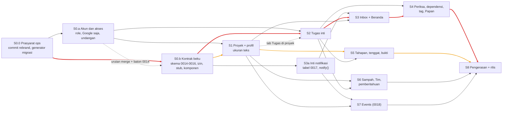

# R10 — Lingkup MVP dan Peta Jalan Irisan Vertikal

> Tanggal: 15 Oktober 2026. Penulis: worker R10 (riset/perencanaan; tidak ada kode diubah). Branch acuan: `feature/project-management`.
> Status: ditulis bertahap sesuai adendum `_BRIEF.md`; R01, R04, R05, R06, R11, R13 masih berupa kerangka kosong saat laporan ini ditulis, jadi tidak dibaca.

## 1. Ringkasan eksekutif
1. **MVP = fondasi + 8 irisan vertikal (S0-S8)**; 69 fitur dipetakan MoSCoW: 25 Must, 24 Should, 10 Could, 9 Won't (+1 butir audit campuran). Sisi produk masih kosong (`app/routes.ts:12-15`, `server/api/app.ts:1-36`), jadi mulai dari nol; tiga celah keamanan fondasi (R12 F1-F3) dan 98 file rebrand yang belum di-commit (R14) harus ditutup dulu di S0.
2. **Definisi MVP (§3.2)** berupa satu paragraf skenario Admin, Project Manager, dan Member, plus 5 syarat kualitas terukur (suite hijau, tanpa N+1, p95 < 300 ms pada 1.000 tugas, ≥ 4 dari 5 penguji berusia ≥ 50 tahun menyelesaikan tugas pertama ≤ 3 menit; angka uji pengguna = ASUMSI).
3. **Urutan irisan (§3.3):** S0 Fondasi → S1 Proyek + ukuran teks → S2 Tugas inti → S3 Inbox + Beranda → S4 Periksa/dependensi/tag/Papan, S5 Tahapan/tenggat/bukti, S6 Sampah/Tim, S7 Events (saling paralel) → S8 rilis. **Jalur kritis:** S0.0 → S0.b → S2 → S3 → S4 → S8 (graf mermaid §3.4).
4. **Estimasi (§5):** ≈ 147-211 hari-orang AI + 32-46 hari reviewer; jalur kritis 39-59 hari kerja (8-12 minggu) bila reviewer ≥ 80% tersedia, 13-18 minggu bila paruh waktu. Proyek dan Tugas tidak punya laporan estimasi (R04/R05 kosong), jadi ±45% angka ini adalah ASUMSI saya.
5. **Delapan penempatan yang menurut saya salah tempat (⚑F1-F8):** mesin pemeriksaan → Should dan disederhanakan; pengulangan acara + Kalender, UI jenis tugas → Could; Beranda cukup 3 widget Must; Events dikerjakan paling akhir; detail tugas halaman-vs-drawer harus diputuskan sebelum S2.
6. **Temuan program terpenting:** dari tiga USP teratas segmen awam/lansia hanya U3 (teks besar) yang masuk MVP; Mode Pendamping (ditunda user) dan kanal chat/suara tidak ada. Saya menambah dua USP kecil dalam aplikasi ("Giliran Anda" T8 = Should, kartu "Terlambat" T16 = Could) dan dua putaran uji pengguna.
7. **Pertentangan dengan laporan lain (§2.5):** R02/R14 membekukan semua skema di awal; saya usul 0014-0016 saja, 0017/0018 lewat baton (hemat ±3-4 hari jalur kritis). Risiko teratas: reviewer tunggal, lingkup merayap, diferensiasi lemah, hipotesis segmen belum diuji (§4).

## 2. Temuan (dengan bukti)

### 2.1 Fondasi: sisi produk masih kosong, jadi MVP mulai dari nol
- `app/routes.ts:12-15`: layout `/app` hanya berisi `app` dan `profile`; tidak ada rute proyek, tugas, events, tim, inbox, sampah, atau pengaturan.
- `server/api/app.ts:1-36`: hanya `/whoami` dan `/avatar`. `app/routes/app/layout.tsx:18-21` (`NAV`) hanya 2 menu; `:31` `BADGE_COLOR` berkunci role `user`.
- `server/permissions.ts:9-18`: `ROLES` masih tiga nilai (`user`, `admin`, `super-admin`) dan `ASSIGNABLE_ROLES = [USER, ADMIN]`; `server/auth.ts:38` `defaultRole: ROLES.USER`; `:45` plugin `anonymous` masih aktif (demo belum dimatikan).
- Migrasi terakhir `server/db/migrations/0013_bitter_phil_sheldon.sql`; `tests/` berisi 66 entri dan `tests/app-routes.test.ts` + `tests/app-contracts.test.ts` sudah ada sebagai penjaga rute.
- Dari R14: 98 file rebrand belum di-commit, `drizzle-kit` tidak memberi `IF NOT EXISTS`, jalur prod eksternal tanpa langkah migrasi. Dari R12: tiga celah fondasi (sign-up email terbuka, super-admin tanpa `emailVerified`, `/api/auth/admin/*` melewati matriks). Semuanya **menghalangi irisan mana pun**, jadi menjadi irisan pertama.

### 2.2 Dokumen desain yang masih memuat hal yang sudah ditunda (keputusan final di `_BRIEF.md` menang)
| Dokumen | Isi yang bertentangan dengan brief | Perlakuan di R10 |
|---|---|---|
| `03-desain/erd/diskusi/02-proyek.md:32,178` | "Ceritakan proyeknya" (AI) masuk v1; kartu "Pakai template" | Won't (fase 5) |
| `03-desain/erd/diskusi/04-wireframe-per-role.md:14` | Impor/Unduh CSV boleh untuk Member | Won't (fase 5) |
| `03-desain/erd/diskusi/06-inbox.md:24,31` | Kartu Pengajuan cuti (satu-satunya kartu dua tombol) | Won't; R07 sudah mengeluarkannya |
| `03-desain/erd/diskusi/07-tim.md:13` | Ketersediaan: Tersedia · Sedang rapat · **Cuti** | Cuti hilang, ketersediaan tinggal dua nilai (Could) |
| `03-desain/erd/diskusi/09-pengaturan.md:18` | Mode Pendamping ditunda (keputusan **user**) | Won't; lihat flag F7 |
| `03-desain/erd/diskusi/05-events.md` #7,#8,#16-#18 | Notulensi Foto/Suara AI, hasil rapat AI | Won't; hanya Ketik + tugas manual |
| `02-analisis/.../DECISIONS.md` D2, D8, D17 | Gelombang P0a/P0b, AI-0…AI-7, MVP 4-5 bulan | Kalah dari 03-desain dan brief; tidak dipakai |

### 2.3 Apa yang terbawa dari USP riset kompetitor ke MVP
| USP (sumber) | Nasib di MVP | Catatan |
|---|---|---|
| U3 Aksesibilitas bawaan (peringkat 1 untuk segmen, `rangkuman-gabungan-usp.md` §13.1) | **Sebagian**: ukuran teks 3 level, tombol besar, label + ikon, aksi tanpa drag | Kontras tinggi / tema terang belum ada di desain |
| U7 Mode Pendamping (peringkat 2) | **Tidak ada** (ditunda user, `09-pengaturan.md:18`) | Peran **Pemantau** adalah pendahulu paling dekat (baca + komentar) |
| U5/U14/U15 tugas dari chat/suara, pengingat WhatsApp (peringkat 3) | **Tidak ada**; semua kanal hanya di aplikasi (`06-inbox.md` #11) | Janji "tidak perlu buka aplikasi" belum bisa dipenuhi |
| U2 Bahasa polos | **Ya** (konvensi), tetapi menu tetap "Inbox", "Events", jenis "Bug" (`06-inbox.md` #2, `05-events.md` #1, `03-tugas.md` #4) | Jargon yang dipertahankan user; serahkan ke R11 |
| U9 Jaring pengaman | **Ya**: konfirmasi, Urungkan, Sampah 30 hari | Dikerjakan lintas irisan |
| U10 Notifikasi tenang | **Sebagian**: dua tab, kartu "Perlu tanggapi" tak bisa dimatikan; tanpa ringkasan harian | |
| U13 Satu hal dalam satu waktu | **Sebagian**: Fokus saya / Tugas saya terkelompok; belum layar "satu tombol Sudah selesai" | |
| USP-1/3/5/6 (loop tertutup via chat) | **Tidak ada**; padanan dalam aplikasi hanya kartu Inbox berujung satu tombol (USP-5 parsial) | USP-3 dan USP-2 saya usulkan sebagai Could/Should kecil (T8, T17) |
Kesimpulan: dari tiga USP peringkat teratas untuk segmen awam/lansia hanya satu (U3) masuk MVP. MVP sebagaimana didesain adalah "PM berbahasa Indonesia dengan teks besar dan jaring pengaman". Itu sah sebagai MVP, tetapi alasan memilihnya dibanding Trello/Asana belum terbukti (risiko program R3 di §4).

### 2.4 Estimasi yang sudah ada tidak boleh dijumlahkan mentah
Angka laporan: R14 15-24, R02 9-12, R03 10-15, R07 14-21, R08 22-33, R12 20-30 (MVP), R09 25-38 = 115-173 hari-orang AI, tetapi R09 dan R12 menyatakan sendiri "dikerjakan bersama modul", R02∩R14 (F0b) dan R03∩R12 (pintu akses) tumpang tindih. **Proyek dan Tugas (API + UI) tidak dicakup laporan mana pun** (R04/R05 masih kosong); S1, S2, S4, S5 di §5 adalah ASUMSI saya dan merupakan ±45% total. Jadi estimasi saya disusun dari bawah ke atas per irisan, memakai angka laporan hanya untuk bagian yang memang miliknya.

### 2.5 Pertentangan dengan laporan lain (eksplisit)
1. **R14 §3.8 (F0b "schema semua domain + 0015-0017")** vs **R02 §3.9 (lima file 0014-0018)**: penomoran dua laporan itu sendiri berbeda. Saya mengusulkan lain: 0014-0016 (akun, proyek, tugas) dibekukan di S0; 0017 `notification` dan 0018 `event` dibuat pemilik modulnya lewat baton saat tiba gilirannya. Alasan: Events adalah area dengan paling banyak pertanyaan terbuka (R08 §6, 9 butir) dan baru dibangun paling akhir; membekukan skemanya sekarang memperpanjang jalur kritis ±3-4 hari dan mengunci keputusan yang belum matang. Aturan "satu pemilik migrasi, berurutan" dari R14 tetap dipakai.
2. **R07** memuat 7 widget Beranda dalam MVP; saya menurunkan Must menjadi 3 widget (Sapaan, Fokus saya, Proyek saya) + baris hitungan. Bukan koreksi fakta, tetapi keputusan lingkup.
3. **R03** menyebut paket izin bisa dipotong; saya membaginya: tipe + izin proyek + izin tugas di S0 (kontrak), `metrics` di S2, izin event/sampah/tim/user/pengaturan mengikuti modulnya.
4. **R09 §1.4**: progres Atlas 70% (`02-proyek.md:163`) vs 17% dari tabel tugas; saya memakai 17% (rumus) sebagai angka emas di kriteria selesai S2, menunggu konfirmasi user (R09 §6.5).
5. **Halaman penuh vs drawer untuk detail tugas** belum diputuskan (`_BRIEF.md`; R05 kosong). Ini memblokir UI detail S2; keputusan dibutuhkan sebelum S2 dimulai (pertanyaan 1, §6).

## 3. Rekomendasi

### 3.1 (a) MoSCoW per fitur
Legenda: **M** Must · **S** Should · **C** Could · **W** Won't-for-now. ⚑ = menurut saya salah tempat di desain; penjelasan di bawah tabel. "Nilai" = untuk orang awam/lansia di tim kecil. Irisan merujuk §3.3.

| ID | Fitur | | Irisan | Nilai bagi awam/lansia & tim kecil | USP |
|---|---|:-:|:-:|---|---|
| A1 | Empat role, `user`→`member`, matriks ubah role (00 §1,§3) | M | S0.a | Dasar semua izin; Admin tak bisa menyentuh Admin lain | – |
| A2 | Login Google saja; tutup sign-up email **di server**; matikan demo anonim (00 §4, R12 F1) | M | S0.a | Tanpa kata sandi untuk diingat | U18 (parsial) |
| A3 | Super-admin wajib `emailVerified`; `/api/auth/admin/*` lewat matriks (R12 F2,F3) | M | S0.a | Mencegah pengambilalihan akun pengelola | – |
| A4 | Status akun `pending/approved/rejected` + halaman tahan berbahasa polos | M | S0.a | Orang tahu kenapa belum bisa masuk, tidak bingung | U2 |
| A5 | Undangan awal (email + role; login pertama langsung approved) | M | S0.a | Anggota keluarga/tim langsung masuk tanpa antre persetujuan | U1 |
| A6 | `/dashboard` Pengguna: persetujuan, kelola peran, undangan | M | S0.a | Satu orang "pengelola akun" cukup untuk tim kecil | – |
| A7 | Hapus akun + pra-cek pengelola tunggal | S | S6 | Mencegah proyek tanpa pengelola | – |
| A8 | Pengaturan tim Admin: pengingat acara bawaan (1 kolom) | C | S6 | Nilai kecil; bawaan sudah masuk akal | – |
| A9 | Saklar Fitur AI, lama simpan rekaman, Cuti perlu persetujuan | W | – | Fitur induknya ditunda | – |
| G1 | Profil + **ukuran teks Normal/Besar/Sangat besar** (SSR tanpa kedip) | M | S1 | Hambatan pertama lansia (font kecil 10/10 kompetitor) | **U3** |
| G2 | Pemberitahuan: 2 saklar (pengingat acara, kabar terbaru) | S | S6 | Kendali sederhana, bukan puluhan toggle | U10 |
| G3 | Kerangka responsif dasar (AppShell + header mobile, tabel scroll) | M | S0.b | Syarat `CLAUDE.md`; polesan mobile dikerjakan rekan | – |
| G4 | Ketersediaan (Tersedia/Sedang rapat), Cuti | W | – | Cuti ditunda; ⚑F4 | – |
| G5 | Mode Pendamping | W | – | ⚑F7 (ditunda user, tetapi paling bernilai kedua untuk segmen) | U7 |
| P1 | Daftar proyek (List), filter dasar, paginasi | M | S1 | Pintu masuk; Member hanya proyek yang diikuti | U1 |
| P2 | Daftar proyek tampilan Grid | C | S5 | Visual kartu; List cukup | U17 |
| P3 | Buat proyek (form; tanpa cerita AI/template) | M | S1 | Proyek pertama < 60 detik | U1 |
| P4 | Detail proyek: Ringkasan + Anggota (Pengelola/Anggota/Pemantau, Lead, pengelola terakhir) | M | S1 | Pemantau = pendahulu pendamping read-only | U7 (parsial) |
| P5 | Status manual + **kondisi dihitung** Lancar/Perlu perhatian/Terlambat + satu kalimat alasan | M | S1 (dasar), S5 (milestone) | Teks + ikon, bukan warna saja | U2, USP-5 |
| P6 | Tahapan: fase + milestone | S | S5 | Gambaran besar; bukan inti tugas harian | USP-4 (kontra) |
| P7 | Perpanjang tenggat + alasan + riwayat + badge | S | S5 | Akuntabilitas tenggat; jarang dipakai awam | – |
| P8 | Ganti kondisi manual (override) | C | S5 | Jarang perlu | – |
| P9 | Aktivitas proyek (`project_activity`) | C | S5 | Riwayat tenggat sudah cukup | – |
| P10 | Hapus proyek → Sampah, pesan Urungkan | M | S1 | Takut salah klik (Linear, Notion) | U9 |
| P11 | Cerita proyek AI, template proyek | W | – | Fase 5 | USP-4 |
| T1 | **Tugas saya** terkelompok (Terlambat/Hari ini/Besok/Minggu ini/Nanti/Tanpa tenggat) | M | S2 | "Apa yang harus saya kerjakan" dalam satu layar | U13 |
| T2 | Buat tugas (satu form), prioritas, tenggat, penanggung jawab | M | S2 | Inti produk | U1 |
| T3 | **Satu tombol langkah berikutnya** per baris (Mulai kerjakan / Tandai selesai), tanpa dropdown status | M | S2 | Tidak perlu belajar status; tanpa drag | U3, U13 |
| T4 | Detail tugas: deskripsi, komentar + riwayat satu timeline | M | S2 | Kolaborasi dasar; ⚑F1 halaman vs drawer | – |
| T5 | Checklist langkah | S | S2 | Sangat dipahami awam (daftar centang) | U17 |
| T6 | Cari/filter tugas (proyek, orang, status) | S | S2 | Dibutuhkan saat tugas > ±30 | – |
| T7 | Minta diperiksa → Setujui/Kembalikan (tombol per tugas, **default mati**) | S | S4 | Berguna bila ada penyelia; ⚑F2 | – |
| T8 | Dependensi + label Tertahan + **notifikasi "Giliran Anda"** saat penghalang selesai | S | S4 | Estafet versi dalam aplikasi | **USP-2** |
| T9 | Tag per proyek | S | S4 | Pencarian tambahan; kelola tag (ganti nama/gabung) = C | – |
| T10 | Batalkan (kategori alasan) + Buka lagi | S | S4 | Bedakan "tidak jadi" dari "hapus" | U9 |
| T11 | **Papan** (kolom status; "Pindahkan ke…", **tanpa pustaka drag-and-drop**) | S | S4 | Familiar seperti Trello/kertas | U17, U3 |
| T12 | Bukti/lampiran foto (S3/RustFS, magic bytes, tanpa SVG) | S | S5 | Foto struk/hasil kerja; bergantung `storageEnabled()` | – |
| T13 | UI kelola jenis tugas (maks 6) | C | S5 | ⚑F3: bawaan 3 jenis cukup | U2 |
| T14 | Mention `@nama` di komentar | C | S4 | Kartu "Balas" di Inbox; belum kritis | – |
| T15 | Impor/Unduh CSV, "Tulis saja" (AI) | W | – | Fase 5 | USP-1 |
| T16 | Kartu Inbox "Terlambat" 3 tombol (Sudah selesai / Geser tenggat / Minta bantu) | C | S4 | Padanan dalam aplikasi untuk tangga tindak lanjut; ⚑F8 | **USP-3** |
| I1 | `notify()` + Inbox tab **Perlu Anda tanggapi** + lonceng + badge + polling 60 dtk; kartu hilang otomatis | M | S3 | Tanpa ini penerima tidak tahu ada tugas/pemeriksaan | USP-5, U10 |
| I2 | Tab Kabar terbaru + bundling per jam | S | S3 | Tenang tapi tidak kritis | U10 |
| I3 | SSE, push PWA, email, WhatsApp | W | – | ⚑F8 | U15 |
| H1 | Beranda: Sapaan, **Fokus saya**, Proyek saya, baris "Perlu Anda tanggapi" | M | S3 | Layar pertama; satu hal sekali | U13 |
| H2 | Beranda: Sekilas, Ringkasan hari ini (3 kalimat bertemplat), Selesai minggu ini | S | S3 | Rasa kemajuan; ⚑F5 | U6 |
| H3 | Beranda: Agenda (butuh Events) | S | S7 | Mengikuti Events | – |
| H4 | Beranda Admin: tautan `/dashboard` + hitung menunggu persetujuan | M | S3 | Admin tidak tersesat | – |
| H5 | Briefing AI, Ask Data | W | – | Fase 5 | U8 |
| Z1 | Halaman **Sampah** (Proyek/Tugas; pulihkan berantai; hapus permanen khusus Admin) | M | S6 | Satu-satunya jalan memulihkan | U9 |
| Z2 | Purge otomatis 30 hari (objek S3 dihapus dulu) | S | S6 | Janji "30 hari" hanya boleh tampil di UI bila purge sudah aktif | U9 |
| M1 | **Tim**: daftar orang, beban aktif/telat, visibilitas D10 | S | S6 | Pengelola lihat siapa kewalahan; ⚑F4 | U6 |
| E1 | Events: daftar (Akan datang/Sudah lewat), form 2 tahap, detail | S | S7 | Rapat/arisan; ⚑F6 | – |
| E2 | Pengingat acara in-app (1 hari, 30 menit) | S | S7 | Mengurangi lupa | U10 |
| E3 | Notulensi tulis (ketik) | S | S7 | Catatan rapat tanpa AI | – |
| E4 | Tugas dari rapat (manual, dikonfirmasi) | C | S7 | Jembatan Events→Tugas | – |
| E5 | Kalender Bulan/Minggu | C | S7 | Daftar sudah default | U17 |
| E6 | Acara berulang (series, materialisasi 90 hari, "Hanya yang ini/Semua") | C | S7+ | ⚑F6 | – |
| E7 | Notulensi Foto/Suara AI, Google Calendar | W | – | Fase 5 | U14 |
| X1 | Audit: aksi berhak istimewa (role, persetujuan, hapus permanen, purge) M; sisa 25 aksi R12 S | M/S | tiap irisan | Pertanggungjawaban | – |
| X2 | Test per fitur, `tests/support`, data Atlas, ratchet `mock.module` | M | tiap irisan | Aturan global; R09 | – |
| X3 | CHANGELOG, README (kontrak publik), `CLAUDE.md` diperbarui | M | tiap irisan | Aturan global | – |
| X4 | **Uji pengguna awam/lansia** (2 putaran) + QA manual | M | S2, S8 | Satu-satunya cara memvalidasi hipotesis segmen | semua |
| X5 | Subcommand `migrate`, backup pra-deploy, checklist 8 butir, rilis 0.3.0 | M | S8 | Deploy hanya atas perintah user | – |
| X6 | Halaman kebijakan privasi bahasa polos, `redact` log | S | S8 | Data pribadi orang awam | – |
| X7 | PWA/push, polesan mobile | W | – | Polesan mobile milik rekan | – |

**Flag ⚑ (menurut saya salah tempat; keputusan tetap di user):**
- **F1** Detail tugas halaman vs drawer belum diputuskan tetapi memblokir S2. Rekomendasi: halaman penuh (`03-tugas.md` #17) karena lansia tidak dibingungkan panel yang menutup daftar; drawer = alternatif ditolak.
- **F2** Mesin pemeriksaan (rantai pemeriksa default, putaran, "Pemeriksa jatuh ke Admin", `03-tugas.md` #7-#8,#20) dirancang sebagai inti padahal default mati (#23). Turunkan ke Should dan sederhanakan: pemeriksa = siapa pun Pengelola/Admin; rantai cadangan jadi konstanta bernama. Tabel `task_review` tetap ada di skema.
- **F3** Jenis tugas fleksibel (maks 6, kategori dasar) memberi beban istilah ("Bug", "Masalah", "Ide") pada awam. Skema `task_kind` tetap, 3 jenis dibuat otomatis, UI kelola = Could; sembunyikan isian jenis bila hanya satu jenis dipakai.
- **F4** Tim (3-5 hari + aturan D10 di SQL) dan Ketersediaan (tinggal dua nilai tanpa Cuti) bernilai kecil untuk tim ≤ 10 orang. Tetap Should, tetapi irisan terakhir yang boleh dipotong; "Ketersediaan" Could.
- **F5** Beranda 7 widget (R07 P3 5-7 hari) terlalu banyak untuk "satu hal sekali"; Must = 3 widget.
- **F6** Events (11-16 hari, modul terbesar R08) dan terutama **pengulangan** (materialisasi, top-up job, dialog dua pilihan, `deleted_with_series_id` di Sampah) adalah biaya tinggi untuk nilai awal rendah. Events Should di irisan paling akhir; pengulangan dan Kalender Could.
- **F7** Mode Pendamping (peringkat 2 segmen) ditunda user dan tidak ada pengganti di MVP selain Pemantau. Saya tidak membalikkan keputusan; saya menandainya sebagai risiko program dan menyarankan Pemantau diposisikan jelas di UI ("Hanya melihat dan berkomentar") sebagai batu loncatan.
- **F8** Semua kanal hanya di aplikasi. Orang yang jarang membuka aplikasi tidak akan melihat Inbox. Tidak ada yang diubah di MVP, tetapi ringkasan harian lewat email adalah kandidat pertama pasca-MVP; T16 (padanan USP-3) saya naikkan sebagai Could terdekat bila ada kapasitas.

### 3.2 (b) Definisi MVP (dapat diuji)
**Simple PM versi MVP selesai bila, pada satu instalasi dengan Google OAuth sungguhan dan data contoh Atlas, tiga orang dengan peran berbeda dapat menuntaskan skenario berikut tanpa bantuan developer dan tanpa membuka `/dev`:** seorang **Admin** mengundang satu email Google lewat `/dashboard`, menyetujui satu pengguna yang datang tanpa undangan, mengubah satu Member menjadi Project Manager, dan ditolak sistem (bukan hanya disembunyikan tombolnya) ketika mencoba mengubah Admin lain; seorang **Project Manager** membuat proyek dengan tenggat, menambah anggota sebagai Pengelola/Anggota/Pemantau, membuat dan menugaskan lima tugas, melihat kondisi proyek (Lancar/Perlu perhatian/Terlambat) beserta satu kalimat alasan, memeriksa tugas (Setujui atau Kembalikan dengan alasan), memperpanjang tenggat dengan alasan, lalu menghapus proyek dan memulihkannya utuh dari Sampah; dan seorang **Member** masuk dengan Google, melihat Beranda dengan "Fokus saya", membuka "Tugas saya" yang terkelompok (Terlambat/Hari ini/Besok/…), menekan satu tombol langkah berikutnya untuk memulai lalu menyelesaikan tugas (atau meminta diperiksa), mencentang langkah dan berkomentar, melihat kartu "Perlu Anda tanggapi" di Inbox yang hilang sendiri setelah ia menindaklanjutinya, membuat acara rapat dengan peserta dan menerima pengingatnya, serta mengganti ukuran teks ke "Sangat besar" sehingga seluruh layar membesar dan tetap setelah muat ulang.

Syarat kualitas yang menyertainya (semua harus lulus; angka uji pengguna adalah **ASUMSI** yang perlu disetujui user):
1. `bun run test` hijau, `bun run typecheck` nol galat, `smoke:prod` + `smoke:binary` + `smoke:coldboot` hijau.
2. Tidak ada rute `/app/*` tanpa guard dan `meta()` (`tests/app-routes.test.ts`), tidak ada endpoint list tanpa paginasi, tidak ada N+1 (penghitung query R09).
3. Beranda dan Tugas saya: p95 < 300 ms pada seed 1.000 tugas, 20 proyek, 30 pengguna (batas usulan R09).
4. Lima penguji awam berusia ≥ 50 tahun: ≥ 4 dari 5 menyelesaikan "buat tugas pertama lalu tandai selesai" dalam ≤ 3 menit tanpa bantuan, pada ukuran teks pilihan mereka sendiri.
5. Seluruh aksi destruktif punya konfirmasi atau Urungkan; setiap tombol async punya status memuat dan umpan balik sukses/gagal (`CLAUDE.md` bagian UX).

### 3.3 (c) Irisan vertikal berurutan
Urutan = urutan integrasi (merge). Pengerjaan boleh tumpang tindih (§3.5). Setiap irisan berakhir dengan demo yang bisa dijalankan orang non-developer dan kriteria terukur. Rujukan "R03/R09" menunjuk laporan yang memuat definisi teknisnya.

**S0 · Fondasi (tiga lajur).**
- **S0.0 Prasyarat ops.** Commit rebrand (M0), wrapper `db:generate` berguard + dua test penjaga, subcommand `migrate`, runbook worktree/env, `.env` lokal valid (R14 §3.1, §3.3, §3.8). *Demo:* worktree baru menjalankan `bun run test` hijau. *Selesai bila:* `git status` bersih setelah M0; generator menghasilkan SQL ber-`IF NOT EXISTS`; test penjaga bentuk dan idempotensi hijau (0000-0013 dikecualikan).
- **S0.a Akun dan akses (A1-A6).** *Demo:* Admin mengundang Bu Ani → Bu Ani login Google → langsung di `/app` sebagai Member; orang tanpa undangan melihat halaman "Menunggu persetujuan"; Admin menyetujuinya di `/dashboard`; Member membuka `/dashboard` → dialihkan. *Selesai bila:* `grep -rn "ROLES.USER" server app` = 0; POST sign-up email di produksi ditolak (test); super-admin tanpa `emailVerified` diturunkan (test); sesi Admin memanggil `POST /api/auth/admin/ban-user` → 404/403 karena prefix `/api/auth/admin/` ditutup kecuali impersonate (R12 R3, C-AUTH-3), dan Admin mengubah Member↔PM lewat wrapper `admin.ts` berhasil sedangkan ke/dari Admin ditolak (R12 F4); matriks 00 §3 diuji `test.each` ≥ 20 kasus; migrasi 0014 dua kali jalan tanpa galat di DB dev **dan** test; backfill `approved` untuk user lama.
- **S0.b Kontrak beku.** Skema akun/proyek/tugas (R02: 2 + 7 + 10 tabel, migrasi 0014-0016), tipe `Principal/Decision/Level` + izin proyek + izin tugas (R03), enum `server/pm/enums.ts`, `isLive()` soft delete, stub 9 rute + `app-<modul>.ts`, NAV 8 menu, komponen bersama (konfirmasi hapus, Urungkan, keadaan kosong, chip kondisi), `tests/support/*` + data Atlas. *Demo:* login tiga role, menu sidebar sesuai role, tiap halaman stub memuat judul dan keadaan kosong, `/dev/db-schema` menampilkan tabel baru. *Selesai bila:* 0015-0016 dua kali jalan di dev dan test; `drizzle-kit generate` kosong (tanpa drift); matriks izin proyek dan tugas lulus `test.each` eksaustif; `tests/app-routes.test.ts` hijau untuk 9 rute; tag `contract-v1` dipasang dan dicatat.

**S1 · Proyek dan profil (P1-P5, P10, G1).** *Demo:* PM membuat "Renovasi Dapur" dengan tenggat dan tiga anggota; Member hanya melihat proyek yang ia ikuti; hapus proyek → pesan Urungkan; Member memilih "Sangat besar" dan semua layar ikut. *Selesai bila:* Member membuka proyek non-anggota → 404 (test IDOR); PM non-anggota hanya baca; pengelola terakhir tidak bisa dikeluarkan (test); kondisi dasar (tenggat + tugas telat) lulus ≥ 8 kasus tabel; ukuran teks diterapkan lewat `--mantine-scale` di `<html>` saat SSR (tanpa kedip, test render) dan tombol tidak terpotong di 768 px dan 1280 px; checklist UX `CLAUDE.md` (konfirmasi, loading, kosong, notifikasi) terpenuhi.

**S2 · Tugas inti (T1-T6).** *Demo:* Member membuka Tugas saya, menekan "Mulai kerjakan", mencentang langkah, berkomentar, "Tandai selesai"; PM melihat progres proyek naik dan kondisi berubah. *Selesai bila:* 12 transisi pada diagram `03-tugas.md` §2 + semua transisi tidak sah (409) lulus `test.each`; `primaryAction` dihitung server sehingga UI tanpa percabangan role (test `no-role-branching`, R03); Tugas saya ≤ 6 query dan p95 < 300 ms pada seed 1.000 tugas; progres Atlas emas 17% (bila user menyetujui rumus); **uji pengguna putaran 1**: ≥ 3 dari 5 penguji ≥ 50 tahun menyelesaikan alur tanpa bantuan (temuan dicatat sebelum S3).

**S3 · Inbox dan Beranda (I1, I2, H1, H2, H4).** Dimulai dengan S3a (tabel `notification` migrasi 0017 + `notify()`) yang boleh jalan sejajar S1/S2. *Demo:* PM menugaskan Dodi → lonceng Dodi menyala → kartu "Ditugaskan" → "Lihat tugas"; Dodi menyelesaikan tugas → kartu hilang; Beranda tiga role tampil. *Selesai bila:* lonceng berubah ≤ 70 detik di tab lain; badge = jumlah kartu "Perlu tanggapi" (test kontrak); `notify()` idempoten (`dedupe_key` sama → 1 baris) dan tidak pernah menggagalkan transaksi domain (test); kartu tertutup lewat jalur API mana pun yang mengubah status; Beranda ≤ 6 query dan p95 < 300 ms; endpoint hitungan dikecualikan dari rate limit (R07 §1.5).

**S4 · Alur periksa, dependensi, tag, Papan (T7-T11, T14).** *Demo:* Dodi meminta diperiksa → Sari mendapat kartu "Periksa" → Kembalikan (alasan wajib) → Dodi memperbaiki → Setujui → Selesai; menyelesaikan tugas penghalang mengirim "Giliran Anda" ke penerus; Papan memindahkan kartu dengan "Pindahkan ke…". *Selesai bila:* semua putaran periksa tercatat (test riwayat); keputusan atas kontradiksi K2 R03 (bolehkah pemeriksa menyetujui tugasnya sendiri) ditetapkan user dan diuji; nama tag unik per proyek tanpa beda huruf besar/kecil (test); tidak ada dependensi baru di `package.json` (diff kosong); Papan dapat dipakai hanya dengan keyboard/ketukan.

**S5 · Rencana proyek dan bukti (P6-P9, T12, T13).** *Demo:* PM membuat 3 fase + 2 milestone, satu milestone terlewat → kondisi "Perlu perhatian" dengan alasan satu kalimat; Perpanjang tenggat dengan kategori + alasan, badge "Diperpanjang ×1"; Member mengunggah foto JPEG ke tugas. *Selesai bila:* aturan kondisi E3 lulus ≥ 12 kasus tabel (R03 §3.8); tenggat baru harus lebih lambat (test); SVG/HTML ditolak walau `Content-Type` palsu (test magic bytes); unduh bukti oleh non-anggota → 403/404; `storageEnabled()=false` → 503 `STORAGE_DISABLED` dan tombol tersembunyi.

**S6 · Jaring pengaman dan Tim (Z1, Z2, M1, G2, A7, A8).** *Demo:* hapus proyek berisi 5 tugas → Pulihkan di Sampah → semuanya kembali; Admin menghapus permanen; PM melihat beban anggota proyek yang ia kelola, Member tidak. *Selesai bila:* tugas yang dihapus lebih dulu tidak ikut pulih (test); Hapus permanen oleh PM → 403; purge idempoten bila tick terlewat dan objek S3 dihapus sebelum baris (test dengan stub); angka beban Member B **tidak ada di respons API** untuk Member A (test, bukan hanya disembunyikan UI); Tim ≤ 4 query; hapus akun ditolak bila ia pengelola tunggal.

**S7 · Events (E1-E3, H3; C: E4-E6).** Dimulai dengan migrasi 0018 oleh pemilik baton. *Demo:* Member membuat acara lewat form dua tahap, peserta menerima pengingat, notulensi diketik, Beranda menampilkan Agenda. *Selesai bila:* layar awal form ≤ 4 isian; pengingat T-1 hari dan T-30 menit muncul di Inbox peserta (test tick dengan `now` disuntik; tick ulang tidak menggandakan); Pemantau tidak bisa membuat acara di proyeknya; hapus acara masuk Sampah; Daftar ≤ 3 query.

**S8 · Pengerasan dan rilis (X1, X4-X6).** *Demo:* seluruh skenario §3.2 dijalankan dari awal oleh orang yang belum pernah melihat sistem. *Selesai bila:* checklist pra-deploy 8 butir hijau (aturan global §6); smoke bertambah dari 23 ke 37 pemeriksaan dan hijau (R09); `bun audit` tanpa high/critical di dependensi langsung, atau pengecualian tertulis user; uji pengguna putaran 2 memenuhi syarat §3.2 butir 4; semua aksi audit baru punya label `ACTION_META`; `tests/readme-endpoint.test.ts` hijau; CHANGELOG `[Unreleased]` → versi rilis (R14 menyarankan 0.3.0); tidak ada TODO tanpa konteks. Deploy/tag hanya atas perintah eksplisit user.

### 3.4 (d) Graf ketergantungan dan jalur kritis

Garis merah tebal = **jalur kritis**: S0.0 → S0.b → S2 → S3 → S4 → S8. Garis oranye = jalur hampir kritis: S0.b → S1 → S5 → S8 (selisih ±2-4 hari kerja, jadi keterlambatan S5 langsung menjadi jalur kritis). Garis putus-putus = ketergantungan lunak (bisa jalan dengan fixture lalu diintegrasikan). Durasi kalender jalur kritis (dengan paralelisme §3.5, estimasi §5): 3-5 + 7-11 + 11-16 + 5-8 + 7-10 + 6-9 = **39-59 hari kerja**. S6 dan S7 punya kelonggaran (bisa digeser atau dipotong tanpa menunda S8 selama Must lain selesai); S3a adalah pekerjaan yang paling aman dikerjakan di luar jalur kritis (hanya butuh tabel dan fungsi murni).

### 3.5 (e) Peta pekerjaan paralel
**Syarat kontrak beku (tag `contract-v1`)**, semuanya dari S0.b: (1) skema + migrasi 0014-0016, (2) `server/pm/enums.ts`, (3) `Principal/Decision/Level` dan izin proyek + tugas (`server/access/*`), (4) stub 9 rute dan `server/api/app-<modul>.ts` yang sudah didaftarkan, (5) NAV 8 menu, (6) komponen bersama + `tests/support/*`. Perubahan setelah tag hanya lewat permintaan tertulis ke pemilik berkas; skema hanya **expand-only** (kolom/tabel baru, tidak mengubah yang ada).

| Lajur | Cakupan | Berkas milik (R14 §3.8) | Mulai setelah | Maks. paralel |
|---|---|---|---|---|
| L-A | S0.a Akun, dashboard Pengguna | `permissions.ts`, `roles.ts`, `guard.ts`, `auth.ts`, `routes/login.tsx`, `routes/admin/*` | M0 | Gelombang 1 |
| L-B | S0.b skema + migrasi (pemilik baton) | `server/db/schema.*.ts`, `migrations/*`, `drizzle.config.ts` | M0 (0015 setelah 0014 dari L-A) | Gelombang 1 |
| L-C | S0.b izin, enum, stub, komponen, `tests/support` | `server/access/*`, `server/pm/*`, `routes.ts`, `layout.tsx`, `app.ts` | M0 | Gelombang 1 |
| L1 | S1 Proyek | `server/project/*`, `app-projects*.ts`, `routes/app/projects*` | `contract-v1` | Gelombang 2 |
| L2 | S2 Tugas: servis, API, metrics | `server/task/*`, `server/metrics/*`, `app-tasks*.ts` | `contract-v1` | Gelombang 2 |
| L3 | S2 Tugas: UI (daftar, form, detail) | `routes/app/tasks*`, `components/task/*` | tipe Eden tugas stabil (±hari ke-3 L2) | Gelombang 2 |
| L4 | S3a notifikasi (baton 0017) + G1 Pengaturan/profil | `server/notify/*`, `schema.notification.ts`, `routes/app/settings.tsx` | `contract-v1` | Gelombang 2 |
| L5 | S3 Inbox + Beranda UI, kait `emit.*` | `server/home/*`, `routes/app/inbox*`, `home.tsx` | S2 merge + L4 | Gelombang 3 |
| L6 | S4 Periksa, dependensi, tag, Papan | `server/task/review*`, `routes/app/tasks/board*` | S2 + S3 merge | Gelombang 3 |
| L7 | S5 Tahapan, tenggat, bukti | `server/project/phase*`, `server/storage/*` pemakaian | S1 merge (tidak butuh S3) | Gelombang 2 akhir / 3 |
| L8 | S6 Sampah + Tim + pemberitahuan | `server/trash/*`, `server/team/*` | S1 + S2 merge | Gelombang 3 |
| L9 | S7 Events (baton 0018) | `server/event/*`, `routes/app/events*` | L4 (`notify`) + S1 | Gelombang 3 |
| L10 | Ops/QA: CI, seed CLI, smoke, docs, uji pengguna | `.github/*`, `scripts/*`, `tests/support` tambahan | kapan saja (tidak menyentuh migrasi) | selalu |

Aturan kapasitas: **maksimal 4 lajur aktif sekaligus** (L10 dihitung setengah). Alasan: satu reviewer manusia (§5) dan bukti kuota token hari ini (429 saat 14 worker; memori `worker-token-quota-limit`). Urutan prioritas bila lajur melebihi 4: jalur kritis dulu (L2, L3, L5, L6), lalu L1, L4, lalu sisanya.

**Titik sinkronisasi:**
| SP | Kejadian | Pemilik | Yang dibuka |
|---|---|---|---|
| SP0 | M1: rename role `user→member` dan 0014 ter-merge ke cabang integrasi | L-A | Semua cabang irisan lahir dari titik ini |
| SP1 | Tag `contract-v1` + tinjau skema oleh reviewer | L-B/L-C + reviewer | L1, L2, L3, L4 mulai |
| SP2 | Tipe Eden API tugas stabil (daftar + detail + `primaryAction`) | L2 | L3 membangun UI tanpa menunggu |
| SP3 | Katalog `emit.*` dan kontrak `notify()` beku | L4 | Pemilik servis menambah kait di PR modulnya sendiri |
| SP4 | Baton migrasi: 0017 → 0018 → berikutnya, satu per waktu | pemilik skema | Cabang yang kalah digenerate ulang, bukan di-merge (R14 §3.7) |
| SP5 | Jendela integrasi mingguan: CHANGELOG, README editorial, landing, `package.json` | integrator | Menghindari konflik berkas bersama |
| SP6 | Pembekuan kode + uji pengguna putaran 2 | reviewer + penguji | S8 |

Yang **tidak boleh paralel**: dua migrasi bersamaan; rename role vs irisan apa pun; pendaftaran rute/API (di-stub S0.b); `scopes.ts` (hanya S0). Yang aman paralel: UI vs servis setelah SP2; L7/L8/L9 satu sama lain; L10 terhadap semuanya.

### 3.6 Keputusan dan alternatif yang ditolak
| # | Keputusan | Alternatif ditolak | Alasan |
|---|---|---|---|
| K1 | Fondasi dulu (S0), lalu irisan vertikal berdemo | (a) lapisan horizontal: semua skema → semua API → semua UI; (b) semua modul paralel sejak hari 1 | (a) tidak ada demo sampai akhir, risiko integrasi menumpuk; (b) migrasi/journal, rename role (±112 baris, R14) dan berkas bersama bertabrakan |
| K2 | Bekukan 0014-0016; 0017/0018 lewat baton | Bekukan seluruh skema (R02/R14) | Memperpanjang jalur kritis ±3-4 hari dan mengunci skema Events yang paling tidak pasti; biaya kembali kecil karena expand-only |
| K3 | Inbox (S3) sebelum alur periksa (S4), Sampah, Tim, Events | Beranda/Events lebih dulu | Pemeriksaan dan penugasan tidak berguna tanpa kartu yang memberi tahu penerima |
| K4 | Events paling akhir, pengulangan + Kalender Could | Events di tengah | Biaya tertinggi (L), nilai awal terendah untuk loop tugas |
| K5 | Beranda Must 3 widget | 7 widget (R07) | "Satu hal sekali" (U13); sisanya Should |
| K6 | Maks. 4 lajur aktif | 8-14 agen paralel | 1 reviewer, kuota token; kecepatan semu karena antrean tinjau |
| K7 | Papan tanpa pustaka drag-and-drop | Tambah `@dnd-kit` | Aturan dependensi (global §10) dan U3 (aksi tanpa drag) |
| K8 | Uji pengguna 2 putaran (akhir S2, S8) | Hanya di akhir | Hipotesis segmen belum diuji sama sekali (`rangkuman-gabungan-usp.md` §13.4); temuan di akhir terlalu mahal |
| K9 | Could tidak disentuh sebelum semua Must+Should irisan itu hijau | Mengerjakan Could saat agen menganggur | Menjaga antrean tinjau dan mencegah lingkup merayap |

## 4. Risiko dan mitigasi (tingkat program, 10 terbesar)
Kemungkinan/dampak: T = tinggi, S = sedang, R = rendah. Urutan = prioritas penanganan.

| # | Risiko program | Kem. | Dampak | Mitigasi | Pemicu peringatan dini |
|---|---|:-:|:-:|---|---|
| R1 | **Satu reviewer manusia menjadi leher botol**: 32-46 hari tinjau (§5) pada jalur kritis 39-59 hari kerja = pemakaian 55-115%; tinjau tidak bisa diparalelkan | T | T | WIP ≤ 4 lajur; PR kecil per sub-fitur; reviewer fokus pada skema, izin, cascade, visibilitas (R08), sisanya dijaga test kontrak; minta pemeriksa kedua untuk S0.b dan S6; blok tinjau tetap di kalender | Antrean PR belum ditinjau > 2 hari kerja atau > 3 PR; rata-rata tinjau > 0,5 hari/PR |
| R2 | **Lingkup merayap** (AI, WhatsApp, Pendamping, CSV; dokumen lama di §2.2 masih memuatnya) | T | T | Daftar Won't §3.1 dikunci; perubahan lingkup hanya sistem tukar (tambah satu = keluarkan setara); bersihkan atau beri tanda dokumen lama | Item baru masuk backlog tanpa ada yang keluar; Could dikerjakan sebelum Must/Should hijau; > 3 permintaan di luar tabel §3.1 per minggu |
| R3 | **Diferensiasi lemah**: MVP = PM biasa berbahasa Indonesia + teks besar, mudah ditiru; alasan memilih dibanding Trello belum terbukti (§2.3) | S-T | T | Bawa USP kecil: U3, T3 (satu tombol langkah), I1 (kartu satu tombol), T8 "Giliran Anda"; satu klaim pemasaran diuji di putaran uji 1; putuskan jalur pasca-MVP (email harian, Pendamping) dari data uji | Penguji berkata "sama saja dengan Trello"; tidak ada penguji yang memilih produk ini untuk tugas nyata |
| R4 | **Hipotesis segmen belum diuji**: riset kompetitor ≠ riset pengguna, tugas harian lansia belum dipetakan, kata "PM" mungkin salah, login Google bisa menjadi hambatan (`rangkuman-gabungan-usp.md` §13.4) | T | T | Uji pengguna putaran 1 di akhir S2 dan putaran 2 di S8; wawancara 5-8 orang; sisakan buffer perbaikan UX (4-6 hari AI, baris UP di §5) | ≥ 2 dari 5 penguji gagal tugas pertama; penguji tidak punya/ tidak mau memakai akun Google |
| R5 | **Kontrak berubah setelah beku dan konflik berkas bersama**: migrasi dengan `when` lebih kecil terlewat diam-diam (R14), rename role ±112 baris, 13 file `mock.module` yang bocor (R09) | S | T | SP1 ditinjau ketat; skema expand-only; satu baton migrasi; semua registrasi di-stub di S0.b; test ratchet `mock.module`; merge `--no-ff` berurut | > 2 permintaan ubah kontrak per minggu; migrasi harus digenerate ulang; test gagal acak di file tak terkait; rebase > 0,5 hari |
| R6 | **Keputusan dan asumsi user tertunda**: 63 pertanyaan terbuka di tujuh laporan (R02 7, R03 11, R07 8, R08 9, R09 9, R12 9, R14 10), asumsi A1-A10, dan halaman vs drawer | T | S-T | Paket 10 keputusan prioritas (§6); default = asumsi dokumen sebagai konstanta bernama (aturan brief); tenggat jawab per irisan | Irisan hendak mulai dengan pertanyaan pemblokir belum dijawab (halaman/drawer, zona waktu, retensi, akun anonim lama) |
| R7 | **Keamanan dan privasi**: F1-F3 fondasi masih terbuka, `bun audit` 1 critical + 2 high (R14), data pribadi orang awam, UU PDP | S | Sangat T | S0.a sebelum pengguna nyata diundang; tidak ada undangan produksi sampai S0.a hijau; jadwalkan `chore(deps)` dengan persetujuan; kebijakan privasi (X6); redaksi log | Test sign-up/`emailVerified`/admin-endpoint merah; temuan `bun audit` baru; permintaan hapus data pertama |
| R8 | **Kapasitas dan konsistensi agen AI**: kuota 1.000.000 token menolak 8 dari 14 worker hari ini (memori `worker-token-quota-limit`); banyak agen = gaya berbeda dan rework | T | S | Peluncuran 2-3 worker per batch; tulis bertahap; WIP ≤ 4; kontrak + test sebagai standar bersama; `CLAUDE.md` project diperbarui di S0.b | ≥ 1 worker mati 429 per hari; > 2 PR per irisan dengan penamaan/gaya menyimpang |
| R9 | **Estimasi UI terlalu optimis**: standar UX `CLAUDE.md` (konfirmasi, loading, kosong, notifikasi, kartu mobile untuk tabel ≥ 4 kolom), tiga ukuran teks × desktop/tablet, tanpa test interaksi UI (R09 #8) | T | S | Komponen bersama di S0.b; definisi selesai = checklist UX; rentang atas §5 sudah memuat buffer 15-20%; pangkas Could lebih dulu | Irisan UI melewati rentang atas > 25%; temuan UX yang sama berulang di tinjau |
| R10 | **Ketergantungan eksternal dan lingkungan**: kredensial Google OAuth (consent screen, domain), repo/hosting rilis ambigu (R14 Q3), S3/RustFS untuk bukti, `.env` lokal tak valid dan Bun 1.3.14 vs 1.4.2 (R14), akun Google untuk penguji | S | S-T | Di S0.0: siapkan klien OAuth uji + akun uji, tetapkan repo rilis, samakan versi Bun; fitur bukti gagal-lunak bila storage mati | Login Google belum teruji end-to-end pada hari ke-5 S0.a; CI merah karena beda versi Bun |

## 5. Estimasi usaha

**Asumsi (semua ASUMSI kecuali dinyatakan sumber):** (1) 1 hari-orang AI = satu hari kerja pekerja AI fokus **termasuk menulis dan menjalankan test** (aturan global §3), konvensi yang sama dengan laporan R02-R14. (2) Reviewer = 1 manusia, menelaah PR dan uji manual, ±20-25% dari hari AI. (3) Rata-rata 3 lajur aktif, maksimum 4 (§3.5). (4) Tidak termasuk: waktu menunggu jawaban user, rekrutmen penguji, penyiapan Google OAuth, deploy. (5) Angka R02, R03, R07, R08, R12, R14 dipakai hanya pada bagian miliknya dan tidak dijumlahkan ganda (§2.4); S1, S2, S4, S5 dari bawah ke atas oleh saya, ketidakpastian ±30%. (6) Skala: S ≤ 5, M 6-12, L ≥ 13 hari AI.

| Irisan | Uk. | AI (hari-orang) | Reviewer (hari) | Kalender di jalur (hari kerja) | Dasar angka |
|---|:-:|:-:|:-:|:-:|---|
| S0.0 Prasyarat ops | S | 3-5 | 0,5-1 | 3-5 | R14 §5: rebrand 0,3-0,5 + generator 1,5-2,5 + `migrate` 0,5-1 + runbook 0,5-1 |
| S0.a Akun dan akses | L | 11-16 | 2-3 | 6-9 (paralel S0.b) | R14 F0a 3-5 + R12 A (R2-R5) 3-4 + R12 C sisa 1-2 + UI Pengguna/halaman tahan/login 4-5 (ASUMSI) |
| S0.b Kontrak beku | L | 16-22 | 3-4,5 | 7-11 (3 lajur) | R02 A+C+D+F 6-8; R03 tipe + izin proyek + izin tugas 6-8; stub/NAV/komponen 2-3; `tests/support` + Atlas 2-3 |
| S1 Proyek + profil | L | 16-23 | 3-4,5 | 8-12 | API 4-6; UI daftar/form/detail 8-11; kondisi dasar 1-2; profil + ukuran teks 3-4 (R08: 1 + 1,5-2 + 1-1,5) |
| S2 Tugas inti | L | 25-35 | 5-7 | 11-16 (2 lajur) | Servis + mesin status 4-6; API 3-4; Tugas saya 4-5; form 2-3; detail 6-8; tab proyek 1-2; metrics 2-3 (R03); test 3-4 |
| S3 Inbox + Beranda | L | 14-21 (Must saja 11-17) | 3-4 | 5-8 | R07 §5 seluruhnya (P1-P5); S3a berjalan sejajar S1/S2 |
| S4 Periksa, dependensi, tag, Papan | L | 14-19 | 3-4 | 7-10 | Periksa 4-5; dependensi + Giliran Anda 2-3; tag 1,5-2; batal/buka lagi 1,5-2; Papan 3-4; test 2-3 |
| S5 Tahapan, tenggat, bukti | L | 15-20 | 3-4 | 8-11 (di luar jalur kritis) | Tahapan 5-7; tenggat 2-3; kondisi penuh 1,5-2; bukti 3-4 (R12 D); test 2-3 (+1 aktivitas bila Could) |
| S6 Sampah, Tim, pemberitahuan | M | 8-13 | 2-3 | 5-8 (kelonggaran) | R08: Sampah 4-6, Tim 3-5, prefs + hapus akun 1-2 |
| S7 Events | M | 9-13 | 2-3 | 6-9 (kelonggaran) | R08 Events 11-16 dikurangi Kalender 1,5-2 dan pengulangan 1,5-2, ditambah migrasi 0018 ±1 |
| UP Uji pengguna 2 putaran + perbaikan | S | 4-6 | 2-3 | tertanam di S3 dan S8 | 2-3 hari AI per putaran; sesi penguji = hari reviewer |
| S8 Pengerasan dan rilis | L | 12-18 | 3-5 | 6-9 | R12 E+F 6-9; seed CLI 2-3 (R14); perf/uji beban 2-3 (R09); CI + docs + rilis 2-3 |
| **Total Must + Should** | **L** | **≈ 147-211** | **≈ 32-46** | **39-59 (jalur kritis)** | |
| Cadangan Could (tidak dijadwalkan) | M | 15-20 | 3-4 | – | Kalender, pengulangan acara, tugas dari rapat, UI jenis tugas, Grid, override, mention, aktivitas, kartu Terlambat, kelola tag |

- **Kalender:** 39-59 hari kerja ≈ 8-12 minggu bila reviewer ≥ 80% tersedia. Bila reviewer paruh waktu (50%), kalender ditentukan reviewer: 32-46 hari ÷ 0,5 ≈ **64-92 hari kerja (13-18 minggu)**. Ini lebih pendek dari "MVP 4-5 bulan" di `DECISIONS.md` D17 karena lingkupnya jauh lebih kecil (tanpa AI, rapat AI, CSV, template, cuti).
- **Urutan pemotongan bila waktu habis** (dari yang pertama dipotong): semua Could → S7 Events → S6 Tim → Papan (T11) → bukti (T12) → Tahapan/tenggat (P6-P7) → pemeriksaan (T7) disederhanakan. **Tidak boleh dipotong:** S0, S1, S2, S3, Sampah (Z1), uji pengguna (X4), checklist rilis.
- Sensitivitas terbesar: S2 (±10 hari) dan S0.b (±6 hari) karena keduanya di jalur kritis; keputusan halaman vs drawer dapat menggeser S2 ±2 hari.

## 6. Pertanyaan terbuka untuk user
Urut menurut dampaknya pada jadwal. Default saya dipakai bila tidak dijawab.
1. **Detail tugas: halaman penuh atau drawer?** Memblokir S2. Default: halaman penuh (`03-tugas.md` #17).
2. **Setujukah dengan penempatan ulang F2-F6?** Pemeriksaan → Should dan disederhanakan; pengulangan acara + Kalender → Could; UI jenis tugas → Could; Beranda Must 3 widget; Tim/Events Should paling akhir.
3. **Berapa kapasitas reviewer manusia** (hari/minggu), dan bolehkah ada pemeriksa kedua untuk S0.b dan S6? Menentukan kalender nyata (§5).
4. **Skema dibekukan bertahap** (0014-0016 beku; 0017/0018 lewat baton) alih-alih seluruhnya (R02/R14)? Default: bertahap.
5. **Mode Pendamping tetap ditunda sepenuhnya?** Atau MVP memuat satu langkah kecil (Pemantau diposisikan jelas + ringkasan email untuk Pemantau)? Default: ditunda; Pemantau diberi teks penjelas.
6. **Cukupkah klaim MVP "teks besar + bahasa polos + jaring pengaman"**, atau T16 (kartu Terlambat 3 tombol) dan T8 ("Giliran Anda") dinaikkan jadi Must supaya ada USP "berujung tombol"? Default: T8 Should, T16 Could.
7. **Login Google saja:** orang tanpa akun Google (mis. lansia yang dibantu keluarga) ditangani bagaimana? Default: diterima sebagai batas MVP; dicatat sebagai temuan uji.
8. **Kriteria uji pengguna** (≥ 4 dari 5 penguji berusia ≥ 50 tahun, ≤ 3 menit, tanpa bantuan) dan siapa pengujinya (R09 Q9)?
9. **Data dan aturan:** progres Atlas 17% (rumus) atau 70% (wireframe) (R09 Q5); zona waktu tim (default Asia/Jakarta); batas domain email (00 §8.2); nasib akun anonim lama (R14 Q5, R09 Q6).
10. **Siapa integrator dan kapan jendela rilis?** Deploy, push, dan tag hanya dilakukan atas perintah eksplisit user (aturan global §1).

## 7. Sumber
Dibaca penuh atau pada bagian yang relevan (semua path relatif terhadap `tahapan-proyek/` kecuali ditulis lain):
- `05-implementasi/riset/_BRIEF.md`; ringkasan (§1), estimasi (§5) dan pertanyaan terbuka (§6) dari `R02-skema-data.md`, `R03-policy-dan-hitungan.md`, `R07-beranda-inbox.md`, `R08-events-tim-sampah-pengaturan.md`, `R09-tes-qa.md`, `R12-keamanan-privasi.md`, `R14-migrasi-rilis-ops.md` (+ §3.7-§3.8 R14, §3.9 R02). `R01`, `R04`, `R05`, `R06`, `R11`, `R13` berisi kerangka "TODO", tidak digunakan.
- `03-desain/erd/diskusi/00-role-dan-area.md` (penuh), `01-login-registrasi-beranda.md`, `02-proyek.md` §1, `03-tugas.md` §1-§2, `04-wireframe-per-role.md` (penuh), `05-events.md` §1-§2, `06-inbox.md` §1-§2, `07-tim.md` §1-§2, `08-sampah.md` §1-§2, `09-pengaturan.md` §1-§2.
- `02-analisis/hasil-orchestrasi/orchestration/DECISIONS.md` (penuh).
- `01-riset/rangkuman-kompetitor/rangkuman-gabungan-usp.md` §1, §8, §13; `gabungan-core-menu-dan-usp-langkah-lanjut.md` §1, §5, §6, §8, §9; `alur-usp-peran-dan-menu.md` §5.
- `04-prototype/prototype/diskusi/01-beranda-poin.md`; `README.md` dan `note.md` (hanya daftar bagian).
- Kode (dibaca langsung, tanpa diubah): `app/routes.ts:12-15`, `server/api/app.ts:1-36`, `app/routes/app/layout.tsx:18-21,31`, `server/permissions.ts:9-18`, `server/auth.ts:38,45`, daftar `server/db/migrations/`, `tests/` (66 entri).
- Memori sesi: `simple-pm-wave1-research-state`, `worker-token-quota-limit`.
- Tidak dibaca (diakui): `02-analisis/.../analysis/A1-A4`, `reviews/R1-R3`, `workflow.md`, `04-prototype/*.html`, `03-desain/erd/{project,task,gabungan,user-profile}.md` utuh; isi turunannya diambil dari dokumen diskusi dan laporan R02/R03 yang sudah membacanya. Wireframe Penpot tidak dapat diakses.
